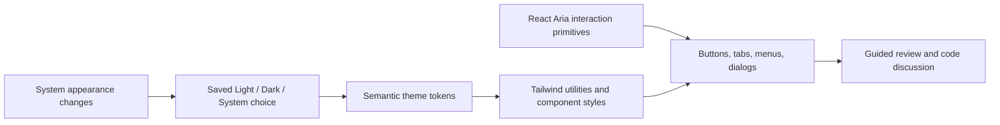

# Appearance and accessibility

The interface uses a monochrome foundation with explicit Light, Dark, and System preferences. Neutral tokens cover the canvas, panels, borders, text, selection, and focus. Color is reserved for primary actions, additions, deletions, warnings, and meaningful status. Text labels, symbols, and selected-state indicators accompany color.

[Tailwind's Vite integration](https://tailwindcss.com/docs/installation/using-vite) compiles styles locally. [React Aria](https://react-aria.adobe.com/getting-started) provides interaction behavior without imposing a visual theme. Native labeled inputs and selects remain where their built-in semantics suffice. Complex diff layout stays in component CSS inside Tailwind's component layer.

## Implemented behavior

- Dialogs contain focus, hide background content from assistive navigation, and restore focus to their opener. Escape and outside dismissal are disabled while saving or publishing.
- Review tabs use tab/tablist/tabpanel semantics with arrow-key navigation. Guide and appearance menus support keyboard selection and dismissal.
- A skip link leads to the review workspace. Landmarks and controls have accessible names, and guide changes have a persistent live announcement.
- Focus rings remain visible in both themes. Reduced-motion preferences remove transitions and animations. Forced-color rules preserve selection and focus indicators.
- Diff signs and spoken added/removed labels provide alternatives to color. Line buttons expose selection state. Full-line reading mode keeps offscreen code in the accessibility tree, at the cost of rendering more rows.
- Narrow layouts show the inbox or the review without covering controls. Opening a PR moves to the review; closing the inbox places focus in the workspace. Discussion stacks below the review at narrow widths.

## Verification

- [x] Five component regression tests cover focus containment/restoration, busy-dialog Escape behavior, keyboard tabs and guide menus, persisted appearance without reconnecting, and keyboard selection of a distant line in full-line mode.
- [x] All 31 automated tests, strict types, ESLint, and Clippy pass.
- [x] WebKit screenshots inspected at 1440 × 940 in both light and dark modes, and at 720 × 940 in dark mode.
- [x] axe-core checks tagged WCAG 2 A/AA, 2.1 AA, and 2.2 AA report no violations on the sampled light/dark guide, dark Connections and Finish dialogs, and the narrow guide. This does not establish full WCAG conformance.
- [x] Real WebKit interaction confirms that Escape from Connections returns focus to the Connections button.
- [x] System appearance follows emulated light/dark changes without reloading; reduced-motion emulation removes button transitions.
- [x] The installed production app renders both light and system-dark themes. Light appearance survives a full quit/relaunch alongside the live Codex guide, review progress, and private line discussion.
- [ ] Complete a manual VoiceOver audit of the installed app, including long diffs, line ranges, streamed answers, and new revisions.
- [ ] Audit every interactive/error/disabled state, full 200–400% zoom behavior, and platform-specific high-contrast modes.
- [ ] Validate large-PR performance when full-line reading is enabled.

Browser checks use synthetic fixtures with mocked Tauri IPC and make no GitHub or Codex requests. They verify rendering and interaction, not native integration or live authentication. Local screenshots and browser logs are ignored under `output/playwright/` and `.playwright-cli/`.
