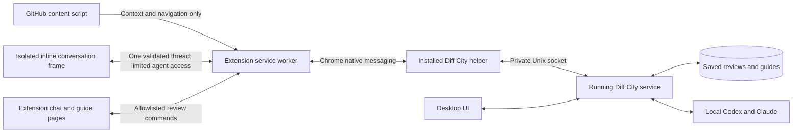

# Chrome companion

Diff City's Chrome extension brings local Codex and Claude conversations to GitHub pull requests. The full guide uses the desktop app's renderer: Markdown and Mermaid overviews, code notes, naming decisions, inline conversations, the navigation rail, and review progress.

## Install the alpha

The companion supports **Chrome 120+ on Apple silicon Macs running macOS 14+**. The connection is included in **Diff City v0.1.0-alpha.2**; no source build is needed. The extension is installed manually, not through the Chrome Web Store.

Download both components from [the same alpha release](https://github.com/crs48/diffcity/releases/tag/v0.1.0-alpha.2):

- [Diff City for Mac](https://github.com/crs48/diffcity/releases/download/v0.1.0-alpha.2/diffcity-macos-arm64.dmg)
- [Chrome companion ZIP](https://github.com/crs48/diffcity/releases/download/v0.1.0-alpha.2/diffcity-chrome-0.1.0.2.zip)
- [SHA256 checksums](https://github.com/crs48/diffcity/releases/download/v0.1.0-alpha.2/SHA256SUMS.txt)

1. Install `diffcity.app` in Applications and follow the [macOS installation instructions](installation.md), including unsigned-alpha approval and your GitHub/agent CLI logins. The older alpha.1 desktop download does not support this connection.
2. In Diff City, open **Connections → Enable Chrome connection**. Keep the app installed at that location. If you move it, enable the connection again.
3. Unzip the Chrome companion into a permanent folder, such as `~/Applications/Diff City Chrome`. Keep that folder in place after loading it.
4. In Chrome 120 or later, open `chrome://extensions`, enable **Developer mode**, choose **Load unpacked**, and select the extracted directory containing `manifest.json`.
5. Open a GitHub pull request. Use the book icon to **Open Diff City guide**, or the colored Diff City logo to ask about the PR, a file, a comment, or selected code. Hover over an icon for its tooltip; every button also has an accessible name. You can also use the extension toolbar button or right-click selected code and choose **Ask Diff City about this selection**.

Code selections and code-line actions open a conversation directly below the code in GitHub's diff. Hover a line for the Diff City icon, or select text and click the icon beside the selection. Asking about an existing inline review comment opens a conversation at that thread. If a comment refers to an older revision or code outside the current diff, an inline notice offers **Continue in PR chat**, keeping the verified GitHub comment and its replies as context. This extra click lets Chrome open its side panel without guessing a new code location. PR-wide and file-wide questions also open PR chat in Chrome's side panel.

Inline conversations expand with replies, so GitHub's page handles vertical scrolling. Saved conversations reappear automatically when you reload or revisit the PR, expanded by default. Resolved GitHub threads remain inline as compact, expandable headers. Restoration preserves your scroll position and waits for GitHub to load matching code. You can queue follow-ups, collapse or close a thread, and copy responses. Text selections are AI-only; line conversations can also save private notes or prepare unpublished GitHub drafts. Publish those explicitly from the full guide's **Finish review**.

Inline chats render only while visible. Scrolling away removes the iframe, React UI, and polling timer, leaving a measured spacer to preserve scroll position. Private drafts, collapse state, and active or queued replies stay in the extension worker and resume when you scroll back. File and comment action icons are also created only in view. If GitHub unloads or replaces a diff row, Diff City reattaches its conversation only after matching the file, old/new side, line, and code text; it does not attach to a recycled row showing different code.

On large PRs, discovering controls and restoring inline placements happen in small scheduled batches that yield to GitHub between batches. Subsequent updates inspect changed subtrees and use an index of file containers and comment permalinks, rather than repeatedly searching the whole page for every conversation. Large side-panel histories virtualize message rendering while retaining the full conversation for context and copying. Concurrent snapshot reads share one in-flight request, and saved-review polling cannot overlap an unfinished request.

The extension has no separate API keys. It uses the desktop app's configured providers, GitHub CLI login, local repository mappings, and access controls. The native helper launches Diff City in the background if necessary. Closing the desktop window leaves the companion available; quitting Diff City disconnects it. Use **Retry** after restarting.

Code selections must match the captured PR code uniquely. If GitHub doesn't expose enough context, Diff City asks you to select the code in its guide instead of silently sending the wrong code. GitHub comment bodies and replies come from the API, not scraped HTML. Review conversations remain private unless you explicitly prepare drafts and publish through **Finish review**.

## Build from source

Alternatively, use the [development prerequisites](../README.md#run-locally) and build both components from the same release tag:

```sh
git clone https://github.com/crs48/diffcity.git diffcity-chrome
cd diffcity-chrome
git checkout v0.1.0-alpha.2
pnpm install --frozen-lockfile
pnpm extension:check
pnpm extension:test
pnpm extension:package
pnpm desktop:build
open target/aarch64-apple-darwin/release/bundle/macos
```

Copy `diffcity.app` from that folder into Applications, then open it and enable the Chrome connection. Source builds are ad-hoc signed, not notarized; see the [macOS installation notes](installation.md).

The unpacked extension is in `apps/extension/dist`; the zip is in `.local/extension`. Load the unpacked directory for development and reload it in Chrome after rebuilding. The public manifest key stabilizes the extension ID; it is not a secret or signing credential. Native host registration must match this ID.

## Manual updates

Quit Diff City and back up its workspace as described in [updates and recovery](installation.md#updates-and-recovery). Install the new desktop app, replace the contents of your unpacked extension folder with the ZIP from the same release, and enable the Chrome connection again. Click **Reload** for Diff City at `chrome://extensions`, then refresh your GitHub tabs. Saved guides and completed conversations remain in the desktop workspace; no source checkout is required. If you previously loaded `apps/extension/dist`, you can replace its contents with the downloaded ZIP and reload it, or load the extracted ZIP from a new permanent folder.

Chrome displays the numeric extension version **0.1.0.2** with release label **0.1.0-alpha.2**. The release's `release.json` records both versions. Follow the [checksum instructions](installation.md#verify-your-download) before installing.

### Verify the native side panel

Use a headed browser with its native viewport when checking the side panel. In a Playwright CLI configuration, set:

```json
{
  "browser": {
    "contextOptions": {
      "viewport": null
    }
  }
}
```

Set the window size with the browser window controls or the `--window-size` launch argument. Avoid a fixed emulated viewport or the CLI's `resize` command for this check: in Chrome for Testing on macOS, emulation can leave GitHub painting underneath the native side-panel header and edge shadow after the panel opens. Restart the test browser after changing the viewport configuration.

Verify the complete browser window, including Chrome's panel title and divider, with the panel open and after resizing it. The GitHub page should reflow into the space left beside the panel. Page-only screenshots do not include the native header or shadow.

## Architecture



The installed app executable doubles as Chrome's native messaging host. The host connects to the running app's service, so execution budgets, permissions, database access, and agent sessions are shared rather than duplicated across browser tabs. Browser questions in the same thread run sequentially; independent threads can run concurrently. Dispatched work continues if a browser view closes, with completed results saved locally. Reopening the review loads saved results; a lost connection does not automatically retry an agent action.

Chrome messages are length-framed and bounded. Large responses are chunked below [Chrome's 1 MiB native-message limit](https://developer.chrome.com/docs/extensions/develop/concepts/native-messaging). No local HTTP server is opened. Socket permissions restrict access to the current user, and the native host accepts only the registered extension origin.

Content scripts cannot call the native host or review RPC. They send only validated GitHub PR identifiers, comment permalinks, and selection hints. Top-level bundled extension UI pages can send allowlisted review commands. An embedded conversation runs in a cross-origin extension frame, not in GitHub's DOM. Its short-lived grant is bound to the browser tab and PR; the worker resolves the supplied code hint against the captured diff and restricts RPC to that thread's notes and AI runs. Publishing, settings, and permission approvals are unavailable inside the frame. Inline agents use Limited access; choose **Continue in PR chat** for the full access controls. Only the inline entry point and its bundled assets are web-accessible, exclusively on GitHub.com. The full guide and side panel cannot be embedded. There is no external messaging API, remotely hosted executable code, generic shell command endpoint, or arbitrary file-reading endpoint. PR content remains untrusted evidence, and the selected agent access mode still governs tool use.

The content script runs on GitHub.com so it can follow GitHub's navigation without a page reload; it only adds controls on pull request pages. Page messages must come from GitHub's active top-level document and match the browser-reported current tab PR. Chrome retains the original document URL across same-document navigation, so comment jumps, diff filters, and switching PRs do not require the original and current URLs to match exactly. Requests for a different PR, embedded frames, and inactive documents are rejected.

GitHub pages receive no native responses, tokens, private chat history, or other repository data. The inline frame sends its parent only sizing, lifecycle acknowledgements, and close messages; the page can observe frame dimensions and placement, but cannot read its conversation. Drafts are persisted privately before an offscreen frame is removed. Tab closure releases temporary extension state; saved notes and completed agent replies remain in the desktop database. A hostile page can overlay an embedded frame, which is why privileged actions remain in the top-level extension UI.

## Current scope

- GitHub.com PRs, including closed and merged PRs; full guides open in a separate extension tab.
- Claude and Codex model settings, private chat, code selections, inline threads, saved guides, enrichment, review progress, and explicit review publishing.
- GitHub Enterprise hosts, other browsers, Windows native host installation, and Chrome Web Store distribution are not part of this alpha.
- GitHub's HTML changes independently. Toolbar and selection-context-menu entry points remain available if a page layout lacks an inline action.
- Inline streaming and queued runs survive scrolling out of view. A browser/worker restart or reopening the full review recovers saved results rather than replaying a lost stream; it never automatically retries an agent action.
