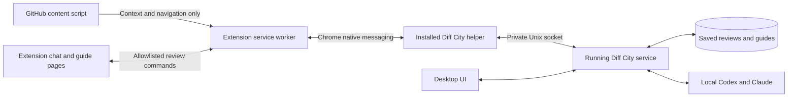

# Chrome companion

Diff City's Chrome extension brings local Codex and Claude conversations to GitHub pull requests. The full guide uses the desktop app's renderer: Markdown and Mermaid overviews, code notes, naming decisions, inline conversations, the navigation rail, and review progress.

## Install the alpha

1. Install the matching Diff City desktop app. The browser companion currently targets macOS; Chrome Web Store publication is a separate release step.
2. In Diff City, open **Connections → Enable Chrome connection**. Keep the app installed at that location. If you move it, enable the connection again.
3. Download and unzip the Chrome companion archive from the matching GitHub release (or build it below).
4. In Chrome 120 or later, open `chrome://extensions`, enable **Developer mode**, choose **Load unpacked**, and select the extracted directory containing `manifest.json`.
5. Open a GitHub pull request. Choose **Open Diff City guide**, **Ask AI**, or **Ask Diff City** beside a GitHub comment. You can also use the extension toolbar button or right-click selected code and choose **Ask Diff City about this selection**.

The extension has no separate API keys. It uses the desktop app's configured providers, GitHub CLI login, local repository mappings, and access controls. The native helper launches Diff City in the background if necessary. Closing the desktop window leaves the companion available; quitting Diff City disconnects it. Use **Retry** after restarting.

Code selections must match the captured PR code uniquely. If GitHub doesn't expose enough context, Diff City asks you to select the code in its guide instead of silently sending the wrong code. GitHub comment bodies and replies come from the API, not scraped HTML. Review conversations remain private unless you explicitly prepare drafts and publish through **Finish review**.

## Build

```sh
pnpm install --frozen-lockfile
pnpm extension:check
pnpm extension:test
pnpm extension:package
pnpm desktop:build
```

The unpacked extension is in `apps/extension/dist`; the zip is in `.local/extension`. Load the unpacked directory for development and reload it in Chrome after rebuilding. The public manifest key stabilizes the extension ID; it is not a secret or signing credential. Native host registration must match this ID.

### Verify the native side panel

Use a headed browser with its native viewport when checking the side panel. In a Playwright CLI configuration, set:

```json
{
  "browser": {
    "contextOptions": {
      "viewport": null
    }
  }
}
```

Set the window size with the browser window controls or the `--window-size` launch argument. Avoid a fixed emulated viewport or the CLI's `resize` command for this check: in Chrome for Testing on macOS, emulation can leave GitHub painting underneath the native side-panel header and edge shadow after the panel opens. Restart the test browser after changing the viewport configuration.

Verify the complete browser window, including Chrome's panel title and divider, with the panel open and after resizing it. The GitHub page should reflow into the space left beside the panel. Page-only screenshots do not include the native header or shadow.

## Architecture



The installed app executable doubles as Chrome's native messaging host. The host connects to the running app's service, so execution budgets, permissions, database access, and agent sessions are shared rather than duplicated across browser tabs. Browser questions in the same thread run sequentially; independent threads can run concurrently. Dispatched work continues if a browser view closes, with completed results saved locally. Reopening the review loads saved results; a lost connection does not automatically retry an agent action.

Chrome messages are length-framed and bounded. Large responses are chunked below [Chrome's 1 MiB native-message limit](https://developer.chrome.com/docs/extensions/develop/concepts/native-messaging). No local HTTP server is opened. Socket permissions restrict access to the current user, and the native host accepts only the registered extension origin.

Content scripts cannot call the native host or review RPC. They send only validated GitHub PR identifiers, comment permalinks, and selection hints. Only top-level bundled extension UI pages can send review commands. There is no external messaging API, remotely hosted executable code, generic shell command endpoint, or arbitrary file-reading endpoint. PR content remains untrusted evidence, and the selected agent access mode still governs tool use.

The content script runs on GitHub.com so it can follow GitHub's navigation without a page reload; it only adds controls on pull request pages. GitHub pages receive no native responses, tokens, private chat history, or other repository data.

## Current scope

- GitHub.com PRs, including closed and merged PRs; full guides open in a separate extension tab.
- Claude and Codex model settings, private chat, code selections, inline threads, saved guides, enrichment, review progress, and explicit review publishing.
- GitHub Enterprise hosts, other browsers, Windows native host installation, and Chrome Web Store distribution are not part of this alpha.
- GitHub's HTML changes independently. Toolbar and selection-context-menu entry points remain available if a page layout lacks an inline action.
- In-progress streaming is attached to the view that started a run; reopening a view recovers saved results rather than replaying the stream.
