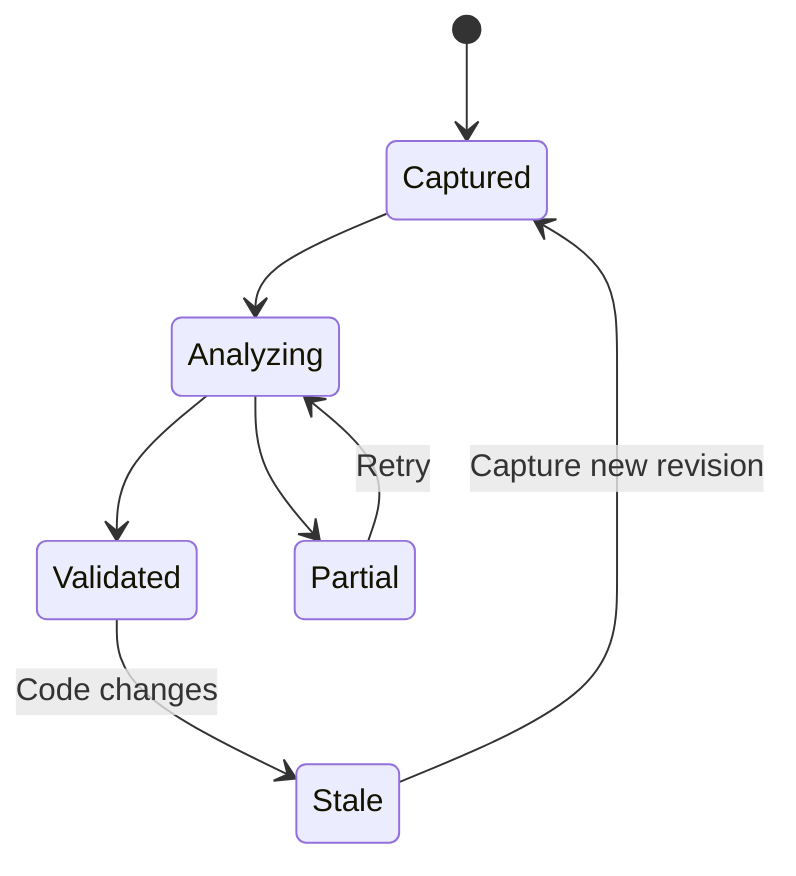

# 🔎 diffcity architecture and integration

**Date:** October 20, 2026 · **Scope:** research supporting the [initial product plan](../plans/initial-product/README.md)

## Problem and summary

Build a desktop GitHub PR review workspace centered on a guided review: consequential changes first, inline explanation and discussion, routine content folded into inspectable summaries, and dependable GitHub publication. The inbox brings the user into that experience. The owner selected Tauri 2 for the first implementation: React/TypeScript UI, Rust backend, local SQLite persistence, and revision-based review state. Desktop-first is also confirmed; initial OS targets remain recommendations.

## Current workspace

The workspace was empty, with no Git metadata, implementation, dependency files, or existing planning examples. There is no migration burden. The authenticated personal GitHub account is `crs48`. A locally resolved executable named `codex` reported `0.2.3` and did not provide usable app-server help, so runtime compatibility must be demonstrated rather than assumed.

## External research

### Diffity

The [README](https://github.com/nilbuild/diffity/blob/main/README.md) describes a macOS review tool with local changes, Claude discussions, PR review submission, and synced GitHub threads. GitHub integration already exists; diffcity needs to differentiate through its inbox and walkthrough, not simply by adding PR comments.

The inspected [package manifest](https://github.com/nilbuild/diffity/blob/115974e205ecb04f6cb00b37c8d10202201338ff/package.json) uses React, TypeScript, Vite, and Tauri. The [source tree](https://github.com/nilbuild/diffity/tree/115974e205ecb04f6cb00b37c8d10202201338ff/src-tauri/src) separates agents, GitHub, and core diff logic. Selected [authentication](https://github.com/nilbuild/diffity/blob/115974e205ecb04f6cb00b37c8d10202201338ff/src-tauri/src/github/auth.rs) and [service](https://github.com/nilbuild/diffity/blob/115974e205ecb04f6cb00b37c8d10202201338ff/src-tauri/src/github/service.rs) code show OS credential storage and a GitHub CLI credential path. This was targeted inspection, not a full code audit.

Its [MIT license](https://github.com/nilbuild/diffity/blob/main/LICENSE) names Kamran Ahmed. Any later reuse of substantial code must retain the applicable notice. This planning pass imports no source, assets, or branding.

### Guided review references

Linear's [review design article](https://linear.app/now/code-review-should-be-fast) describes chapters organized around core changes and their consequences, with auxiliary work separated. Its [Diffs documentation](https://linear.app/docs/diffs) describes guides and file categories, including documentation, generated content, and localization. These support semantic grouping as an interaction pattern; they do not establish that categories reliably predict risk.

Diffity remains a reference for inline agent discussion. Its maintainer [reported older tours absent after a rewrite](https://github.com/nilbuild/diffity/issues/17), so this plan does not assume the historical tour is currently shipped. The owner's explicit priority is a better guided experience regardless of the reference tools' current feature set.

The proposed design makes review attention explicit and evidence-backed, separates it from defect severity, and keeps high or unassessed code out of automatic folds. This is a product hypothesis, not a measured superiority claim. The [guided review specification](../plans/initial-product/guided-review.md) defines ordering, exceptions, progress, and a comparative evaluation corpus.

### GitHub and Codex

[GitHub's integration guide](https://docs.github.com/en/rest/using-the-rest-api/best-practices-for-using-the-rest-api) prefers webhooks and covers conditional reads and backoff. The desktop-only MVP therefore makes a conscious tradeoff: budgeted polling with an optional relay later. [Rate-limit response headers](https://docs.github.com/en/rest/using-the-rest-api/rate-limits-for-the-rest-api) determine scheduling rather than an assumed fixed quota.

[GitHub App device flow](https://docs.github.com/en/apps/creating-github-apps/writing-code-for-a-github-app/building-a-cli-with-a-github-app) supports a desktop user identity; repository installation remains a separate access constraint. Inline feedback has [specific line/side/commit semantics](https://docs.github.com/en/rest/pulls/comments), so rendering and publication need a shared canonical anchor model.

The [Codex SDK guide](https://learn.chatgpt.com/docs/codex-sdk) distinguishes automation from custom interactive clients. The [app-server protocol](https://learn.chatgpt.com/docs/app-server) is the recommended surface for this interactive client. Shell-output scraping would create avoidable version and lifecycle problems.

## Options and tradeoffs

| Option | Benefit | Cost | Recommendation |
| --- | --- | --- | --- |
| Tauri 2 + React + Rust | System webview, native backend, and similar foundation to the reference | Rust/TypeScript contracts and platform webview testing | Selected by the owner for the first implementation |
| Electron + React + TypeScript | Shared integration/domain/UI language and direct process management | Bundled runtime size and memory | Considered; one-language convenience does not require choosing it for this app |
| SwiftUI + embedded diff surface | Native macOS integration | Separate UI expertise and reduced cross-platform reuse | Defer unless native-only becomes a product requirement |
| Web app + local companion | Browser distribution with local Codex access | Two install/runtime surfaces and companion security | Defer; user selected desktop-first |
| Fork Diffity | Existing rendering and review features | Inherited local-change/Claude assumptions and product migration | Prefer original product structure, with selective attributed reuse if worthwhile |
| Cloud review backend | Easy event ingestion and multi-device state | Source-data custody, hosting, authentication, and operations | Not needed to prove personal review value |

Tauri's [process model](https://v2.tauri.app/concept/process-model/) supports the intended division between a React webview and a Rust core. Use explicit [capabilities and custom-command permissions](https://v2.tauri.app/security/capabilities/), with application validation in Rust. Treat untrusted PR content and revision correctness as application responsibilities.

Codex speaks a stdio protocol that Rust can manage directly; a Node bridge is unnecessary. [Tauri's sidecar support](https://v2.tauri.app/develop/sidecar/) also provides a future packaging path if bundling the runtime becomes appropriate. Verify large-diff rendering, command/event throughput, cancellation, and process cleanup in a packaged macOS app before building out the complete interface.

## Key findings and recommendation


Make revision identity the common contract between the diff, model output, review progress, and publishing. Show the guide interaction with fixtures immediately, then prove a single real PR end to end before investing in a large navigation system or a hosted sync service. A file category is a useful hint, while content assessment and conservative coverage rules determine whether it can be folded.



## Example domain rule

```ts
const reviewBucket = (pr: PullRequest, viewerId: string) =>
  pr.authorId === viewerId ? "mine"
    : pr.requestedReviewerIds.includes(viewerId) ? "requested"
    : pr.assigneeIds.includes(viewerId) ? "assigned"
    : "other";
```

This illustrative pure function makes precedence explicit. Production behavior also handles team requests, unavailable membership information, and stable sorting without duplicating PRs.

## Implementation checklist

- [ ] Prove packaged desktop → GitHub → snapshot → Codex handshake.
- [ ] Prototype the primary Guide with migration callouts and folded routine content.
- [ ] Add canonical diff anchors and durable private drafts.
- [ ] Validate guide attention ordering, folding, grounded evidence, and coverage before exposing publication.
- [ ] Implement mutation reconciliation and revision update handling.
- [ ] Measure the complete loop during private dogfooding.

## Validation checklist

- [x] Inspect the local workspace and reference repository directly.
- [x] Read current primary integration sources.
- [x] Compare product and architecture alternatives.
- [x] Incorporate the owner's Tauri 2 selection across the plan and architecture.
- [x] Incorporate guided review as the primary flow with content-based priority and folding rules.
- [x] Transfer recommendations into sequential implementation steps.
- [ ] Validate proposed behavior with working integration prototypes.

## Next action and references

Review the [product specification](../plans/initial-product/product-spec.md), then execute [step 01](../plans/initial-product/01-foundation.md). Sources are linked beside the claims they support; the [architecture document](../plans/initial-product/architecture.md) carries the detailed API, persistence, and trust contracts. The [MIT license text](https://opensource.org/license/mit) informs the private-to-public release setup.
