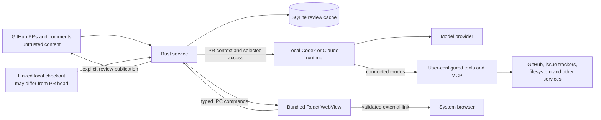
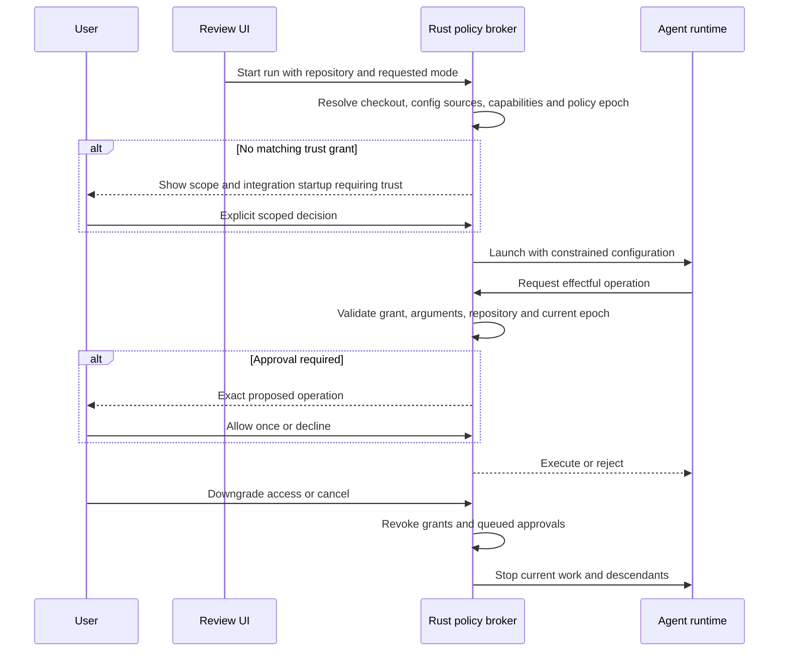

# Security boundaries and public launch readiness

> 🔎 Investigation: 27 October 2026. Scope: the macOS ARM alpha, local agents, GitHub integration, local data, rendered review content, and release infrastructure. This is an engineering security review, not an independent penetration test or a guarantee of isolation.

Diff City reads potentially hostile code and comments while connecting to powerful agents under the user's OS account. The central design question is how to retain useful repository research and integrations without allowing review content to expand that authority.

## Executive summary

The application has several sound controls: credentials stay in Rust, GitHub requests use a fixed host without redirects, Markdown drops raw HTML and remote images, publication validates the captured PR revision, and approval answers are scoped to one pending request and run.

The most important findings concern **agent startup, filesystem confidentiality, and persistent authorization**:

1. **Confirmed:** a headless Claude session using the original connected-mode configuration started a repository-defined MCP process during initialization, before any question or approval. The companion fix restricts connected sessions to user-level settings and integrations. A synthetic startup test confirmed the project server stayed stopped while a user-configured server still started.
2. **Confirmed boundary limitation:** the bundled Codex read-only sandbox could read a synthetic file outside its working directory while denying a write inside that directory. Read-only is not repository-only. This test used the runtime's command API and the same sandbox-policy shape; it did not attempt model-driven exfiltration.
3. **Confirmed:** new UI sessions defaulted to Ask although the security documentation promised Limited. The companion fix defaults new/invalid/unavailable preferences to Limited, preserving deliberate existing choices. Full access remains a global persistent preference, which should become repository/session scoped.
4. **Confirmed dependency finding:** the lockfile included Tokio 1.54.0, affected by a memory-safety advisory. The companion fix updates it to 1.54.1. A fresh Rust audit reports zero vulnerability findings, with two warnings in Linux-only dependencies. JavaScript auditing reported no known advisories at investigation time.
5. **Remaining launch work:** publish a deliberately labeled unsigned alpha, complete history/privacy cleanup, verify downloadable artifacts, and configure the public repository's reporting and protection features. A successful build or clean advisory scan does not establish a secure agent boundary.

**Recommendation:** ship a transparently limited alpha only after the concrete startup/default/dependency fixes and publication checks. Prioritize a backend-owned, repository-scoped access policy next. Do not advertise Limited as a confidentiality sandbox or as safe for arbitrary hostile repositories on an account containing secrets.

## Current state in the repository

### Architecture and trust boundaries



| Boundary | Current enforcement | Important limit |
| --- | --- | --- |
| PR/comment → WebView | `react-markdown`, `skipHtml`, URL validation, remote-image suppression, Mermaid restrictions, CSP | Mermaid first renders into a hidden live DOM host; no proof against all renderer bugs |
| WebView → Rust | One local-window capability, explicit command allowlist, typed arguments | The authorized window can request powerful commands; an XSS would inherit its IPC authority |
| Rust → GitHub | CLI credential in backend memory, fixed API host, no redirects, input/revision validation | Ambient GitHub CLI access in connected agents is a separate authorization channel |
| Rust → agent | Provider-specific modes, feature restrictions, prompt guidance, scoped approvals | Provider flags and prompt instructions are not equivalent security boundaries |
| Agent → local checkout | Linked canonical directory, limited/connected provider settings | `cwd` does not constrain all reads; same-user credentials and files remain relevant |
| Agent → integrations | Limited disables MCP; connected modes use provider capabilities | User integration processes start before per-tool approvals; integration internals have their own permissions |
| Files → persisted data | SQLite parameters, application directory mode `0700`, migrations/backups | Plaintext data, WAL and backups; not protection from the same user or an unrestricted agent |
| Source → app download | Locked dependencies, release checks, ARM verification, checksums | Unsigned alpha lacks Developer ID identity and notarization; checksums alone do not authenticate a publisher |

Source anchors: [provider dispatch](../../apps/desktop/src-tauri/src/providers.rs), [Codex adapter](../../apps/desktop/src-tauri/src/codex.rs), [Claude adapter](../../apps/desktop/src-tauri/src/claude.rs), [repository discovery](../../apps/desktop/src-tauri/src/local_repositories.rs), [IPC capability](../../apps/desktop/src-tauri/capabilities/main.json), [CSP](../../apps/desktop/src-tauri/tauri.conf.json), [GitHub client](../../apps/desktop/src-tauri/src/github.rs), [storage](../../apps/desktop/src-tauri/src/storage.rs).

### Assets and plausible attackers

Protect private source and conversations, GitHub/provider credentials, local working trees, external-service write authority, signing credentials, release authenticity, and the user's model budget.

The relevant attackers are a malicious PR author or commenter; a hostile or compromised dependency/configuration in an actual local checkout; a compromised agent integration; and a compromised build dependency/action. An unrelated same-account malware process is outside a realistic application-only isolation guarantee. A malicious PR shown through GitHub does **not**, by itself, put its configuration files into the selected local checkout: the startup attack requires hostile configuration to exist where the agent starts.

### Access modes after the companion fixes

| Capability | Limited | Ask before actions | Full access |
| --- | --- | --- | --- |
| Supplied PR/code sent to model | Yes | Yes | Yes |
| Local repository investigation | When a checkout is linked | Yes, when available | Yes, when available |
| Intended local writes | Denied | Approval-dependent | Allowed within request |
| External integrations | Disabled | Available; calls can request approval | Available without routine prompts |
| Claude configuration source | Empty settings sources, strict empty MCP | User-level settings/MCP only | User-level settings/MCP only |
| Codex configuration | Read-only sandbox and restricted feature/config overrides | Runtime trust/configuration plus approval overrides | Runtime trust/configuration plus broad access |
| Repository-only file confidentiality | **Not guaranteed** | **Not guaranteed** | **Not guaranteed** |
| Process startup individually approved | No integrations intended | **No**: trusted user integrations may initialize | **No** |

Guides and enrichment use the limited review path. Chat carries the selected mode with each queued question. A changed preference does not retroactively downgrade the access already captured by queued or running work. Existing deliberate Full choices remain preserved in this patch.

## External research

- **Claude headless trust:** official documentation distinguishes interactive repository trust from `-p`/SDK execution; project MCP startup can happen without the interactive dialog. It documents `--setting-sources user` to exclude project configuration and warns about inherited Bash auto-approval. This directly motivated the configuration fix. [Claude permissions](https://code.claude.com/docs/en/permissions)
- **Sandbox scope:** Claude's Bash sandbox does not automatically contain MCP processes, hooks, LSPs, or credential helpers. Whole-process containment requires another layer. [Claude sandboxing](https://code.claude.com/docs/en/sandboxing)
- **Codex isolation:** approval and sandbox are distinct controls. The actual bundled runtime's generated schema exposes `readOnly` with a network flag, not repository-readable-root constraints in that policy variant. The local boundary probe is stronger evidence for our exact configuration than a general product security claim. [Codex sandboxing](https://learn.chatgpt.com/docs/sandboxing), [agent approvals](https://learn.chatgpt.com/docs/agent-approvals-security)
- **Tauri scope:** capabilities constrain IPC access; they do not eliminate an authorized renderer's authority, Rust mistakes, or supply-chain risks. [Tauri capabilities](https://v2.tauri.app/security/capabilities/)
- **Supply chain:** pin actions to commit SHAs, minimize tokens, keep untrusted code away from privileged jobs, and verify artifact provenance. Attestations establish origin, not code safety. [GitHub Actions security](https://docs.github.com/en/actions/reference/security/secure-use), [artifact attestations](https://docs.github.com/en/actions/concepts/security/artifact-attestations)
- **History cleanup:** rewriting branches does not remove old PR refs or cached commits. Server-side cleanup can require GitHub Support; a new clean repository with the old one kept private is an alternative when preserving those views is unnecessary. [GitHub sensitive-data removal](https://docs.github.com/en/authentication/keeping-your-account-and-data-secure/removing-sensitive-data-from-a-repository)

## Key findings

Priority is an engineering action order, not an assigned CVSS score. “Confirmed” means source inspection or a bounded local test supports the claim. “Risk” means a plausible failure path that was not exploited end to end.

### S1 · High · Repository configuration could execute before an approval — mitigated for Claude project configuration

**Evidence:** the original connected path in `claude::Session::spawn` inherited project settings and MCP configuration. A synthetic `.mcp.json` launched a Python server which wrote a harmless marker during initialization. No user prompt or model inference was sent. No tool-approval request preceded that marker. The original Limited configuration did not start that project server.

**Fix included:** both connected modes now pass `--setting-sources user`, while continuing to disable hooks. Ask mode also sets `sandbox.autoAllowBashIfSandboxed=false` so an inherited setting cannot silently bypass the intended Bash confirmation behavior. A follow-up test in an isolated home directory observed project MCP not started and user MCP started.

**Residual risk:** this explicitly trusts user-managed integration startup. It does not sandbox those processes. Repository-specific MCP is intentionally excluded until there is an explicit repository trust mechanism. Codex's connected config/trust behavior needs equivalent real-runtime startup tests; the Claude result is not proof about Codex.

**Next design:** inventory executable configuration before launch; show its origin and scope; store approval in Rust against repository identity, canonical checkout, provider, executable/configuration digest, and policy version. Changed executable configuration invalidates trust. A Git remote string identifies a candidate checkout but does not authenticate its trustworthiness.

### S2 · High · Read-only does not prevent access to unrelated local files — unresolved boundary

**Evidence:** with the bundled Codex runtime's `readOnly`/`networkAccess:false` command policy and a synthetic working directory, reading a sibling synthetic marker succeeded; creating a file inside the working directory failed with permission denied. No actual secret was accessed. This tests the sandbox primitive independently of the model and Diff City's prompt handling.

The provider adapters permit local research tools in a linked checkout. Codex's limited path enables shell/code execution features under a read-only sandbox. Claude's limited tool set explicitly includes Bash alongside restricted file tools. The prompt says not to run project programs, but that instruction is not a process-execution barrier. The Claude probe did not test arbitrary writes or file exfiltration, so those outcomes are not claimed.

**Consequence:** hostile code/comments can try to persuade an agent to read unrelated files and include their contents in inference or answers. Turning off a shell's network does not prevent readable content from reaching the model through ordinary tool results.

**Recommended long-term boundary:** a narrow, Rust-owned read/search/revision tool broker backed by a sanitized snapshot, with no general shell in a genuinely confined review mode. Enforce path access using file-descriptor-relative traversal that rejects symlink escapes; simple `canonicalize` then `read` is subject to races. Even tracked source may contain secrets: filtering requires an explicit policy and cannot promise perfect detection.

For a useful interim alpha, describe Limited honestly, keep it the default, and recommend an isolated OS account/environment when the user's threat model includes hostile repositories and sensitive neighboring files. Do not equate a stronger prompt with confinement.

### S3 · High · Privilege persistence and authorization ownership — partially fixed

**Evidence:** [useAgentAccess](../../apps/desktop/src/features/AgentAccess.tsx) used one WebKit local-storage key and defaulted to Ask. The key is global across repositories. The companion fix corrects the initial/fallback default and adds a regression check, while preserving explicit preferences.

The [backend command](../../apps/desktop/src-tauri/src/commands.rs) accepts an access enum from the authorized renderer. There is no independent repository-specific Rust grant required to elevate it. Queued questions retain the mode captured when enqueued.

**Risk:** a user can carry an earlier Full selection into another repository; a compromised renderer could request broader access. This is an authorization design gap, not evidence of an existing XSS.

**Next design:** Rust owns repository/session grants; the UI displays effective policy. Keep normal reads seamless. Offer “Allow once”, “Trust this repository for this session”, and clearly scoped persistent trust. On downgrade, cancel/re-authorize queued work and revoke pending grants rather than silently keeping older broad authority. Display the actual tools and configuration source available to a run.

### S4 · High impact if renderer compromised · Broad native authority behind one WebView

[Tauri capability configuration](../../apps/desktop/src-tauri/capabilities/main.json) is local-window scoped, but includes agent execution, settings changes, publication, and external links. Configured executable paths can be changed through backend settings. An attacker who already achieves script execution inside that authorized view could try to chain settings changes and broad agent execution.

**Positive controls:** raw HTML is skipped; unsafe URL schemes and credential-bearing links are rejected; CSP excludes arbitrary script sources; external web URLs open through a validated native command using arguments rather than shell interpolation. No renderer code-execution exploit was found.

**Next steps:** make backend policy independent of the renderer for sensitive grants; require an explicit trusted native path-selection flow for executable changes; keep remote documents in an IPC-free surface if introduced. Add `base-uri 'none'`, `object-src 'none'`, and `form-action 'none'` if verified compatible. Avoid weakening CSP to accommodate future rich rendering.

### S5 · Medium · Rich rendering has good defaults but incomplete hostile-input testing

[CommentMarkdown](../../apps/desktop/src/ui/CommentMarkdown.tsx) suppresses raw HTML and remote image loads. [Mermaid rendering](../../apps/desktop/src/ui/mermaid.ts) limits input to 20,000 characters, disables HTML labels, uses strict mode, caps edges at 150, rejects several configuration/resource syntaxes, and displays the final SVG through an image data URL.

The intermediate Mermaid render still uses a hidden live DOM host in the application document. Existing Mermaid tests mock the library; they establish wrapper behavior, not that every malicious diagram is inert in WebKit. Rendering also lacks a hard execution deadline. A pathological graph can block the renderer despite an edge cap.

**Next steps:** run a hostile-input corpus against the real library in the native WebView. Check network silence, script inertness, SVG/HTML edge cases, huge labels/graphs/tables, and UI responsiveness. Consider rendering in an isolated frame/process without IPC; a worker alone may be incompatible with DOM-based diagram rendering. Keep a safe source-text fallback and bounded cache bytes.

### S6 · Medium · Local data and provider privacy need explicit scope

The data directory is `0700` on Unix and SQLite uses parameterized statements. GitHub's credential is obtained from the CLI and retained in Rust memory, not written into the review database or passed through the UI.

Review text, code snapshots, settings, conversations, WAL files, and migration backups are plaintext. WebKit holds additional UI state. Provider sessions being ephemeral does not prove that runtime diagnostics or provider-side logs contain no content. Connected runtimes inherit a broader environment than Limited, potentially including unrelated secrets.

**Next steps:** provide “Forget PR/repository” with documented backup/WAL handling; implement redacted support bundles with preview; minimize inherited environment while preserving explicitly configured integrations; document account boundaries. Optional database encryption using a Keychain-held key can reduce offline exposure, but does not stop the same authorized process from reading unlocked data. FileVault and OS-account isolation solve different parts of the problem.

Do not promise perfect secure deletion from SSDs, snapshots, cloud backups, or already-sent provider requests. Copy-thread functionality intentionally exports contextual code; the destination is the user's responsibility, but the UI should make the included scope visible.

### S7 · Medium · Resource limits apply unevenly

The [AI scheduler](../../apps/desktop/src-tauri/src/ai_runs.rs) caps concurrency and queue size; provider execution has a timeout; enrichment has bounded file/note targets. These are useful safeguards.

Provider readers call `lines()` before checking an 8 MB message limit, so allocation precedes validation. Aggregate response text and some pending protocol collections do not have a corresponding total byte budget. General GitHub JSON reads are less tightly bounded than raw-file reads. Dropping a child with `kill_on_drop` does not establish that all integration descendants have exited.

**Next steps:** enforce byte limits while reading frames, cap aggregate output and retained events, bind work to per-run and per-repository budgets, and verify process-tree cleanup. Track model usage/cost where supported and give automatic enrichment a visible cumulative budget. Timeouts alone are weak cost controls. Cancellation must invalidate outstanding approvals and prevent late responses from being accepted as current work.

### S8 · Strong foundation · GitHub publication is deliberately separate from AI chat

[Service publication](../../apps/desktop/src-tauri/src/service.rs) validates draft identity, current PR state, captured revisions, comment anchors, and permitted review type. It blocks unsupported comparison publication and test fixtures. A publication mutex and operation identity/reconciliation protect against accidental duplicate retry. Account mismatches disconnect the saved session instead of silently reusing another identity.

Keep these controls. Add regression coverage for account changes during pending operations, stale PR heads, duplicate network completion, and oversized/unexpected GitHub responses. Preserve preview-and-publish as the explicit workflow for Diff City drafts.

**Boundary clarification:** independently authorized agent tools can use GitHub or other services outside this draft pipeline. An access mode allowing such tools must not be described as “everything stays local until Sync.”

### S9 · High · Known dependency advisory — patched; ongoing scanning needed

The original lockfile contained Tokio 1.54.0. RustSec identifies an `Interval` race on a multithreaded runtime that can corrupt memory; version 1.54.1 fixes it. `Sleep`/`Timeout` are not affected. We found no direct `Interval` use in Diff City source, but Tokio is a macOS runtime dependency through the app, networking and Tauri. Transitive reachability was not proven, so upgrading is preferable to a speculative exception. [RUSTSEC-2026-0384](https://rustsec.org/advisories/RUSTSEC-2026-0384.html)

After updating the lockfile, `cargo audit` reports zero vulnerability findings. Warnings remain for unmaintained `proc-macro-error` and unsound `glib`; the dependency tree places them in the Linux GTK stack, not the shipped ARM macOS dependency graph. They still matter before Linux distribution and should have an owner and a time-bounded triage record. `pnpm audit` reported no known advisories at the time of this review.

Use automated dependency updates and scheduled advisory scans; scan both build and runtime dependencies. A scan only knows published advisories and cannot detect a malicious new package or logic flaw.

### S10 · High · Release authenticity and repository governance

The release workflow pins its actions, builds from a version tag reachable from main, verifies ARM packaging, checks version consistency, and distinguishes Developer ID releases from explicitly selected ad-hoc prereleases. The user chose an **unsigned alpha**: describe it plainly, explain macOS Gatekeeper handling, and do not claim notarization.

At investigation time, main had no legacy branch protection or ruleset, Actions allowed arbitrary actions, repository-wide action SHA pinning was off, and the ordinary CI/site workflows still used mutable action tags. The companion patch pins the ordinary workflow actions and adds weekly/PR dependency and redacted secret checks, reused as a release prerequisite, plus Dependabot configuration. No dedicated release environment existed. Private vulnerability reporting could not be verified through the API while the repository remained private; a link in SECURITY.md is not evidence that the form is enabled.

**Next steps:** pin remaining actions, protect main and release tags, use least-privilege job tokens, and enable public secret scanning/push protection and private reporting where available. Add dependency/security CI. For signed releases later, isolate signing credentials from PR jobs and use a protected release environment. Generate a machine-readable SBOM and provenance attestations; consider immutable releases. Never make `pull_request_target` execute untrusted PR code with write credentials.

### S11 · Privacy publication gate · History and hosted artifacts

Current screenshot privacy settings do not sanitize earlier Git blobs, PR diffs, Pages artifacts, workflow logs, caches, or another person's clone. Historical references were identified during release preparation, and the user explicitly requested their removal before publication.

Back up privately, sanitize all intended refs, scan both text and binary/screenshot history, then inspect GitHub's retained refs/cached views before changing visibility. Avoid including removed identifiers in the cleanup report itself. If server-side retention prevents verification, keep the existing repository private and obtain approval for a clean public repository plus a private archive rather than claiming a force-push erased everything.

## Options and tradeoffs

| Approach | Benefit | Cost / limitation | Recommendation |
| --- | --- | --- | --- |
| Prompt restrictions only | Lowest integration effort | No reliable access enforcement under injection | Never use as the sole boundary |
| Existing local CLI with safer configuration | Retains user login and tools; fast to ship | Broad file reads and trusted integration startup remain | Alpha baseline, documented accurately |
| Read/search/revision tool broker | Clear repository boundary, deterministic allowed operations | Provider tool integration and robust path handling needed | Preferred confined-review architecture |
| Separate OS account or sandboxed worker | Contains more of the process tree and ambient credentials | Provisioning, authentication, performance and cross-platform complexity | Stronger option for hostile repositories |
| Remote isolated review worker | Separates local secrets entirely | Upload/privacy/billing/backend obligations; weaker local workflow | Optional future mode, not required for desktop launch |
| Full user-agent environment | Maximum continuity with existing workflow | Intentionally broad authority, highest injection impact | Explicit trust per repo/session, visible effective mode |

Separate **what the agent may read**, **what it may execute**, **what it may change**, and **which services it may contact**. A single three-position selector can remain a simple UI, but the backend policy should model those dimensions independently.

## Recommendation and implementation design

### Backend-owned grants



A repo selection is not permission to execute repo configuration. A source file, PR comment, model answer, or tool response can provide evidence, but cannot create a grant. Keep untrusted text structurally separate from trusted instructions and validate requested effects independently of the model's explanation.

### Delivery order

1. **Alpha correctness:** default and startup fixes, patched Tokio, honest privacy/access documentation, unsigned-release labeling, history cleanup and download verification.
2. **Authorization hardening:** backend grants, per-repository/session scopes, explicit integration provenance, revocation semantics for queues, clean inherited environment, supported-runtime compatibility checks.
3. **Confined review:** brokered read/search/history without generic execution; secret/path policies; optional isolated worker; genuine runtime negative tests on supported macOS versions.
4. **Operational maturity:** security CI, branch/tag protection, dependency updates, private reporting, signed/notarized builds, SBOM/provenance, redacted diagnostics and incident exercises.

The runtime is an independently updated dependency. Record provider executable path, version, mode and effective capabilities in diagnostics without recording secrets. Reject unsupported permission/protocol combinations rather than falling back to broader access. Test against actual supported runtime versions in addition to protocol mocks.

## Implementation checklist

### Completed in the companion patch

- [x] Update Tokio to the patched 1.54.1 release.
- [x] Default new and invalid/unavailable access preferences to Limited.
- [x] Preserve deliberately saved access preferences.
- [x] Exclude project settings/MCP from connected Claude startup.
- [x] Prevent inherited sandbox Bash auto-approval from bypassing Ask mode.
- [x] Document read-only confidentiality limits and independent runtime logging.

### Launch and follow-up work

- [ ] Finish authorized history/privacy cleanup, including retained GitHub refs or a clean-repository alternative.
- [ ] Verify unsigned-alpha label, installation instructions and public download bytes.
- [ ] Enable and verify private vulnerability reporting after publication.
- [x] Pin all workflow actions to verified commit SHAs.
- [ ] Protect main and release tags in GitHub.
- [x] Add weekly/PR advisory and redacted history-secret checks, reuse them before release builds, and configure weekly Dependabot updates.
- [x] Verify the new security workflow in GitHub PR CI: dependency and history-secret checks passed.
- [ ] Reverify security checks in the final public repository after history migration.
- [ ] Create repository/session grants enforced in Rust, with config-change invalidation.
- [ ] Make downgrades cancel or re-authorize queued/running elevated work.
- [ ] Add a real confined-read path with no generic execution tool.
- [ ] Bound streaming frames, aggregate outputs, caches and model usage.
- [ ] Validate process-tree cancellation, including MCP descendants.
- [ ] Add scoped deletion and previewable redacted support bundles.
- [ ] Isolate rendering further if hostile-input tests expose a need.
- [ ] Add Developer ID signing/notarization, protected signing environment, SBOM and provenance.

## Validation checklist and evidence

### Completed investigation

- [x] Inspect Rust/React execution, configuration, approval, publication, rendering, storage and release paths.
- [x] Review current primary-source guidance for provider trust, Tauri and GitHub workflows.
- [x] Run a synthetic Codex read-only boundary test: outside read allowed, inside write denied.
- [x] Run synthetic Claude initialization without inference: original Ask starts project MCP; original Limited does not.
- [x] Test the patched user-only configuration with an isolated home: project server excluded, user server preserved.
- [x] Run JavaScript advisory scan: no known advisories reported.
- [x] Run Rust advisory scan before/after patch and inspect ARM dependency reachability.
- [x] Inspect GitHub branch/action/environment settings without changing visibility.
- [x] Run all 126 Rust tests and all 220 frontend tests after the fixes. An initial unconstrained frontend run timed out in three UI tests during concurrent compilation; the two-worker rerun passed all tests.
- [x] Confirm the patched Limited startup also excludes the synthetic user MCP server.
- [x] Pass GitHub CI for the ARM app, site and security jobs.
- [x] Build and mount the unsigned-alpha DMG; verify the single ARM executable, ad-hoc signature integrity, manifest and every published-file checksum. This is not a clean-machine launch test.

Local probe scripts, runtime schemas, scan outputs, and the audited pre-cleanup commit identity are retained in ignored `.local/security-audit/`. Probes used Codex CLI `0.164.0-alpha.11.1` and Claude Code `2.1.304`. They did not request inference, access real secret contents, publish comments, or contact business integrations. Local probes test provider startup/sandbox primitives; they are not full model-driven exploit tests.

### Required regression coverage as policy evolves

- [ ] Real runtime rejects outside-root and symlink/hardlink escapes in confined review mode.
- [ ] Repository MCP, helpers, hooks and executable settings cannot start without scoped trust.
- [ ] Permission denial, cancellation, duplicate/stale/cross-run replies and changed config cannot authorize work.
- [ ] A permission downgrade affects already-queued work and terminates revoked operations.
- [ ] Markdown/Mermaid hostile corpus causes no script execution, unwanted network requests or prolonged UI blocking in native WebKit.
- [ ] A compromised/untrusted renderer cannot obtain an elevated backend grant through ordinary IPC alone.
- [ ] Large protocol frames, streaming answers, diffs and API responses fail within measured memory/time budgets.
- [ ] Detached integration descendants exit after cancellation or application shutdown.
- [ ] Account changes cannot publish with a stale identity; publication retries remain idempotent.
- [ ] Downloaded release bytes match published checksum/architecture/signing claims and launch on a clean supported Mac.

### Incident response and maintaining assurance

For a reported vulnerability, reproduce using synthetic data, identify affected releases/access modes and whether content or credentials could have escaped, then contain the specific boundary. Pause affected releases or integrations where justified. Rotate exposed credentials; removing a Git blob does not revoke a credential. Publish a patched release and a scoped advisory with clear mitigations, verify the public reporting path, and retain a regression reproducer.

Review dependency advisories at least weekly and on release. Review permissions whenever adding a provider, plugin, file format, IPC command, background job or auto-update mechanism. Keep an owner and expiry for accepted advisory exceptions. Never interpret “all tests pass” as evidence that prompt injection cannot occur.

## Example code: a declarative grant decision

Illustrative policy shape, **not implemented**. Grant creation, secure storage, repository identity resolution and execution belong to trusted Rust code. IPC callers can request a mode but cannot mint grants. In a complete implementation, the user confirms canonical structured arguments and the broker binds a one-time approval to their digest.

```rust
#[derive(Clone, Copy, PartialEq, Eq)]
enum Effect { ReadSource, Execute, WriteFiles, ExternalMutation }

struct Scope<'a> {
    repository: &'a str,
    session: &'a str,
    config_digest: &'a str,
    policy_epoch: u64,
}

struct Grant<'a> {
    scope: Scope<'a>,
    allowed: &'a [Effect],
    confirm: &'a [Effect],
    expires_at: u64,
}

enum Decision { Deny, AskOnce, Allow }

fn authorize(grant: &Grant<'_>, request: &Scope<'_>, effect: Effect, now: u64) -> Decision {
    let same_scope = grant.scope.repository == request.repository
        && grant.scope.session == request.session
        && grant.scope.config_digest == request.config_digest
        && grant.scope.policy_epoch == request.policy_epoch;
    match (same_scope && now < grant.expires_at,
           grant.allowed.contains(&effect), grant.confirm.contains(&effect)) {
        (true, true, true) => Decision::AskOnce,
        (true, true, false) => Decision::Allow,
        _ => Decision::Deny,
    }
}
```

This only decides authority. Filesystem confinement, process isolation, concrete destination/argument validation, and enforcement against race conditions remain separate responsibilities.

## References

- [Security policy](../../SECURITY.md), [installation](../installation.md), [release workflow](../../.github/workflows/release.yml).
- [Access selector and preference](../../apps/desktop/src/features/AgentAccess.tsx), [approval lifecycle](../../apps/desktop/src-tauri/src/agent_access.rs), [queued chat dispatch](../../apps/desktop/src/App.tsx).
- [Agent protocol tests](../../apps/desktop/src-tauri/tests/agent_permissions.rs), [Markdown tests](../../apps/desktop/src/ui/CommentMarkdown.test.tsx), [Mermaid wrapper tests](../../apps/desktop/src/ui/mermaid.test.ts).
- [Claude permissions](https://code.claude.com/docs/en/permissions), [Claude sandboxing](https://code.claude.com/docs/en/sandboxing), [Claude security](https://code.claude.com/docs/en/security).
- [Codex sandboxing](https://learn.chatgpt.com/docs/sandboxing), [Codex approvals](https://learn.chatgpt.com/docs/agent-approvals-security).
- [Tauri capabilities](https://v2.tauri.app/security/capabilities/), [GitHub Actions security](https://docs.github.com/en/actions/reference/security/secure-use), [artifact attestations](https://docs.github.com/en/actions/concepts/security/artifact-attestations).
- [Tokio advisory](https://rustsec.org/advisories/RUSTSEC-2026-0384.html), [GitHub history cleanup](https://docs.github.com/en/authentication/keeping-your-account-and-data-secure/removing-sensitive-data-from-a-repository).
