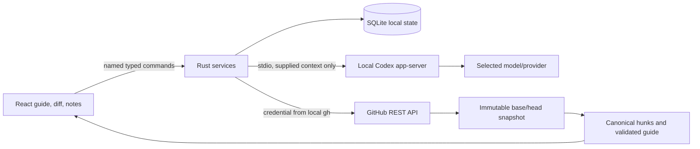

# Local alpha implementation

Updated October 20, 2026. This document describes the implemented application; the initial product plan also includes later distribution and product work.

## Runtime and architecture

The tested host runs the x86_64 app through Rosetta on macOS 26.7, with Rust 1.97.1, Node 23.11.1, pnpm 10.11.1, GitHub CLI 2.94.0, and OpenAI Codex CLI 0.163.0-alpha.10.2 bundled with the local desktop app. The source build recommends Node 24. The installed shell command named `codex` was an unrelated 0.2.3 executable, so runtime discovery selected the supported desktop-bundled binary without replacing that command. The local runtime supplied the model catalog and selected its default model.

The Rust contract definitions generate `packages/contracts/src/index.ts`. Domain parsing, line validation, attention floors, coverage, and unchanged-progress transfer are pure functions. Services coordinate the effectful GitHub, Codex, and SQLite adapters. The Tauri capability file explicitly allows named commands; credentials and shell execution are not exposed to the webview.

SQLite uses WAL and full synchronous writes with a versioned document table. Saved snapshots are keyed by repository and base/head identity. Notes retain the original snapshot and canonical side/range anchor. Prior revisions can be reopened without moving the latest-revision pointer. App-close and in-app navigation flush the note composer before leaving it.

Codex output must pass schema and evidence validation before replacing a guide. A hunk omitted by the model stays visible as unassessed. Unknown references, invalid line anchors, and duplicate primary coverage reject the proposed guide. Higher rule-derived attention wins over a model's lower classification. Routine content folds only after assessment, and groups with findings or discussions stay visible. The first step of an entirely routine PR opens by default.

GitHub publication has a persisted operation journal. The successful result and all selected draft updates commit in one SQLite transaction. A failed transaction leaves the prior operation state available for reconciliation. It checks the current base/head, selected draft ownership, source coordinates, existing pending reviews, and self-review restrictions. An ambiguous outcome is reconciled by exact remote review and comment evidence; it is not automatically reposted. Model discussions and private notes are excluded unless deliberately converted to selected drafts.

## Validation evidence

- [x] Strict TypeScript, ESLint, Rust formatting, and Clippy pass.
- [x] All 25 Rust tests and 11 TypeScript/component tests pass. Tests cover canonical additions/deletions, multiline anchors, incomplete patches, attention floors, invalid model output, omitted coverage, unchanged progress transfer, explicit publication payload selection, dialog focus, keyboard navigation, appearance, full-line reading, range selection, and exact-range Codex context.
- [x] Live local GitHub identity, repository inbox, Codex handshake/model catalog, guide generation, and selected-line discussion succeed.
- [x] The packaged WKWebView reaches a real GitHub PR, generates and displays a grounded Codex guide, saves a line discussion, and previews only deliberately prepared GitHub feedback.
- [x] Native restart, cancellation, and new-revision recovery pass. A real push changed the migration hunk, invalidated its review mark, and left earlier notes accessible.
- [x] The explicitly authorized [test review](https://github.com/crs48/diffcity/pull/1#pullrequestreview-5593137216) was posted through the native app and reconciled into its line discussion. The original submission targeted RIGHT line 1; after the synthetic push GitHub reanchored it to line 2. The remote feedback contains exactly the approved inline text plus the labeled summary; the private question and model reply are absent.
- [x] A normal production bundle was built and installed at `~/Applications/diffcity.app`. Its release dependency features exclude the WebDriver plugin, and the installed executable hash matches the built executable.
- [x] Open the installed production app and render its sample guide.
- [x] Verify live GitHub and Codex connections in the installed production app. After unlocking the host, the normal installed bundle connected as `crs48`, loaded the synthetic PR and checks, generated a fresh Codex guide, and streamed a private line-scoped answer.
- [x] Quit and relaunch the installed production app. Both connections returned, the generated guide and two reviewed hunks persisted, and the private question and answer reopened on migration line 2 alongside the existing GitHub comment. Light appearance persisted; System appearance was restored after the check.
- [x] In the updated production bundle, select migration lines 2–3 with Shift-click, save a private comment, and send it using **Ask Codex about this comment**. The live reply discusses both the required-column rollout and index locking. Quit/relaunch and reopen the thread through **Other discussions in this change**; both messages retain the identical RIGHT-side 2–3 anchor and remain private in SQLite.
- [x] [GitHub Actions](https://github.com/crs48/diffcity/actions/runs/39521404628) passed contract generation, formatting, types, lint, tests, and the unsigned desktop build, including the monochrome themes and accessibility changes.

The native harness initially exposed a stale-analysis race and two test synchronization problems (clicking before refresh completed and an unbounded driver request). Snapshot guards, readiness waits, and request timeouts were added. The final resumed run completed without reposting the approved review.

The installed production app's live connection and restart checks are complete. Its fresh three-section guide put migration safety and tenant boundaries first, with findings anchored to the changed lines. A private question about the migration received a streamed three-step rollout answer. The Finish review dialog showed no selected GitHub drafts and disabled publication, confirming that this discussion remained private. The previously approved GitHub test comment appeared on its current line; no additional review was published during this check.

Earlier connection attempts timed out for Rust TCP clients while curl and Python succeeded. Those timeouts did not recur in either installed-app launch after the host was unlocked. Their cause remains unconfirmed; no firewall or network-filter setting was changed. Connection errors retain their underlying cause, and `DIFFCITY_CONNECT_ONLY=1` runs the service smoke check without model inference.

Native screenshots, logs, and isolated test databases live under ignored `.local/native-e2e/`. They are development artifacts, not shipped assets. The synthetic draft PR contains deliberate migration and authorization issues and is not intended to merge.

Multi-line discussions use the exact selected range for their thread identity. Selecting a different range or side cannot reuse that draft or display its in-flight response. Other threads in the same hunk remain reachable through the discussion panel. Codex receives selected lines separately from nearby diff rows, and a reply inherits the question's snapshot, side, and endpoints. The installed multi-line build's executable SHA-256 is `6d5b9e0a409613c6a58c8ebfa6d154ca266e0807af555ed3956401e62a60ca03`, matching the built bundle.

## Current boundaries

The personal alpha uses an existing GitHub CLI login. GitHub App onboarding and organization installation flows are not implemented. It supports github.com, one GitHub identity per local data directory, and read-only model analysis. The app can publish new reviews and read remote feedback; thread resolution and targeted replies to existing review threads remain later work.

Large or unavailable GitHub patches are reported as incomplete; there is no Git-object download fallback yet. The model receives a bounded 180,000-character hunk context. Diff rows are virtualized, but the full large-PR benchmark and curated comparative guide-quality study have not been completed. No claim that this guide outperforms Linear or Diffity has been established.

The local macOS bundle is not a signed/notarized release, and other OS/architecture combinations are not yet validated. Auto-update, public downloads, the diff.city website, dependency-license audit, and clean-machine distribution gates remain on the release roadmap. Repository visibility stays private until the owner chooses a public launch.
