# Local alpha implementation

Updated October 20, 2026. This document describes the implemented application; the initial product plan also includes later distribution and product work.

## Runtime and architecture

The tested host runs the x86_64 app through Rosetta on macOS 26.7, with Rust 1.97.1, Node 23.11.1, pnpm 10.11.1, GitHub CLI 2.94.0, and OpenAI Codex CLI 0.163.0-alpha.10.2 bundled with the local desktop app. The source build recommends Node 24. The installed shell command named `codex` was an unrelated 0.2.3 executable, so runtime discovery selected the supported desktop-bundled binary without replacing that command. The local runtime supplied the model catalog and selected its default model.

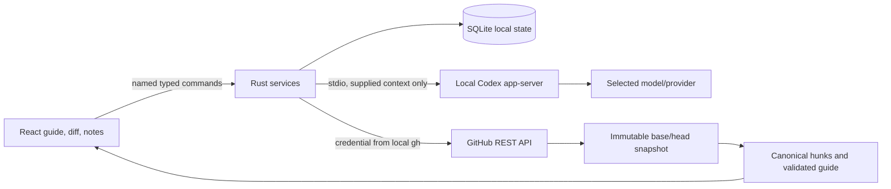

The Rust contract definitions generate `packages/contracts/src/index.ts`. Domain parsing, line validation, attention floors, coverage, and unchanged-progress transfer are pure functions. Services coordinate the effectful GitHub, Codex, and SQLite adapters. The Tauri capability file explicitly allows named commands; credentials and shell execution are not exposed to the webview.

SQLite uses WAL and full synchronous writes with a versioned document table. Saved snapshots are keyed by repository and base/head identity. Notes retain the original snapshot and canonical side/range anchor. Prior revisions can be reopened without moving the latest-revision pointer. App-close and in-app navigation flush the note composer before leaving it.

Codex output must pass schema and evidence validation before replacing a guide. A hunk omitted by the model stays visible as unassessed. Unknown references, invalid line anchors, and duplicate primary coverage reject the proposed guide. Higher rule-derived attention wins over a model's lower classification. Routine content folds only after assessment, and groups with findings or discussions stay visible. The first step of an entirely routine PR opens by default.

GitHub publication has a persisted operation journal. The successful result and all selected draft updates commit in one SQLite transaction. A failed transaction leaves the prior operation state available for reconciliation. It checks the current base/head, selected draft ownership, source coordinates, existing pending reviews, and self-review restrictions. An ambiguous outcome is reconciled by exact remote review and comment evidence; it is not automatically reposted. Model discussions and private notes are excluded unless deliberately converted to selected drafts.

## Validation evidence

- [x] Strict TypeScript, ESLint, Rust formatting, and Clippy pass.
- [x] All 28 Rust tests and 14 TypeScript/component tests pass. Tests cover canonical additions/deletions, multiline anchors, incomplete patches, attention floors, invalid model output, omitted coverage, unchanged progress transfer, explicit publication payload selection, dialog focus, keyboard navigation, appearance, full-line reading, range selection, and exact-range Codex context.
- [x] Live local GitHub identity, repository inbox, Codex handshake/model catalog, guide generation, and selected-line discussion succeed.
- [x] The packaged WKWebView reaches a real GitHub PR, generates and displays a grounded Codex guide, saves a line discussion, and previews only deliberately prepared GitHub feedback.
- [x] Native restart, cancellation, and new-revision recovery pass. A real push changed the migration hunk, invalidated its review mark, and left earlier notes accessible.
- [x] The explicitly authorized [test review](https://github.com/crs48/diffcity/pull/1#pullrequestreview-5593137216) was posted through the native app and reconciled into its line discussion. The original submission targeted RIGHT line 1; after the synthetic push GitHub reanchored it to line 2. The remote feedback contains exactly the approved inline text plus the labeled summary; the private question and model reply are absent.
- [x] A normal production bundle was built and installed at `~/Applications/diffcity.app`. Its release dependency features exclude the WebDriver plugin, and the installed executable hash matches the built executable.
- [x] Open the installed production app and render its sample guide.
- [x] Verify live GitHub and Codex connections in the installed production app. After unlocking the host, the normal installed bundle connected as `crs48`, loaded the synthetic PR and checks, generated a fresh Codex guide, and streamed a private line-scoped answer.
- [x] Quit and relaunch the installed production app. Both connections returned, the generated guide and two reviewed hunks persisted, and the private question and answer reopened on migration line 2 alongside the existing GitHub comment. Light appearance persisted; System appearance was restored after the check.
- [x] In the updated production bundle, select migration lines 2–3 with Shift-click, save a private comment, and send it using **Ask Codex about this comment**. The live reply discusses both the required-column rollout and index locking. Quit/relaunch and reopen the thread through **Other discussions in this change**; both messages retain the identical RIGHT-side 2–3 anchor and remain private in SQLite.
- [x] [GitHub Actions](https://github.com/crs48/diffcity/actions/runs/39521404628) passed contract generation, formatting, types, lint, tests, and the unsigned desktop build, including the monochrome themes and accessibility changes. The [shared inline-chat run](https://github.com/crs48/diffcity/actions/runs/39537558283), [layout-fix run](https://github.com/crs48/diffcity/actions/runs/39537744633), and [final chat-ordering run](https://github.com/crs48/diffcity/actions/runs/39538162805) also passed all checks and the unsigned desktop build.

The native harness initially exposed a stale-analysis race and two test synchronization problems (clicking before refresh completed and an unbounded driver request). Snapshot guards, readiness waits, and request timeouts were added. The final resumed run completed without reposting the approved review.

The installed production app's live connection and restart checks are complete. Its fresh three-section guide put migration safety and tenant boundaries first, with findings anchored to the changed lines. A private question about the migration received a streamed three-step rollout answer. The Finish review dialog showed no selected GitHub drafts and disabled publication, confirming that this discussion remained private. The previously approved GitHub test comment appeared on its current line; no additional review was published during this check.

Earlier connection attempts timed out for Rust TCP clients while curl and Python succeeded. Those timeouts did not recur in either installed-app launch after the host was unlocked. A later inline-chat restart returned `tls handshake eof` from GitHub; **Save and reconnect** restored the existing account and live checks on the next attempt. The connection failures’ cause remains unconfirmed; no firewall or network-filter setting was changed. Connection errors retain their underlying cause, and `DIFFCITY_CONNECT_ONLY=1` runs the service smoke check without model inference.

Native screenshots, logs, and isolated test databases live under ignored `.local/native-e2e/`. They are development artifacts, not shipped assets. The synthetic draft PR contains deliberate migration and authorization issues and is not intended to merge.

Inline discussions use the exact selected range for their thread identity and appear beneath its final line. PR chat mirrors those same saved messages and includes code links back to their guide section. A response inherits its question’s snapshot, side, and endpoints even if the reviewer changes selection while it streams. PR-wide questions have no code anchor. Every request rebuilds a bounded recent conversation across the current snapshot, with separately identified exact selection and supporting PR code; it does not retain a long-running Codex thread.

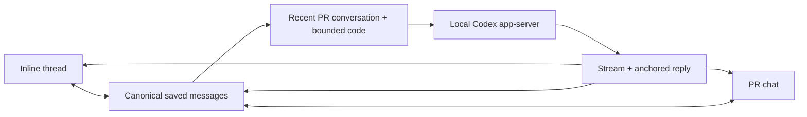

- [x] Inline and sidebar replies share message IDs; mirroring never writes duplicate messages. A PR-wide answer stays in chat, and a pending inline answer stays on its original range after selection changes.
- [x] Draft state survives guide navigation and virtualized rows. Failed saves retain the composer, and overlapping saves reuse the original note ID.
- [x] An 80-line WebKit fixture with an expanded thread between rows preserves drag selection on lines 11–12 and keyboard selection on 79–80 while virtualizing code rows.
- [x] Sampled light and dark inline/chat states have no axe-core WCAG A/AA violations. This is not a complete assistive-technology audit.
- [x] The installed production app answered a private question on migration lines 2–3 in both the inline thread and PR chat. A PR-wide follow-up correctly recalled the “Lantern” plan name and locking safeguard from that inline discussion. SQLite contains one question/reply pair with the RIGHT-side 2–3 anchor and one pair with no anchor; all four remain private.
- [x] Focus in long threads stays inside the reading area. The 80-line WebKit regression renders 29 code rows at the end of the diff, with the app scroll offset and header top both zero.
- [x] The final production build restored all eight private messages, the existing GitHub feedback, and both live connections after restart. PR chat shows the latest agent reply after older GitHub feedback. The installed executable SHA-256 is `f0f91fd08a38e55e6b399c06266c8b7d93d1a7ae3d66d0526d6ce895a35e1b43`, matching the built bundle.

## Current boundaries

The personal alpha uses an existing GitHub CLI login. GitHub App onboarding and organization installation flows are not implemented. It supports github.com, one GitHub identity per local data directory, and read-only model analysis. The app can publish new reviews and read remote feedback; thread resolution and targeted replies to existing review threads remain later work.

Missing or truncated GitHub text patches use a bounded reconstruction fallback from immutable merge-base/head file contents. Capture checks the reconstructed addition/deletion counts against GitHub; binary, metadata-only, oversized, and mismatched files remain explicitly unavailable. The fallback permits 20 files, 2 MiB and 50,000 lines per file side, and 16 MiB total. Diff computation has a 750 ms deadline. The model receives a bounded 180,000-character hunk context. Diff rows are virtualized. A real 16,868-line GitHub fixture now exercises large capture and rendering; this is a bounded corpus check, not a broad performance benchmark. A curated comparative guide-quality study has not been completed. No claim that this guide outperforms Linear or Diffity has been established.

The local macOS bundle is not a signed/notarized release, and other OS/architecture combinations are not yet validated. Auto-update, public downloads, the diff.city website, dependency-license audit, and clean-machine distribution gates remain on the release roadmap. Repository visibility stays private until the owner chooses a public launch.

## Historical reviews, languages, and schema upgrades

Open PRs remain the default inbox. **History** pages through closed and merged PRs for the selected repos, retaining cached pages during connection failures. PR URLs work independently of state. A historical snapshot supports the guided flow, private discussions, and Codex; GitHub publication requires an open PR and is checked again immediately before posting. Reopening a cached snapshot refreshes its PR metadata without changing its code anchors.

The interface uses i18next and react-i18next, with English and Spanish catalogs in `apps/desktop/src/locales/`. **Connections → Language** persists the selection in SQLite and updates the document language. Catalog tests check matching keys, interpolation variables, plurals, and English fallback. Repository content and generated review prose retain their original language. Add a new locale by registering its catalog in `src/i18n.ts` and the supported settings values in Rust.

SQLite upgrades run numbered SQL files from `apps/desktop/src-tauri/migrations/`, registered in order in `src/migrations.rs`. Version 1 is the original document store; version 2 adds snapshot/update indexes; version 3 supplies the language preference. Before upgrading an existing database, the app creates a consistent `before-schema-<version>-<timestamp>.sqlite` backup beside it. All pending migrations run in one immediate transaction. A failed step rolls everything back. Recorded checksums prevent edits to already-applied migrations, and a newer database version fails closed rather than being downgraded. Append a new migration and add it to the manifest; never rewrite an applied file. Test both a fresh database and an upgrade containing saved review data.

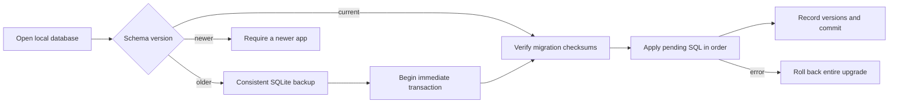

The large-text fallback uses the PR merge base rather than the target branch tip, so unrelated changes on the target branch cannot enter the reconstructed diff. It reads through GitHub's authenticated contents endpoint without following redirects. Snapshot capture format version 2 keeps newly reconstructed code separate from earlier incomplete captures. [GitHub content media types](https://docs.github.com/en/rest/repos/contents) and the [similar diff library](https://docs.rs/similar/latest/similar/) document the underlying APIs.

## Expanded corpus verification (October 20–21, 2026)

- [x] 36 Rust tests and 18 TypeScript/component tests pass, with types, ESLint, Clippy, formatting, and the production app build.
- [x] [Implementation CI](https://github.com/crs48/diffcity/actions/runs/39540803966) passes on commit `f383c36`, including the unsigned native bundle.
- [x] Five new PRs are available in the [review corpus](../tests/corpus/README.md): one actual implementation, three open synthetic drafts, and one closed, unmerged historical fixture.
- [x] The live Rust service captures all 8,580 additions and 8,288 deletions of PR #3 across 18 textual hunks, including a reconstructed 7,500-line hunk. Binary, rename-only, and mode-only files remain visible with explicit text limitations. Every captured addition/deletion anchor validates.
- [x] Live Codex analysis of PR #4 produces two guided sections and three findings covering the required-column rollout, destructive note deletion, and skipped backup. A private reply preserves its RIGHT-side lines 2–3 anchor.
- [x] WebKit replays the actual captured PRs: saves a LEFT-side lines 1–2 discussion, reaches RIGHT line 4,000 while keeping fewer than 100 rows mounted in the 7,500-line hunk, displays renamed paths and binary limitations, and renders the closed PR with publication disabled.
- [x] Sampled light/Spanish history and dark guided-review states pass axe WCAG A/AA checks. This does not replace a complete assistive-technology audit.
- [x] The installed production app upgrades the real schema 1 database to schema 3, preserving all eight private messages. Its consistent pre-upgrade backup also contains all eight messages and remains at schema 1.

The current installed executable SHA-256 is `bef045cee7c82e013f9b8945ca8091c1c1fa7af8990f7a42c180b2107407f363`, matching the build from `f383c36`. Native UI and restart verification completed on October 21 after the host was manually unlocked. Two earlier large-PR Codex attempts encountered GitHub connection timeouts before analysis; the installed app subsequently captured the PR and completed its Codex review. No network or security settings were changed.

- [x] In the installed production app, **Save and reconnect** restores the existing GitHub and Codex connections after the locked-host timeouts. History loads closed PR #6 and renders its additions and deletions. Publication remains disabled with a nonempty review summary; no review is posted.
- [x] Selecting Spanish translates the native interface. After quitting and relaunching, Spanish, closed PR #6, and both live connections return. SQLite remains at schema 3 with exactly three migration entries and all eight original private messages. English is restored after the check.
- [x] The installed app captures all 16,868 changed lines in PR #3. Its 7,500-line generated-data hunk reaches RIGHT line 4,000 with 30 code rows in the accessibility tree.
- [x] A fresh native Codex review creates an 18-section guide, placing the workspace migration and destructive cleanup first, followed by authorization changes and the API contract. Findings identify the missing migration backfill, deletion of every note, and missing required API path parameter. The bounded context supplies eight of 18 textual hunks; all ten omitted hunks remain visible as unassessed, alongside explicit binary and metadata limitations. Full capture does not imply full model coverage.

## Repo inbox priority

GitHub repositories are labeled **repos**. The Inbox groups each PR once: your open PRs (including drafts), review requests, assigned work, other PRs awaiting review, reviewed PRs, other authors' drafts, then your recent completions. Within a group, recent activity sorts first; completed items use their completion time. Submitted GitHub reviews reduce priority and use subdued text with explicit status labels. A current review request overrides an earlier review. Private notes, Codex discussion, and local reading progress do not count as submitted reviews. Review-request matching currently covers individual requested reviewers; team-level requests are not expanded into membership.

**Display settings** in the inbox header controls recently completed work: hidden, 24 hours, two days (default), one week, or 30 days. The preference is saved in SQLite with a backward-compatible default for older settings. Only your own completed PRs appear in the Inbox; **History** includes every author's closed and merged PRs independently of that preference.

[GitHub's review fields](https://docs.github.com/en/graphql/reference/pulls) supply the signed-in user's latest submitted review, current review requests, and aggregate review decision. Pending or dismissed reviews do not count as completed reviews. The automatic inbox queries five repos per batch, paginating 30 open PRs per repo, with smaller retries for failed batches. Recent completions come directly from the viewer's paginated closed/merged PR connection. Paging stops outside the update window, then filters by actual `closedAt`; an old PR with a new comment cannot masquerade as recently completed. This avoids search-index lag and scanning closed history in every repo. Pagination and access failures retain saved results for affected repos and report an explicit partial-sync error.

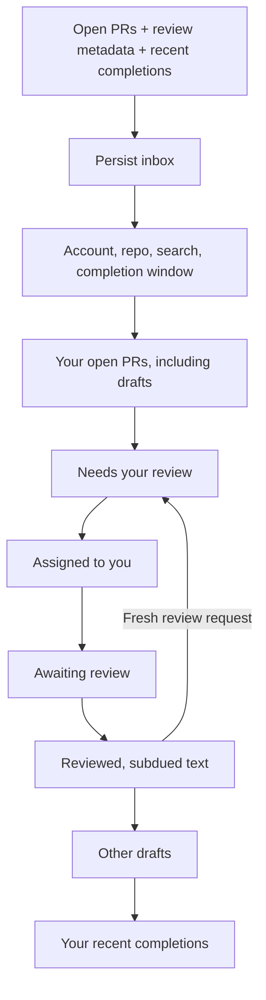

The separate **Sample inbox** contains 23 labeled, fictional scenarios and a session-only review-request simulator. Its cards open real local walkthroughs, but sample identities are blocked from GitHub publication in both the UI and Rust service. The [corpus guide](../tests/corpus/README.md#inbox-ux-samples) documents nine additional live GitHub PRs and reproduction commands.

### Inbox verification (October 21, 2026)

- [x] 42 Rust tests and 24 TypeScript/component tests pass. Type checking, ESLint, Clippy, formatting, contract generation, and the production bundle pass. [GitHub Actions](https://github.com/crs48/diffcity/actions/runs/39622030393) passes on `ef57f00`.
- [x] Live inbox capture returns 12 open PRs, including seven drafts, plus three recent completions. All open PRs have fetched review metadata, including the original authorized review on PR #1.
- [x] WebKit verifies all seven priority groups, review demotion and re-request promotion, completion filtering, preference persistence across reload, complete sample history, and a narrow 900-pixel layout. Sampled light/dark states pass axe WCAG A/AA after theme transitions settle.
- [x] The installed production app connects to GitHub and Codex, shows owned draft/ready PRs together, and opens actual ready PR #7, draft PR #11, and recently closed PR #14 with their code.
- [x] Native Sample inbox moves PR #106 into Reviewed after a simulated submission and back into Needs your review after a simulated re-request. No GitHub communication occurs.
- [x] A one-week completion window adds the four-day-old merged sample. After quitting and relaunching, the saved preference, prior real PR, and both connections return. The default two-day window is restored afterward. All eight original private messages remain intact at schema 3.

The installed bundle matches the build from `ef57f00`; its executable SHA-256 is `1e7829616ecbac8a8de7e5401a1b1f414d0115ac8039885649cbc637ddb7f97e`. The synthetic GitHub PRs remain unmerged. Sample metadata resets when reloaded, while sample notes and code-reading progress are stored separately for each sample.

## Compact account navigation

A 64-pixel rail selects **All accounts**, a GitHub organization, or a personal account. Accounts combine GitHub organization memberships, accessible repo owners, and the signed-in personal account and use monochrome GitHub avatars with initials as an offline fallback. The selected account name remains visible in the inbox header. A labeled **Repo** selector narrows its accessible repos; under All accounts, options include the owner to distinguish same-name repos. The standard PR list is 300 pixels wide, leaving 111 more pixels for the review than the former 205 + 270 pixel layout.

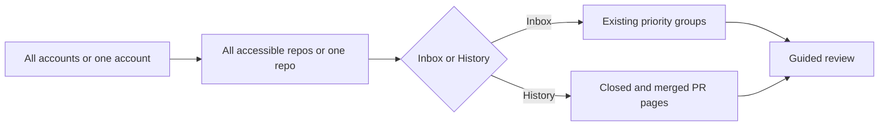

The personal account stays first. Other accounts sort by their most recent known activity across accessible repos: PR updates, repo pushes, or repository updates. Ties and accounts without activity data sort alphabetically. Cached directory timestamps keep this order available offline; older caches without timestamps remain readable. Incoming inbox batches update the order without changing the current account/repo selection or keyboard focus.

Accounts without a known update in the last 30 days fold behind a compact count by default. The cutoff uses the same PR/repo activity as sorting; updates exactly at the cutoff remain visible. Personal and selected accounts stay visible. The disclosure expands older accounts in activity order, announces its expanded state and count, and supports keyboard activation. Hidden buttons leave the tab order and accessibility tree. All accounts and repo filters still include their PRs, and newly updated accounts return automatically. The fold resets on app launch; it does not change GitHub access or cached data.

- [x] 40 frontend tests pass, with coverage for the 30-day boundary, keyboard disclosure, retained selected accounts, unchanged PR visibility, and automatic return on new activity. Production WebKit passes light/dark and expanded-state axe WCAG A/AA checks, selection/focus verification, and narrow layout checks.
- [x] The installed app displays four accounts and folds 16 according to live cached activity; native expansion, selection, and collapse retain the active account correctly. Existing notes remain unchanged. [CI passes on `5d58fd7`](https://github.com/crs48/diffcity/actions/runs/39643270242), including 55 Rust tests. The installed executable matches the packaged build, SHA-256 `6025444ffc9166388f7ef7bad730f14592fa4c6f8fa3902473cfe484d6efeb41`.

- [x] 55 Rust and 38 frontend tests pass, including activity ordering, stable selection/focus after reordering, and legacy caches. Types, ESLint, Clippy, formatting, generated contracts, and the production build pass.
- [x] The installed app reads activity timestamps for 179 repos and displays all 20 accounts in the independently calculated order. Existing notes remain unchanged. [CI passes on `bde128a`](https://github.com/crs48/diffcity/actions/runs/39642045602); the installed executable matches the bundled build, SHA-256 `b110db55f8cbc864839be3f371c9cd7a6b6b5586556f6268ac85f5c0b2efd0b0`.

Account changes reset the repo filter and preserve search and the Inbox/History choice. Losing repo access falls back to its account; organizations remain selectable even with no accessible repos. Both local filtering and history requests honor the account. Rust validates the selected account/repo against the discovered directory before making requests, and cached history pages retain the exact repo set as their key. In-flight responses from an old account are discarded; changes to the accessible repo set reload history.

The rail has 44-pixel circular buttons, named controls, React Aria hover/focus tooltips, and a selected outline/edge marker. The native repo selector supports keyboard navigation and type-ahead. The account list scrolls independently when many accounts are available. Connections and the two sample entry points remain available at the bottom. Avatar image loading is limited by CSP to GitHub and its avatar host; no GitHub tokens enter the webview. The narrow-window search focus target now works independently of the selected language.

### Compact navigation verification (October 21, 2026)

- [x] 43 Rust tests and 28 TypeScript/component tests pass, alongside type checking, ESLint, Clippy, and formatting. Coverage includes account/repo isolation, repo removal fallback, failed avatar loading, keyboard selection, history request scope, and stale history responses.
- [x] Production WebKit replay verifies three account owners, narrowing from account to repo, restoring All accounts, live-history fixtures, and 64/300-pixel panel widths. The real account avatar loads; unavailable fixture avatars retain initials.
- [x] Light account navigation and dark guided-review states report no axe WCAG A/AA violations. A 1000-pixel window switches between inbox and review without horizontal overflow and returns keyboard focus to search. These automated checks do not replace a full assistive-technology audit.

- [x] The installed native app loads the real `crs48` avatar, scoped repo menu, 12 open PRs, and three historical PRs. Selecting `diffcity` preserves the account scope; opening closed PR #15 renders its code. A transient GitHub TLS handshake failure on the first launch recovered through the existing Save and reconnect action. The final build restarts with a live inbox and restores PR #15 without the connection error. All eight private notes remain at schema 3.

The installed executable matches the bundle built from `d44bd6e`, SHA-256 `5144f59116bdc2fb6fe55c2fe72b4404e8dc79bb4126b29a216d0f42e6b244d8`. WebKit's native select appearance initially ignored the desired control height; an explicit chevron now preserves native select semantics while allowing a verified 34-pixel target. [Navigation CI](https://github.com/crs48/diffcity/actions/runs/39624993187) passes on `d10c7d8`; the final select styling also passes all local checks and the production bundle.

## Automatic GitHub discovery

The application discovers organization memberships through `/user/orgs` and all repos available to the local credential through `/user/repos`, including owned, collaborator, and organization-member repos. Both REST lists paginate. Connecting or launching the app discovers the directory and starts the inbox sync; no Add repos step is required. Legacy selected-repo settings only seed the directory cache on an older installation's first launch.

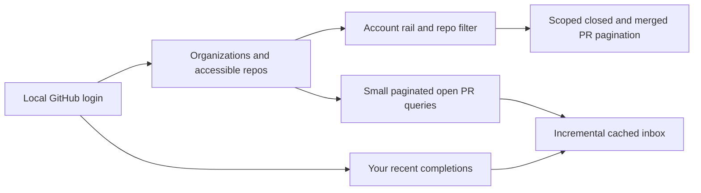

Discovery runs every 15 minutes while visible, with a manual refresh action in the rail. Inbox sync runs every 90 seconds and publishes progress after each repo batch. The selected PR's polling can run between background requests. Recent completions and history use lighter queries without open-review metadata. History retains per-repo cursors, so a large repo cannot be truncated by an aggregate page limit. Org-only memberships with no accessible repos show an empty filter instead of disappearing.

A failed discovery retains the last successful directory with an error. A failed repo query retains that repo's cached PRs while successful batches update normally. Errors and sync progress are visible in the UI; a partial sync never receives a new successful-sync timestamp. Repo source contents are fetched only when a PR is opened; directory discovery and inbox sync do not start Codex or publish GitHub feedback.

### Discovery verification (October 21, 2026)

- [x] 50 Rust tests and 31 TypeScript/component tests pass. Tests cover cached discovery on failure, repositories losing access, empty organization history, pagination cursors, complete review metadata, automatic account/repo filters, incremental PR delivery, and partial-sync visibility. Type checking, ESLint, Clippy, formatting, and contract generation pass.
- [x] The read-only live check discovers 16 organization memberships and 179 accessible repos, then loads 243 open PRs and five recent completions with no sync errors. An organization with 19 repos loads 137 open PRs and two distinct history pages containing 315 and 170 PRs. These counts are a point-in-time capture; subsequent independent checks confirmed that differences reflected PRs merged or created during testing.
- [x] Production WebKit replay displays all 179 repos and 20 account/owner buttons, verifies account/repo narrowing and history scope, and keeps cached PRs visible after partial failure. The account rail scrolls independently. Light and dark states pass axe WCAG A/AA; keyboard tooltips/selection and a 1000-pixel layout pass.

The live check exposed GitHub 502 responses when requesting diff statistics for many large PRs. Inbox/history queries now omit those unused statistics; opening a PR still retrieves complete metadata. No GitHub feedback or model inference occurs during this verification.

- [x] The installed production app automatically discovers the full live directory through the registered Tauri command, renders all 19 repos in the selected organization's menu, filters the inbox to its main repo, and loads 30 historical PRs. Background sync reaches all 179 repos and reports success. All eight pre-existing note records are byte-for-byte unchanged at schema 3.
- [x] [Discovery CI](https://github.com/crs48/diffcity/actions/runs/39638310475) passes on `41b2490`. The installed executable matches that source build and the packaged bundle, SHA-256 `9e2577d46041e0404eb70d0959291c9fbcfe13b898190aecb10a480fb61013eb`.

## Local repo and PR pins

Repo pins add compact shortcuts below the repo selector and a **Pinned repos** option group. They respect the selected account and do not widen the navigation rail. Pin controls appear beside a selected repo, on each PR card, and in the review toolbar.

Pinned PRs occupy a single **Pinned pull requests** section before the usual priority groups. Pins remain subject to account, repo, and search filters; History continues to show only closed/merged work. A pinned completion remains in the Inbox regardless of author or completion window. Unpinning restores its ordinary priority and visibility. Sample pins stay separate from the live GitHub inbox.

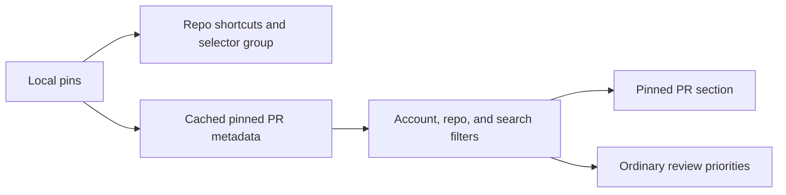

Pins use separate per-item SQLite documents, so saving a theme or connection preference cannot overwrite them. Existing databases need no schema upgrade and start with empty pins. Sync uses fresh inbox metadata for open pins and separately refreshes pinned PRs absent from the ordinary inbox, including old completions. Offline failures retain saved pin metadata and surface a sync error. Refreshed metadata lives separately from the pin preference, so an in-flight refresh cannot recreate an unpinned item.

Pin buttons use React Aria, named tooltips, pressed state, visible keyboard focus, and saved-state announcements. PR card and pin controls are sibling buttons. After a PR moves between groups, keyboard focus returns to its pin control; if an unpinned old completion disappears, focus returns to search. Failed saves retain the previous pin state.

- [x] 54 Rust tests and 35 TypeScript/component tests pass, with types, ESLint, Clippy, formatting, and generated contracts checked. Coverage includes persistence, case-insensitive identity, independent settings, offline pinned history, current metadata, filters, failed saves, and focus restoration.
- [x] Production WebKit verifies repo grouping/shortcuts, keyboard PR pinning without opening the review, a 60-day-old other-author completion retained in the Inbox, reload persistence, search, failed unpin recovery, and narrow layout. Light and dark states pass axe WCAG A/AA. The pin controls preserve the 64px rail and 300px inbox.

- [x] The installed production app pins a repo and closed PR #15 through their native controls, restores both after quitting and relaunching, opens the repo through its pinned shortcut, and removes both test pins successfully. All eight original private notes remain byte-for-byte unchanged at schema 3.
- [x] [Pinning CI](https://github.com/crs48/diffcity/actions/runs/39640448422) passes on `9563326`. The installed executable matches the packaged build, SHA-256 `03460445c681b286dedb6c3e80d9551f10be144f84d0dbc4997fa64807987bd6`.

## Rich PR status cards

PR cards keep the monochrome surfaces and add semantic color to lifecycle icons, status overlays, and labeled badges. Green identifies open/approved/passing states, purple merged and reviewed states, red closure/conflicts/failure/change requests, blue personal review work, amber pending/blocked/behind-base states, and gray drafts or unavailable information. The lifecycle icon remains visible beneath a small overlay; conflicts and failures take precedence over requests, pending work, and positive signals.

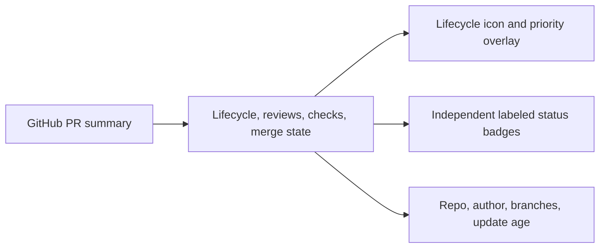

Open inbox queries request `mergeable`, `mergeStateStatus`, and `statusCheckRollup.state` in the existing batched GraphQL call. These are [GitHub PR fields](https://docs.github.com/en/graphql/reference/pulls); no additional per-PR request or diff-statistics query is needed. The optional status contract preserves older saved snapshots. An explicit null rollup becomes “No checks”; missing metadata stays unavailable. Unknown checks, an approval, and conflict-free code are not inferred to mean readiness to merge. The mergeable badge requires GitHub's CLEAN merge state. Completed cards suppress stale review and CI warnings.

Cards show the full repo identity, author, source/target branch, and localized relative age with an absolute timestamp tooltip. Diff counts render only when file statistics are available, avoiding fabricated zero-change summaries. Names and branches truncate visually while remaining in the accessible name. Pin controls remain siblings of card buttons.

- [x] 56 Rust tests and 47 frontend tests pass, with types, ESLint, Clippy, formatting, generated contracts, and production build checked. Tests cover conflicting signals, unknown states, completed-state precedence, review re-requests, and independent pin/open behavior.
- [x] Live read-only sync discovers 179 repos and retrieves status metadata for all 239 open PRs, including passing/pending/failing checks and clean/blocked/conflicting/behind-base merges. History still paginates; counts are a point-in-time capture.
- [x] Production WebKit verifies all six color families, merged/closed icons, keyboard pinning and restored focus, search, narrow layout, and light/dark axe WCAG A/AA checks. The 23 local inbox samples now include varied status combinations.
- [x] The installed production app displays live check and merge badges in the organization inbox, with purple merged and red closed icons verified in sample History. All eight original notes remain byte-for-byte unchanged at schema 3.
- [x] [Rich-card CI](https://github.com/crs48/diffcity/actions/runs/39646986589) passes on `3a57306`. The installed executable matches the packaged build, SHA-256 `efcb39111ddab0c913b4b8e2b93936b221eb4f6330eeb39013d9be3b46f628d7`.

## Default model and reasoning

The **Model** tab in the account rail opens an accessible selector for the default provider, model, and reasoning choice. Codex is the first supported provider. New or previously unselected installs default to `gpt-6-astra` with `xhigh` reasoning; legacy explicit model choices retain their previous Medium reasoning until changed.

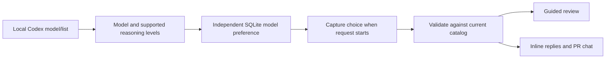

The provider/model/effort preference has a dedicated document and command, so connection or appearance saves cannot overwrite it. Codex config files remain untouched. The [Codex App Server model catalog](https://learn.chatgpt.com/docs/app-server#list-models-modellist) supplies model descriptions, supported reasoning levels, defaults, and pagination. Both saving and running validate the choice; unsupported combinations fail explicitly. Switching models preserves a compatible reasoning choice, otherwise selects the advertised default and announces the adjustment. A model-default reasoning choice follows the selected model. Changes apply to the next request, preserving active runs.

- [x] 61 Rust tests and 52 frontend tests pass. Coverage includes legacy defaults, independent persistence, failed saves, catalog pagination, the actual model/effort sent to Codex, unsupported choices, and accessible picker interactions. Type checking, ESLint, Clippy, and formatting pass.
- [x] Live Codex discovery returns seven models and confirms Astra/Extra high. An isolated smoke run persists the selection across restart, produces a three-section guided review, and answers a sample PR question using the saved default.
- [x] Production WebKit checks model switching, effort adjustment, failed-save recovery, refresh, persistence, Escape/focus return, narrow layout, and light/dark axe WCAG A/AA. The multiline discussion regression uses user paste events for longer comments to avoid per-character timing sensitivity while retaining focus, anchoring, and mirroring assertions.
- [x] The installed production app refreshes all seven models and saves Astra/Extra high through its native controls, and restores that choice after a full quit/relaunch. All eight existing private notes remain unchanged. [Model-selector CI](https://github.com/crs48/diffcity/actions/runs/39650762195) passes on `ecc7bc5`; the installed executable matches the packaged build, SHA-256 `bbc858c758bb570d127828463f1b6ff2344779e5b58520a879c4cfce62dc0a44`.

## Shared review scrolling and surrounding context

Guides, code, and inline discussions flow inside one review viewport; PR chat has its own adjacent pane. Expanded hunks render every line, with long source and response text wrapping instead of creating nested scrollbars. Inline comment editors grow with their content. Guide changes, individual hunks, and inline threads can collapse completely; unfinished draft state survives reopening. Pointer range selection uses actual row geometry, including wrapped lines and inserted threads, and scrolls the shared viewport. Changing review views returns to their beginning; the continuous guide now restores its active section.

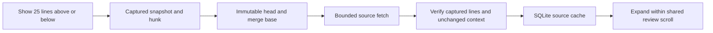

Context requests use a known captured hunk rather than accepting arbitrary paths. Renames use the prior path for the base source. Added/deleted files have an empty opposite side. Expansion stops at neighboring hunks and respects the existing 2 MiB and 50,000-line per-file bounds. A mismatching source produces an inline retryable error. Cached source is usable after restarting offline. Additional lines are read-only: existing comment anchors and bounded AI context remain unchanged.

- [x] 67 Rust tests and 55 frontend tests pass. New coverage includes neighboring hunks, zero-context insertions/deletions, renames, Unicode/CRLF/no-final-newline text, stale or oversized source rejection, cached restart, cumulative expansion, complete collapse, and preserved inline drafts and anchors.
- [x] Type checking, ESLint, Clippy, formatting, generated contracts, and the production frontend build pass.
- [x] A live read-only smoke run loads surrounding context from `crs48/diffcity#2` and retrieves the same lines after restarting without a GitHub session.
- [x] Production WebKit verifies a 3,000-line hunk, cumulative context and error recovery, guide/diff/thread collapse, a 35-line comment and 50-paragraph mirrored reply, growing editors, wrapped-line dragging, keyboard selection, and shared-viewport drag autoscroll from lines 180–199. No nested vertical scroll regions remain inside the review; light/dark axe WCAG A/AA and narrow-width checks pass. Next-step navigation starts at the explanation.
- [x] The installed production app expands live GitHub context above `.gitignore` and below the first `Cargo.lock` hunk in `crs48/diffcity#2`, then collapses context through native controls. All eight original notes and the model preference remain byte-for-byte unchanged. [CI passes on 40e8e4a](https://github.com/crs48/diffcity/actions/runs/39658625704). The installed executable matches the packaged build, SHA-256 `825ad7d75d22e002cc919db96f0b4dc1428dd77c9d5254969fd5d7a9aa7534fc`.

## Left gutter comments

Inline comment buttons now precede the line numbers in unified and split diffs. Their 25px targets stay visible on selected rows and keyboard focus, and opening a comment preserves the entire selected range. Read-only expanded context uses the same gutter spacing.

- [x] All 57 frontend tests, type checking, ESLint, and production packaging pass. Added regressions cover Shift-click selection followed by the gutter comment action in both views.
- [x] Production WebKit verifies left-side placement, selected-button visibility, forward Shift-click ranges, reverse dragging on deleted lines, Shift-arrow keyboard ranges, inline focus, and expanded-context alignment in both layouts. Light/dark axe WCAG A/AA checks report no violations.

- [x] The range toolbar action is also left-aligned. Native verification Shift-selects migration lines 1–2, opens the left gutter comment, and focuses an inline composer with the complete range. All eight private notes remain unchanged. Installed executable SHA-256: `7a921e2440b8c84d1e746cacbabb6ff743f47f67da98634b06f794bbf15d5345`.

## Cached review loading and background preparation

Opening a previously captured PR now reads SQLite immediately, including saved guides, notes, discussion, check results, and progress. A cold open captures code first; the selected review then refreshes GitHub metadata, comments, and checks independently. Directory discovery no longer blocks restoration of the last review. Previous-revision lookup reads a single ID instead of decoding every stored diff.

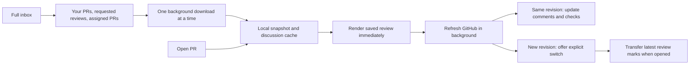

The prefetch queue includes drafts and prioritizes authored PRs, then requested reviews, then assignments, ordered by recent updates. It operates across repo/account filters, skips the active review and hidden windows, refreshes changed heads/base commits/updated timestamps, and uses a five-minute freshness window with failure backoff. A foreground open cancels speculative work; per-PR locks prevent overlapping captures from replacing each other. No Codex inference or GitHub writes occur during preparation.

Background capture preserves revision-specific notes and guides, never writes back existing progress, and defers progress transfer until the new revision is opened. Intermediate prefetched revisions without review progress are skipped during transfer. Stale async responses are ignored after navigation; new revisions never replace code under the reader.

- [x] Regression coverage verifies offline cached opens while a network lock is held, interruption and foreground priority, revision freshness, progress transfer at open time, queue membership/order/deduplication/backoff, slow GitHub responses, rapid switching, and restoration before directory discovery completes.
- [x] All 70 Rust tests and 63 frontend tests pass, with type checking, ESLint, Clippy, formatting, production packaging, and [CI on b6b483f](https://github.com/crs48/diffcity/actions/runs/39662528011). Production WebKit switches among cached authored/draft/requested/assigned reviews in 77–125 ms while metadata responses are delayed three seconds. Review marks survive switching; light/dark axe WCAG A/AA and narrow-width checks pass.
- [x] A read-only live smoke run prepares PRs #2, #3, and #4 in 3–6 seconds and reopens them offline in 0–184 ms (debug backend timings, including the 16,868-line fixture). The installed app automatically prepares reviews across repos despite an active repo filter, and renders draft/open PR code while background sync is visible. All eight private notes and saved settings remain unchanged. Installed executable SHA-256: `1532887471abac76fb59c0f3c317fdd8573617c917e60a5a498840c7fdc40146`.

## Continuous guided review

The guide is one document with all sections rendered in priority order. Each section places a bounded explanation to the left of its code; it sticks below the outline while that section is visible and yields at the section boundary. A narrow workspace stacks the explanation above the code. An explanation that cannot fit in the available viewport stays in normal document flow. Full walkthroughs and review checks are visible by default in the code column and can be collapsed independently.

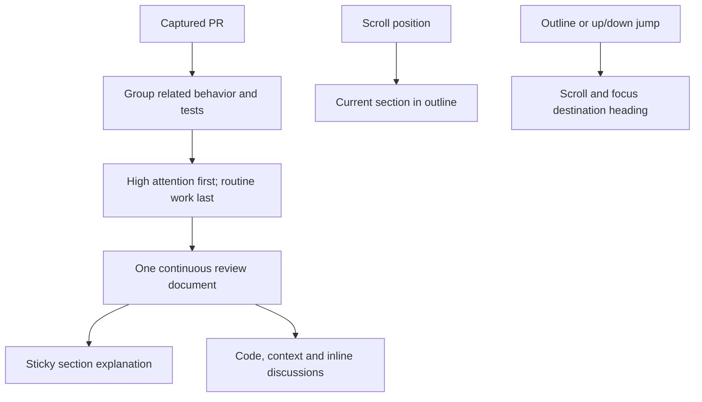

Codex is prompted for roughly 5–12 high-level sections on substantial PRs, fewer on small changes, with short sticky takeaways and separate detailed explanations. The response schema caps model sections at 20. Provisional and omitted code groups by attention/category instead of one section per hunk, filtering already-covered hunks before grouping. Oversized saved guides compact within equal attention, assessment, and folding boundaries, preserving every explanation, question, finding, hunk, and unavailable path. Active and expanded section IDs remap while per-hunk progress stays unchanged.

Scrolling updates the outline and saved active section without resetting the viewport or moving focus. Explicit jumps focus the destination heading. Code and discussion remain mounted across jumps; each section can independently collapse. Long diffs, surrounding context, full explanations, and inline threads share the review scrollbar.

- [x] 72 Rust and 66 frontend tests pass, including partial model coverage, large legacy-guide compaction, preserved findings/progress, independent collapse state, manual-scroll tracking, final short-section detection, and keyboard outline focus. Types, ESLint, Clippy, formatting, and the production web build pass.
- [x] A live local Codex run using the saved Astra/Extra high preference produces a three-section sample guide and a PR-chat answer.
- [x] Production WebKit verifies two 400-line sections, sticky handoff, bounded annotations, full-context disclosure, outline/keyboard navigation, all chapters retained, a single scroll viewport, narrow stacking, and zero light/dark axe WCAG A/AA violations.
- [x] WebKit renders all 19,890 diff lines of the stress fixture in 20 sections, retains them across jumps, and supports wheel scrolling. Multi-line questions and long replies remain inline across section jumps and mirror into PR chat; full-context disclosure from mid-section scrolls into view. Unchanged diff content is memoized. On this extreme fixture, in-page jump-to-second-frame measurements remain 1.6–1.7 seconds in WebKit, mostly scrolling/layout/paint; this historical measurement is superseded by the paint-containment work below.
- [x] The installed production app restores the active historical review, replaces its old 120-step provisional guide with four broad sections, and jumps to API compatibility with the heading focused and explanation beside the code. All eight private notes, settings, and model preference remain byte-for-byte unchanged. Installed executable SHA-256: `f8fa2f25e9ec027cf7b9105b909e497b4937d44f9112cdc1e7234df7deb37313`.

## Compact review header

Scrolling the shared review viewport reduces the PR heading to a 48px row containing the title and Codex action. Returning to the top restores author, check, and change-count details. Historical-review and revision notices scroll with the document. Active-run and incoming-update notices remain visible. The title retains its full accessible name, and the narrow layout preserves the action label for assistive technology.

Header scroll state stays local to its component. Separate collapse/expand thresholds account for the reclaimed height so short reviews cannot oscillate as their scroll range changes. Guide jumps and restored positions use the same behavior; switching PR or view resets the heading.

- [x] All 66 frontend tests, type checking, ESLint, formatting, production web/native builds, and [CI on 55c00f7](https://github.com/crs48/diffcity/actions/runs/39672516986) pass.
- [x] Production WebKit verifies expansion, 48px compaction, preserved keyboard focus, scroll-away notices, guide jumps, view switching, short-review stability, and narrow layouts. Light/dark axe WCAG A/AA checks report no violations.
- [x] The installed production app compacts the header on a real historical PR and restores its metadata at the top. All eight private notes, settings, and model preference remain byte-for-byte unchanged. Installed executable SHA-256: `ea45c295a539efc0cbf0e7e4afcb1caddccf1ddc6a8bb7c8a7461b03b4d8781f`.

## GitHub-flavored comment Markdown

One memoized renderer now handles local notes, GitHub comments, streamed Codex replies, draft previews, and overview descriptions/discussion. It uses [remark-gfm](https://github.com/remarkjs/remark-gfm) for tables, task lists, strikethrough, autolinks, and footnotes, and [remark-breaks](https://github.com/remarkjs/remark-breaks) for GitHub-style comment line breaks. Scoped styles restore list markers and readable headings, quotes, code blocks, and tables. Code and table cells wrap without introducing nested scroll regions.

Task checkboxes are read-only and labeled from their text. Every rendered copy namespaces its footnote IDs and accessibility references, so inline/chat mirrors navigate within the correct comment and return focus without removing links from the tab order. Draft selection stays separate from links and task checkboxes in the preview. Saved bodies and publication payloads remain raw Markdown.

User-activated HTTP/HTTPS links open through the native browser command. Both UI and backend reject local/executable schemes and embedded credentials. Active HTML stays inert and remote images are represented by their alternative text without fetching them.

- [x] All 73 Rust and 71 frontend tests pass, including Markdown semantics, task labels, safe link dispatch/error handling, mirrored footnote navigation, and partially streamed code fences. Types, ESLint, Clippy, formatting, and production packaging pass.
- [x] Production WebKit verifies inline/chat/overview/preview rendering, keyboard link activation, independent draft selection, unique footnotes, long wrapped code, and narrow layouts without horizontal overflow or nested Markdown scrolling. Light/dark and draft-preview axe WCAG A/AA checks report no violations.
- [x] The installed app renders existing GitHub review comments as semantic tables, formatted text, and code. All eight private notes, settings, and model preference remain byte-for-byte unchanged. [CI passes on ee18030](https://github.com/crs48/diffcity/actions/runs/39678168549). Installed executable SHA-256: `e67a0299e76fac6e46ff1607291c568256df3076c0c52135ac78f4f12abc190a`.

## Independent PR chat scrolling

The review viewport and PR chat are sibling panes. Chat messages scroll independently with contained overscroll, while the chat header, context, and composer stay available. Long chat drafts have a bounded editor so they cannot push the conversation or send controls out of the window; inline editors remain expanded within the review. Replies follow the bottom only while the reader stays near it. Reading older messages suppresses automatic following.

On narrow windows, chat occupies its own panel and the covered review is hidden from keyboard and assistive navigation without unmounting it. Escape and close restore focus to the chat toggle. Code references close the narrow panel and focus the inline thread. Opening, scrolling, or closing chat preserves the review's reading position.

- [x] All 71 frontend tests, type checking, ESLint, formatting, and production web/native builds pass. WebKit verifies independent wheel/keyboard scrolling, scroll-boundary containment, fixed header/composer, new-reply following, preserved older-message position, bounded long drafts, and narrow-panel return to code. Light/dark axe WCAG A/AA checks report no violations.
- [x] The installed app shows the restored real review beside its own bounded chat pane, with the latest GitHub comments and composer visible. All eight private notes, settings, and model preference remain unchanged. [CI passes on 93cb5b4](https://github.com/crs48/diffcity/actions/runs/39680579229). Installed executable SHA-256: `325e7909d6b220c79d30c2984651a4fe93be0f6801121f212cd58ed1a3ed889f`.

## Informative walkthroughs

Diffity's [guide prompt](https://github.com/nilbuild/diffity/blob/ce9de40e94707f1983d1995c9c63679ffa9c670c/src-tauri/prompts/guide.md) organizes an explanation around intent, a coherent reading path, and source context. Diffcity's [prompt](../apps/desktop/src-tauri/prompts/guide.md) applies those ideas while keeping high-impact code first and concrete suspected defects separate from explanations. It asks for PR orientation, before/after behavior, flow across actual symbols and paths, non-obvious decisions, evidence from tests, and specific review checks. Substantive explanations typically have two to five focused paragraphs; simple edits need less, and length is not a quota.

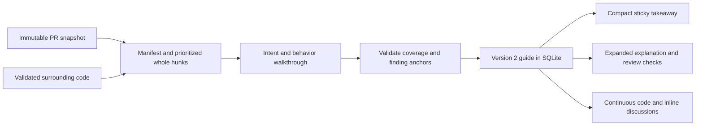

Evidence is bounded to 180 KB of complete hunks, a 24 KB file manifest, an 8,000-character PR description, and 32 KB of extra context. Behavior and tests precede bulk copy and dependency content when capturing hunks. Supplementary context reuses the existing revision-bound source cache and validates source against the diff; it requests 25 unchanged lines on either side of one hunk in up to eight modified files. A 12-second deadline bounds that preparation, cancellation interrupts it, and capture failures fall back to the supplied patch. The guide records capture limitations independently of the model's own limitations. Unseen callers remain explicitly unknown, and additional source lines never become valid finding anchors.

New output requires nonempty section explanations; saved version-1 guides deserialize with an empty explanation and render their original summary intact. A notice offers regeneration rather than running Codex automatically. Compaction preserves full explanations, questions, findings, and progress. Provisional groups state that no guide has been generated. PR orientation, walkthroughs, rationale, and checks use the existing safe Markdown renderer, with no nested review scrollbar. The authored invitation demo also explains its deliberately incomplete migration, tenant scope, and expiry wiring.

Live verification can be repeated without publishing comments:

```sh
DIFFCITY_DATA_DIR=.local/guide-smoke cargo run -p diffcity --bin guide-smoke -- owner/repo 123
```

The command saves the resulting workspace locally for qualitative review and checks structured output, anchors, stored coverage, and persistence. Word counts are diagnostics, not a quality assertion.

- [x] Unit coverage for bounded complete-hunk capture, manifest omissions, Unicode description limits, exact immutable context, cancellation, legacy guides, explanation validation, preserved compaction, visible Markdown, and independent disclosure.
- [x] Production WebKit verifies visible orientation and checks, sticky annotations, independent prose collapse, narrow stacking, no nested guide scrolling, and zero light/dark/narrow axe WCAG A/AA violations.
- [x] Live local Astra/Extra high generates a nine-section guide for a 56-file historical PR: seven assessed chapters with 1,297 words of explanation and 20 checks, plus two groups keeping the omitted code visible. The 180 KB hunk budget supplies 74/120 hunks; all 46 omitted hunks remain unassessed. Qualitative review confirms explanations of migration preconditions versus repair execution, release ordering, retained management boundaries, resolver/locking behavior, and the limits of visible test evidence.
- [x] Live analysis of migration fixture PR #4 covers 3/3 hunks in two chapters, with 399 words of explanation, six concrete checks, and three validated findings. It correctly distinguishes a schema error that blocks upgrade from the destructive note deletion it masks, and connects the changed backup predicate to one-step upgrade recovery. Both guides survive restart.
- [x] 76 Rust tests and 72 frontend tests pass. Generated contracts, types, formatting, lint, Clippy, production packaging, and [CI on 8427a47](https://github.com/crs48/diffcity/actions/runs/39682710550) pass.
- [x] The production app is installed and restores the real historical review with the new guide and orientation. All eight private notes, settings, and model preference match the pre-update backup. Native accessibility verification confirms the restored PR and new orientation; native screenshot capture timed out, so visual layout verification uses production WebKit. Installed executable SHA-256: `d4fda08feb8ce492e98118617fe0f025e575c6199517f7efb43c606c5f31b61d`.

## Large-review scroll rendering

Code and expanded context use paint boundaries every 64 code rows. The browser can skip painting offscreen blocks while retaining exact layout and every mounted line. No height estimation, virtualized rows, or nested scrollers are introduced. Discussion insertion does not shift later block keys; keyboard focus and component identity remain stable. Selection binary-searches blocks and their actual variable-height rows, so wrapping and inline conversations preserve line anchors. Gutter focus outlines stay inside paint boundaries.

The repeatable production WebKit stress check uses a 1600 × 1000 viewport, 19,890 rendered lines, and 20 expanded guide sections. After two settling frames, it moves the review by 100 pixels per animation frame for 45 frames, then back for 45. Measurements below compare the original layout with the final build on the same machine. These are scripted frame intervals, not a guarantee of hardware wheel-scroll FPS.

| Measurement                                     |  Before |  After |
| ----------------------------------------------- | ------: | -----: |
| Median frame interval                           |  522 ms |  25 ms |
| 95th percentile                                 |  735 ms |  58 ms |
| Frames over 50 ms                               |   90/90 |   7/90 |
| Total 90-frame sequence                         | 45.44 s | 2.77 s |
| Section click to second frame, measured in-page |  1.50 s | 0.11 s |

- [x] All 76 frontend tests, types, ESLint, production web/native builds, and diff whitespace checks pass. Regressions cover pointer/keyboard selection across paint boundaries, variable-height rows and thread gaps, and retained focus when a discussion is inserted.
- [x] Production WebKit retains all 19,890 lines through five section jumps and wheel scrolling. Separate interaction checks verify cross-boundary drag and Shift selection in unified/split layouts, a 50-paragraph inline agent reply, 75 expanded context rows, no nested review scrollbars, and zero light/dark/narrow axe WCAG A/AA violations.
- [x] The installed app restores the real historical PR and its nine-section guide; native section navigation focuses the destination heading and scrolling retains the sticky explanation and compact header. All eight private notes, settings, and model preference remain byte-for-byte unchanged. Installed executable SHA-256: `7fa0df0d24c34253779d92a8f65599fa921f4bcd5796441cb1cbdf7235f1d3ba`.

Initial rendering still mounts the complete expanded document and can be expensive at capture limits. The measured stress fixture is well below the maximum possible capture; exhaustive worst-case profiling remains open.

## Adaptive code virtualization

Reviews with at least 3,000 captured diff rows use TanStack Virtual to choose nearby 64-row blocks. Small reviews remain fully rendered. Lightweight block shells remain in normal document flow; measured heights replace estimates, retaining one review scrollbar and sticky chapter annotations. The shared document owns scroll adjustments so individual hunk windows cannot compete for the viewport. Native browser anchoring is disabled while virtual blocks are active. Explicit section/search jumps reconcile nearby height changes for a bounded eight frames and immediately yield to another user gesture.

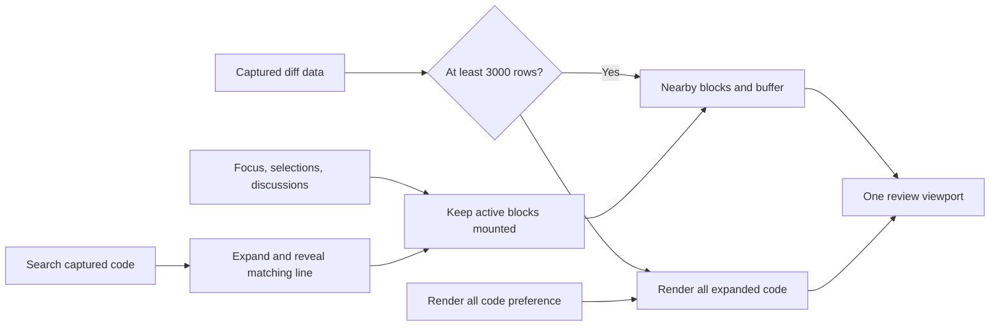

Selected ranges, native text selections, adjacent keyboard targets, and discussion blocks stay mounted; draft text and thread collapse state survive distant scrolling. Hidden/covered panes retain pinned blocks and previous measurements. Rapid Shift-arrow input moves focus synchronously when its buffered neighbor exists. Context uses the same block renderer. A named offscreen-block control loads code on focus. **Render all code** persists in WebKit local storage for full-document assistive reading, while Cmd/Ctrl+A from code temporarily mounts the full document before native selection runs.

**Find in code** searches the captured diff data rather than mounted DOM. Cmd/Ctrl+F focuses the field; Enter/Shift+Enter and previous/next controls cycle through matching lines with original old/new anchors. A result expands folded code and clears an incompatible file filter. Search covers captured diff lines, not unloaded surrounding file contents, prose, or chat. The guide navigation is docked above the code viewport to prevent partially obscured line-number targets; PR chat retains its independent pane.

Production WebKit comparison on the same 19,890-line fixture at 1600 × 1000:

| Measurement                                  |                Fully rendered |   Adaptive |
| -------------------------------------------- | ----------------------------: | ---------: |
| Open sample to mounted guide plus two frames |                      7,592 ms |     249 ms |
| Initially mounted code rows                  |                        19,890 |        203 |
| Initial DOM elements                         |                       201,111 |      4,247 |
| Median scripted scroll-frame interval        | 25 ms (prior containment run) |      17 ms |
| Adaptive p95 / maximum                       |                             — | 21 / 23 ms |
| Adaptive frames over 50 ms                   |                             — |       0/90 |

Opening excludes GitHub capture and Codex generation; these are local browser-fixture timings, not guaranteed native FPS. Captured review data remains in memory. Very large selections, many discussions, and explicit full-code rendering can still mount substantial DOM.

- [x] 83 frontend tests, types, ESLint, formatting, and production web build pass. New regressions cover bounded mounting, pinned focus/selections, full-code mode persistence, data-backed search/line anchors, scroll-target reconciliation/cancellation, and docked navigation.
- [x] Production WebKit visits all 20 section destinations and random positions throughout Files without blank visible blocks. The 3,012-row interaction fixture verifies offscreen search, multiline drafts and mirrored long replies, collapse state, native text selection, expanded context, and zero light/dark/narrow axe WCAG A/AA violations.
- [x] Keyboard checks verify offscreen block loading, rapid split-view range extension, cross-block native selection, Select All including distant code, search into folded/filtered code, and Cmd+F. Independent-chat regressions pass, including narrow-panel return and accessibility checks.
- [x] Install the final production bundle and verify native large-PR navigation/search with private data preserved. The installed app opens real GitHub test PR #3 with adaptive rendering enabled, searches and selects generated-code line 4,000, loads surrounding blocks during ordinary scrolling, and jumps from section 14 to section 8 with the sticky explanation and destination code visible. The search is cleared afterward, and adaptive rendering remains enabled.
- [x] [CI passes on implementation commit 12a0b06](https://github.com/crs48/diffcity/actions/runs/39695349581): 76 Rust and 83 frontend tests, generated contracts, types, formatting, lint, Clippy, and production packaging.

The installed production executable matches the packaged bundle (SHA-256: `264d35ca1082fe85aafff616193f50ef1b37686b589e445a3ef89986d040bc54`). All 10 private notes, saved settings, and the model preference match the fresh pre-install SQLite backup byte for byte. Native accessibility and screenshot checks confirm the visible search result, scrolling code, and section destination. [Validation documentation CI also passes on f5aa024](https://github.com/crs48/diffcity/actions/runs/39695759147).

## Sticky file headers and minimap

Consecutive hunks from the same file share one sticky title and collapse control in Guide and Files. The guide's order is preserved, including intentional revisits to a file in separate chapters. A fresh line-selection request reopens its file. Collapsing while deep inside a file keeps the header reachable, and the next header replaces it when the previous file leaves the viewport.

A single bounded canvas overlays the editor's right edge and represents the active file's captured diff and expanded context. It appears only when that file is taller than the viewport. Green, red, and neutral bands summarize additions, deletions, and unchanged code; unloaded source is not invented. Drawing happens when the active file, theme, or canvas dimensions change. Ordinary scrolling updates only the viewport marker and accessible slider value, without painting the canvas or rerendering the review document. A layout registry handles source registration and context changes without scanning thousands of mounted rows each frame.

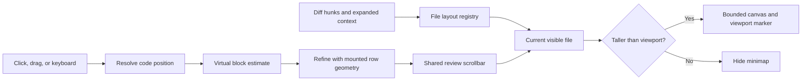

Minimap navigation does not change comment anchors or review marks. It clamps the first/last page inside the selected file, refines virtual positions once code is mounted, and yields to subsequent user gestures. Source geometry accounts for wrapping and inline-discussion gaps. Keyboard users can use arrows, Page Up/Down, Home, and End; assistive technology receives a named vertical slider and percentage value. Partially obscured line controls under sticky headers do not leave small clickable slivers.

Virtual window visibility uses cached numeric bounds and one shared, frame-batched scroll listener. This avoids a stale WebKit intersection notification at the lower edge of a file after a distant jump. Actual geometry is refreshed when a window enters/leaves its buffer or layout resizes.

- [x] 90 frontend tests, types, ESLint, formatting, and production web build pass. Regressions cover multi-hunk collapse, same-anchor reopening, measured/virtual/context coordinates, shared scroll subscriptions, and newly visible code without an intersection notification.
- [x] Production WebKit verifies sticky handoff between files, click/drag/keyboard minimap navigation, multi-hunk collapse, filtering/search, hidden maps for short files, and zero canvas repaints during ordinary scrolling. Light/dark/narrow axe WCAG A/AA checks pass.
- [x] All 20 section jumps and random Files positions in the 19,890-line fixture render visible blocks. Multiline drafts, mirrored long replies, expanded context, text selection, full-code mode, and independent chat regressions pass. A local scripted 90-frame run measures an 18 ms median and 23 ms p95, with 2 frames over 50 ms and 4,271 DOM elements; these are fixture measurements, not guaranteed native FPS.
- [x] Install and verify sticky headers and minimap navigation in the native app, preserving private notes and settings. Real GitHub test PR #3 verifies a midpoint minimap jump, keyboard navigation to the file end, title/map handoff from `policies-0.ts` to `policies-1.ts`, and collapse/reopen from the pinned title.
- [x] [CI passes on a132122](https://github.com/crs48/diffcity/actions/runs/39703426638): 76 Rust and 90 frontend tests, contracts, types, formatting, ESLint, Clippy, and desktop packaging. The existing implementation PR describes sticky headers, minimap behavior, validation, and limits.

The first sticky-header/minimap bundle, including the single range-comment control below, was installed and verified (executable SHA-256: `c459d0fd5218b183e78aec92db52431e8720777d016252bf396090b88b4b9ab1`). All 10 private notes, saved settings, and the model preference matched the fresh pre-install SQLite backup byte for byte. The later overlay build is recorded below.

## Single comment control for selected ranges

Selected ranges show one gutter comment button on their last line. Earlier selected rows retain empty gutter space, including on hover and keyboard focus, so code stays aligned without duplicate comment targets. The button opens a discussion for the entire range. Endpoint matching uses the selected old/new side, including backward selections and context rows whose old/new line numbers differ.

- [x] 92 frontend tests, ESLint, formatting, types, and desktop production packaging pass.
- [x] Production WebKit verifies one final-row button, preserved full-range discussion anchors, and stable gutter alignment in unified and split views.
- [x] Native verification selects lines 360–366 in `policies-0.ts`: only line 366 has a range-comment icon, and its inline editor identifies the full range. The empty test composer is closed without saving a note or publishing a comment.
- [x] [CI passes on cfcf1a8](https://github.com/crs48/diffcity/actions/runs/39704448989), including 76 Rust and 92 frontend tests, generated contracts, formatting, types, lint, Clippy, and desktop packaging.

## Minimap overlay and horizontal clearance

The minimap is absolutely positioned inside the review canvas, below the sticky file title and inset from the viewport scrollbars. It no longer consumes a flex column or changes code width/wrapping when it appears. Only the visible map receives pointer events. The review panel keeps a fixed content width and adds end padding outside that content box: 108 px on desktop, 64 px in narrow windows. This provides horizontal panning room beneath the overlay using the existing review scrollbar. Inline scroll padding reveals focused controls without a nested scroller.

- [x] Production WebKit verifies identical editor and file widths with/without the map, horizontal clearance, and no nested or window-level overflow in unified/split views at 1440 px and 720 px.
- [x] Click, drag, keyboard navigation, sticky titles, collapse, hiding for short files, and zero canvas repaints during ordinary scrolling still pass. Light/dark/narrow axe WCAG A/AA checks pass; focusing an inline close control pans it clear of the overlay.
- [x] Install the overlay and verify its placement and midpoint navigation in native test PR #3. The full-width file header and code extend behind the map; the map no longer consumes a separate column. All 10 private notes, settings, and the model preference match the fresh SQLite backup byte for byte. Installed and packaged executables match (SHA-256: `73a61638a93cfeb3e157e36ec73ee5cb123e03a70fa24ecf4672c59e4b416312`).
- [x] [CI passes on 56dedbc](https://github.com/crs48/diffcity/actions/runs/39708081394): 76 Rust and 92 frontend tests, generated contracts, formatting, types, lint, Clippy, and packaging.

Native horizontal-wheel/keyboard verification was interrupted by the Mac locking. The installed overlay is visually verified; horizontal clearance and focused-control reveal are verified in production WebKit, including actual long wrapped text moving clear of the map.

## Native Apple silicon packaging

The installed overlay executable was Intel-only (`x86_64`). The local rustup default host was `x86_64-apple-darwin`, so the architecture-neutral `1.97.1` pin selected an Intel compiler despite the Mac and Node running ARM. Previous CI used an ARM runner and therefore did not reproduce the local packaging mistake. Binary identity comparisons did not establish architecture.

Development and release commands now explicitly pass `--target aarch64-apple-darwin`, and the pinned toolchain includes that target. A checkout-specific rustup override selects the native compiler locally without changing other repositories. The canonical app path is now `target/aarch64-apple-darwin/release/bundle/macos/diffcity.app`; the native test harness uses the corresponding debug path.

`pnpm desktop:build` runs an architecture and signature gate after packaging. It walks all bundled files, follows internal framework symlinks, rejects escaping symlinks, and requires an ARM slice in every Mach-O image plus the main executable. The local bundle uses ad-hoc signing and must pass deep, strict codesign verification. Developer ID signing and notarization remain release work. CI requires an ARM runner and tests the gate with actual ARM, universal, Intel-only, and mixed-architecture helper fixtures.

- [x] All 10 packaged executables are `arm64`; the signed bundle passes strict verification.
- [x] All 76 Rust tests pass under the native ARM toolchain. Four packaging regressions pass, including rejection of an Intel helper in an otherwise ARM app.
- [x] The configured GitHub CLI and resolved Codex CLI executable are both `arm64`. ARM connection checks reach Codex and enumerate seven models. Initial standalone GitHub API checks timed out twice; the installed ARM app subsequently connects as `crs48`, identifies the Codex login/version, and advances repository synchronization.
- [x] Replace the installed Intel build and verify native launch after manual Mac unlock. The installed app opens the saved review for test PR #3 with its minimap and no Intel warning. A runtime process sample reports `Code Type: ARM64`; all 10 installed binaries pass the architecture gate and the copied bundle passes strict signature verification.
- [x] All 10 private notes, saved settings, and the model preference match a fresh pre-install SQLite backup byte for byte. Installed executable SHA-256: `accbda3e52d8353191979b51e5aea41c1d97206472d2efca28b7f3f800ae6da6`.
- [x] [Signed ARM packaging CI passes on 58af2a9](https://github.com/crs48/diffcity/actions/runs/39709382554), including the architecture fixtures, deep signature check, and existing Rust/frontend validation.

## Rich guide overview

Every guide begins with a full Markdown overview in the same scrolling document as its code chapters. It has its own outline destination, next/previous navigation, and a shortcut into the first code chapter. Opening a newly generated guide starts at the overview; reopening a saved review retains its chapter progress. Overview navigation uses the existing null active-section value, so saved data requires no migration and overview reading does not mark code reviewed.

The version 3 Codex prompt and output schema request an evidence-grounded account of purpose, before/after behavior, cross-file flow, rollout concerns, test evidence, and the reading path. Substantial changes normally receive 300–600 words, with diagrams when helpful. Older guides preserve their summaries and offer regeneration. Before generation, the overview clearly labels the author's PR description as the available context. Guides with no text chapters still show their overview.

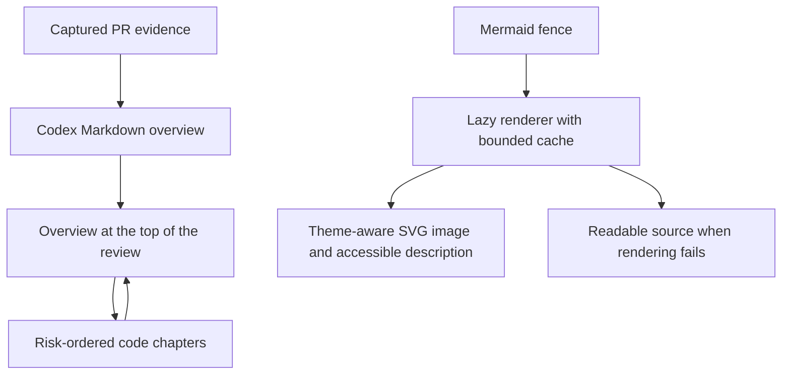

Mermaid loads only for overview diagram fences. Rendering is serialized, bounded to 20 KB/150 edges, cached for up to 32 source/theme combinations, and never triggered by ordinary scrolling. Strict rendering produces an isolated SVG image with natural dimensions, an accessible title/description, and expandable source. Configuration overrides and external-resource syntax are rejected. Invalid diagrams retain readable source without breaking the surrounding Markdown. GitHub comments and streaming chat keep their existing literal code-fence behavior.

- [x] 98 frontend tests and 76 Rust tests pass. Types, ESLint, Clippy, formatting, and production builds pass. Regressions cover overview navigation, empty guides, legacy content, diagram theme changes, failed/stale results, and renderer bounds/resource rejection.
- [x] Production WebKit renders actual Mermaid diagrams in light/dark modes at 1440 px and 720 px, with no nested vertical scroller or window overflow. Natural scrolling, outline jumps, first-chapter navigation, and return to the top all pass.
- [x] Live local Codex verification with GPT-6 Astra/Extra high produces a persisted version 3 guide with a 389-word Markdown overview, one accessible Mermaid flowchart, and four chapters. The actual generated diagram renders in production WebKit; the same saved model preference also produces a follow-up reply. This uses the invitation sample in an isolated data directory. A separate live GitHub capture attempt timed out at `/user` and is not counted as a passing check.
- [x] Light/dark/narrow axe WCAG A/AA checks report no violations. Invalid Mermaid and external-image syntax show readable source; the browser makes no requested external image fetches.
- [x] Install and verify the native ARM bundle after manual Mac unlock. The sample opens at its full Markdown overview, renders the accessible Mermaid image in dark mode, navigates to the first code chapter with heading focus, and returns to the overview with Previous section. All 10 private notes, settings, and model preference match the fresh pre-install SQLite backup byte for byte. Installed and packaged executable SHA-256: `fa9aa4e4130309f77329e814ae68df23c2db6b9bb467c4579fe154b5b553a5c2`; all bundled executables remain ARM-native and the strict signature check passes.
- [x] [CI passes on d0f43d2](https://github.com/crs48/diffcity/actions/runs/39712522348), including all 98 frontend tests, 76 Rust tests, architecture fixtures, and signed ARM packaging.

## Changes since your last review

A compact **Full PR / Since your last review** control appears above the review document. It identifies the comparison source, review date, and both commit IDs; a blue dot identifies a different head. The focused view shows only the exact reviewed-head-to-current-head file diff, with the existing unified/split layouts, file search, sticky headers, minimap, context expansion, and virtualization. Full PR returns to the complete guide and its existing notes/progress. The focused view does not reuse the full guide's explanations as if they described only the new changes.

The baseline is the later of an explicit private checkpoint and the viewer's latest submitted GitHub review (commented, approved, or changes requested). Pending/dismissed reviews and other people's reviews do not qualify. **Finish review → Save review checkpoint** saves the captured revision locally without publishing, changing hunk assessments, or discarding drafts. Confirmed GitHub publication records its submitted commit and date. Opening, capturing, prefetching, and AI analysis never advance the checkpoint.

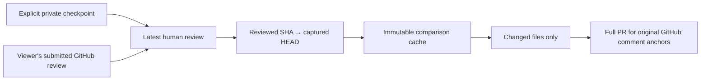

Comparisons and their context bases are stored separately from normal PR captures, so they cannot become the latest full review or alter progress transfer. Cached comparisons survive restart and work offline. Review history refresh failures retain the saved baseline and show a retryable warning. A missing baseline explains how to establish one. Identical commits or identical trees show an explicit up-to-date state; failures never masquerade as empty comparisons.

Right-side selections map to the same immutable head in the full PR before opening an inline composer. Left-side selections refer to the reviewed revision, not GitHub's original PR base. These and ranges absent from the full PR show guidance to choose a full-PR comment location. Rust rejects direct publication from comparison snapshots. Incremental-only inline conversations and incremental Codex guides are not implemented.

GitHub's comparison API supplies at most 300 files. A result reaching that limit is rejected rather than silently treated as complete. Rewritten history, a newer review than the captured revision, or an inaccessible reviewed commit falls back to an explanatory error with Full PR and retry available. Text fallback is bounded to 20 files/16 MiB, retaining visible unavailable-file entries for binary, metadata-only, or oversized changes. These are deliberate correctness limits, not an exact tree comparison for divergent histories.

- [x] 82 Rust tests (62 unit, 19 review invariants, one command/capability consistency check) and 107 frontend tests pass. Generated contracts, type checking, formatting, ESLint, Clippy, and signed ARM packaging pass.
- [x] Read-only live comparison of PR #2 from `471ca677` to `f5ead337` returns 23 files, +1450/−83, matching local `git diff` file-by-file with complete patches. An offline service restart returns the identical comparison.
- [x] PR #1 automatically selects the viewer's actual submitted GitHub review at `f5475290`, compares it with `db57c887`, and shows one file with one added line. No GitHub review or comment is posted by these checks.
- [x] The native sample demonstrates six changed files (+9/−7), including a rename, added locale, and removed draft absent from the full PR. Unchanged migration and documentation files are excluded.
- [x] Production WebKit verifies full/focused switching, private checkpoints and empty states, failure/retry, and a multiline selection opening the correct full-PR inline composer. Light/dark layouts at 1440 and 720 px have no window overflow or nested vertical scrollers. Settled-theme axe WCAG A/AA checks report no violations.
- [x] Native validation caught and fixed missing Tauri command permissions. A regression checks every registered app command against both the command manifest and main-window allowlist.
- [x] Installed the corrected ARM bundle and verified the comparison in the native app, leaving the sample open. All 14 private note/settings/model-preference documents match the pre-install SQLite backup byte for byte. All 11 bundled executables are ARM-native and the strict bundle-signature check passes.

## Ask AI about selected text

Native text selection in code now exposes a floating **Ask AI** action (also **Alt+Enter**). It immediately sends “Help me understand this selected code. What does it do, and how does it fit into the surrounding code?” Selecting line numbers still creates the existing line-based discussion. Text questions display the selected fragment inline and in the shared PR chat; follow-ups keep that fragment, source revision, side, line range, and UTF-16 character offsets. Different variables on the same line get separate threads.

Text conversations are AI-only. Their composers omit Save comment, and neither questions nor answers offer Prepare GitHub draft. Service validation rejects draft conversion, removal of the text anchor, and GitHub publication of text-selected notes. Existing line comments and publication remain available through the gutter.

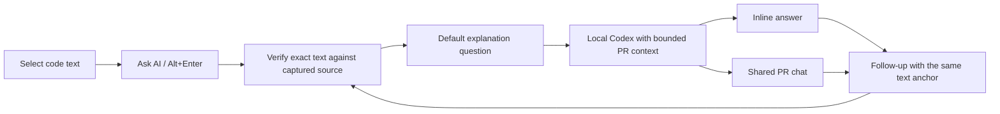

Selections may cover up to 200 consecutive source lines and 16,000 UTF-16 units within one file and one side. Mixed additions/deletions in unified view do not offer the action; select one side in split view instead. Expanded context is eligible after it has been captured. In “Since your last review,” the selected source retains the reviewed-to-current comparison identity while the private conversation belongs to the canonical PR workspace. Source is verified against cached immutable hunks/context before sending; columns cannot split Unicode surrogate pairs. Nearby code and historical selection excerpts are bounded separately from the exact current selection.

- [x] 88 Rust tests and 115 frontend tests pass, including precise selection, split columns, Unicode, multiple words on one line, keyboard action, follow-up identity, comparison source, bounded model context, persistence, and publication rejection.
- [x] Strict TypeScript, ESLint, Clippy, formatting, and production web build pass.
- [x] `cargo run -p diffcity --bin text-selection-smoke` sends the selected `invitationExpiry` identifier and a follow-up through the installed local Codex runtime using GPT-6 Astra / xhigh. Both answers retain the exact private anchor and survive reopening the isolated SQLite store. No GitHub write is performed.
- [x] Production WebKit verifies native pointer selection, one-click default questions, inline and shared-chat follow-ups, separate words on one line, Alt+Enter/Escape, backward multiline selections, split columns, reviewed-comparison old-side text, and expanded context. Light/dark and narrow layouts have no window overflow or nested diff/comment scrollbars. The full-page axe audit caught a stale review tab-to-panel reference; remounting the active panel and a keyboard regression fix it. Final sampled WCAG A/AA checks report zero violations.
- [x] Installed the final signed ARM app and verified native double-click selection → Ask AI → streamed explanation → follow-up → shared PR chat. Both answers persisted through quit/relaunch. All 14 pre-existing private documents remain byte-for-byte identical; exactly four private messages were added by the native sample check. The final accessibility update preserves all 18 documents. All 12 bundled executables have ARM slices, strict signature verification passes, and installed/packaged executable hashes match.

## Claude and saved guide versions — October 22, 2026

**New guide** now opens a provider/model/reasoning picker. The choice applies to that guide only; **Model** in the account rail still controls the default for subsequent requests and chat. **Saved guide** switches among immutable runs for the same captured revision, including repeated runs of the same model. Generating a guide keeps the current reading view in place until the reviewer opens the result. Existing guides migrate lazily into the history without losing their content.

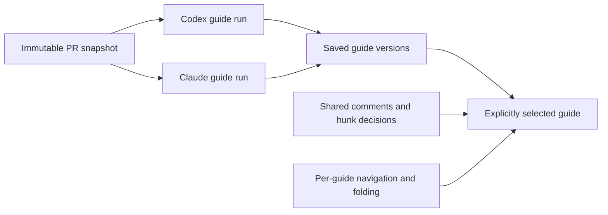

Claude Code uses its existing local login through the SDK streaming protocol. Its runtime supplies resolved model IDs and supported effort levels. Telemetry-disabled Claude startup omits older models from its standard picker, so the supported `modelPicker` setting explicitly includes Fable 5; runtime model restrictions still apply. Each turn checks the actual model, permits only structured-output tooling for guide generation, and rejects unexpected tool/MCP requests or missing structured output. Sessions are ephemeral, run outside the checkout, and disable customizations and hooks. The same provider routing supports private chat, with the actual model retained on each assistant message. See the [Claude CLI reference](https://code.claude.com/docs/en/cli-reference) and [model configuration](https://code.claude.com/docs/en/model-config).

Validation completed:

- [x] 93 Rust tests, 119 frontend tests, type checking, ESLint, Clippy, generated contracts, and formatting.
- [x] Real local accounts: Astra / Extra high produced a three-section guide with a 2,358-character overview; Fable 5 / High produced four sections and a 2,846-character overview of the same synthetic invitation PR. Both were retained, selected, and reopened after restart. Shared review decisions and the default preference survived. A Claude follow-up chat returned attributed model metadata.
- [x] Production WebKit: saved-run switching, another run of the same model, generation without moving the current view or default, selection persistence, and preserved review marks. Light/dark guide and picker plus a 720px guide report zero axe WCAG A/AA violations.
- [x] Installed ARM app: saved-guide menu switches between both real generated guides and their distinct overviews. The New guide dialog connects to the local Claude Code account, offers Claude Fable 5 / High, and enables generation.
- [x] All 13 bundled Mach-O executables contain ARM code and pass strict signature verification. The installed main executable matches the built bundle. All 18 pre-existing note/settings/model-preference documents match the fresh SQLite backup byte for byte. Two live-generated synthetic guides were added for immediate comparison; no GitHub feedback was published.

The isolated live check is repeatable with `cargo run -p diffcity --bin guides-smoke -- --infer`. It reuses saved successful runs when repeated. Manual VoiceOver coverage and direct API-key/cloud-account management remain separate work; this implementation connects the installed Claude Code runtime.
