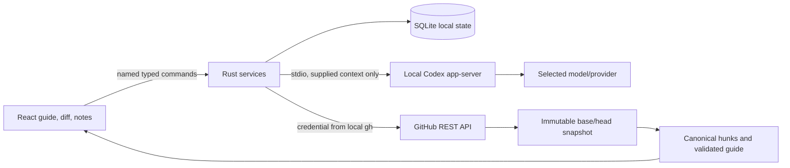

# Local alpha implementation

Updated October 20, 2026. This document describes the implemented application; the initial product plan also includes later distribution and product work.

## Runtime and architecture

The tested host uses macOS, x86_64, Rust 1.97.1, Node 23.11.1, pnpm 10.11.1, GitHub CLI 2.94.0, and OpenAI Codex CLI 0.163.0-alpha.10.2 bundled with the local desktop app. The source build recommends Node 24. The installed shell command named `codex` was an unrelated 0.2.3 executable, so runtime discovery selected the supported desktop-bundled binary without replacing that command. The local runtime supplied the model catalog and selected its default model.

The Rust contract definitions generate `packages/contracts/src/index.ts`. Domain parsing, line validation, attention floors, coverage, and unchanged-progress transfer are pure functions. Services coordinate the effectful GitHub, Codex, and SQLite adapters. The Tauri capability file explicitly allows named commands; credentials and shell execution are not exposed to the webview.

SQLite uses WAL and full synchronous writes with a versioned document table. Saved snapshots are keyed by repository and base/head identity. Notes retain the original snapshot and canonical side/range anchor. Prior revisions can be reopened without moving the latest-revision pointer. App-close and in-app navigation flush the note composer before leaving it.

Codex output must pass schema and evidence validation before replacing a guide. A hunk omitted by the model stays visible as unassessed. Unknown references, invalid line anchors, and duplicate primary coverage reject the proposed guide. Higher rule-derived attention wins over a model's lower classification. Routine content folds only after assessment, and groups with findings or discussions stay visible. The first step of an entirely routine PR opens by default.

GitHub publication has a persisted operation journal. It checks the current base/head, selected draft ownership, source coordinates, existing pending reviews, and self-review restrictions. An ambiguous outcome is reconciled by exact remote review and comment evidence; it is not automatically reposted. Model discussions and private notes are excluded unless deliberately converted to selected drafts.

## Validation evidence

- [x] Strict TypeScript, ESLint, Rust formatting, and Clippy pass.
- [x] Unit and integration tests cover canonical additions/deletions, multiline anchors, incomplete patches, attention floors, invalid model output, omitted coverage, unchanged progress transfer, and explicit publication payload selection.
- [x] Live local GitHub identity, repository inbox, Codex handshake/model catalog, guide generation, and selected-line discussion succeed.
- [x] The packaged WKWebView reaches a real GitHub PR, generates and displays a grounded Codex guide, saves a line discussion, and previews only deliberately prepared GitHub feedback.
- [ ] Final native restart, cancellation, and new-revision journey passes after the recovery changes.
- [ ] The explicitly authorized test review is posted and reconciled through the native app.
- [ ] A normal production bundle is built, installed, opened, and verified without the test driver.
- [ ] The GitHub Actions build passes on the pushed implementation.

Native screenshots, logs, and isolated test databases live under ignored `.local/native-e2e/`. They are development artifacts, not shipped assets. The synthetic draft PR contains deliberate migration and authorization issues and is not intended to merge.

## Current boundaries

The personal alpha uses an existing GitHub CLI login. GitHub App onboarding and organization installation flows are not implemented. It supports github.com, one GitHub identity per local data directory, and read-only model analysis. The app can publish new reviews and read remote feedback; thread resolution and targeted replies to existing review threads remain later work.

Large or unavailable GitHub patches are reported as incomplete; there is no Git-object download fallback yet. The model receives a bounded 180,000-character hunk context. Diff rows are virtualized, but the full large-PR benchmark and curated comparative guide-quality study have not been completed. No claim that this guide outperforms Linear or Diffity has been established.

The local macOS bundle is not a signed/notarized release, and other OS/architecture combinations are not yet validated. Auto-update, public downloads, the diff.city website, dependency-license audit, and clean-machine distribution gates remain on the release roadmap. Repository visibility stays private until the owner chooses a public launch.
