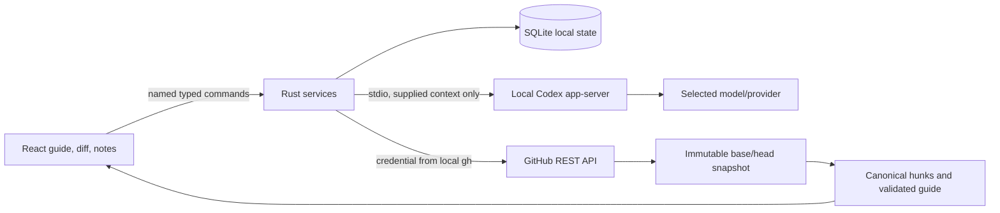
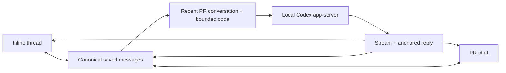
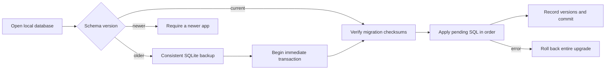
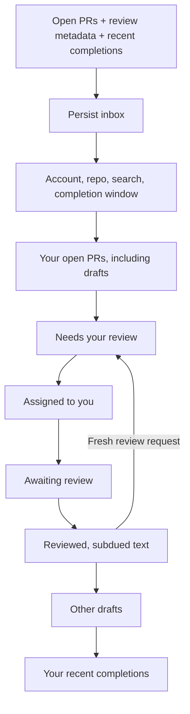
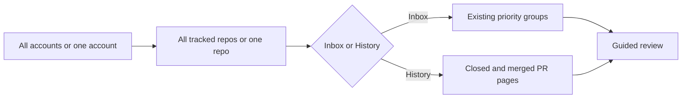

# Local alpha implementation

Updated October 20, 2026. This document describes the implemented application; the initial product plan also includes later distribution and product work.

## Runtime and architecture

The tested host runs the x86_64 app through Rosetta on macOS 26.7, with Rust 1.97.1, Node 23.11.1, pnpm 10.11.1, GitHub CLI 2.94.0, and OpenAI Codex CLI 0.163.0-alpha.10.2 bundled with the local desktop app. The source build recommends Node 24. The installed shell command named `codex` was an unrelated 0.2.3 executable, so runtime discovery selected the supported desktop-bundled binary without replacing that command. The local runtime supplied the model catalog and selected its default model.

The Rust contract definitions generate `packages/contracts/src/index.ts`. Domain parsing, line validation, attention floors, coverage, and unchanged-progress transfer are pure functions. Services coordinate the effectful GitHub, Codex, and SQLite adapters. The Tauri capability file explicitly allows named commands; credentials and shell execution are not exposed to the webview.

SQLite uses WAL and full synchronous writes with a versioned document table. Saved snapshots are keyed by repository and base/head identity. Notes retain the original snapshot and canonical side/range anchor. Prior revisions can be reopened without moving the latest-revision pointer. App-close and in-app navigation flush the note composer before leaving it.

Codex output must pass schema and evidence validation before replacing a guide. A hunk omitted by the model stays visible as unassessed. Unknown references, invalid line anchors, and duplicate primary coverage reject the proposed guide. Higher rule-derived attention wins over a model's lower classification. Routine content folds only after assessment, and groups with findings or discussions stay visible. The first step of an entirely routine PR opens by default.

GitHub publication has a persisted operation journal. The successful result and all selected draft updates commit in one SQLite transaction. A failed transaction leaves the prior operation state available for reconciliation. It checks the current base/head, selected draft ownership, source coordinates, existing pending reviews, and self-review restrictions. An ambiguous outcome is reconciled by exact remote review and comment evidence; it is not automatically reposted. Model discussions and private notes are excluded unless deliberately converted to selected drafts.

## Validation evidence

- [x] Strict TypeScript, ESLint, Rust formatting, and Clippy pass.
- [x] All 28 Rust tests and 14 TypeScript/component tests pass. Tests cover canonical additions/deletions, multiline anchors, incomplete patches, attention floors, invalid model output, omitted coverage, unchanged progress transfer, explicit publication payload selection, dialog focus, keyboard navigation, appearance, full-line reading, range selection, and exact-range Codex context.
- [x] Live local GitHub identity, repository inbox, Codex handshake/model catalog, guide generation, and selected-line discussion succeed.
- [x] The packaged WKWebView reaches a real GitHub PR, generates and displays a grounded Codex guide, saves a line discussion, and previews only deliberately prepared GitHub feedback.
- [x] Native restart, cancellation, and new-revision recovery pass. A real push changed the migration hunk, invalidated its review mark, and left earlier notes accessible.
- [x] The explicitly authorized [test review](https://github.com/crs48/diffcity/pull/1#pullrequestreview-5593137216) was posted through the native app and reconciled into its line discussion. The original submission targeted RIGHT line 1; after the synthetic push GitHub reanchored it to line 2. The remote feedback contains exactly the approved inline text plus the labeled summary; the private question and model reply are absent.
- [x] A normal production bundle was built and installed at `~/Applications/diffcity.app`. Its release dependency features exclude the WebDriver plugin, and the installed executable hash matches the built executable.
- [x] Open the installed production app and render its sample guide.
- [x] Verify live GitHub and Codex connections in the installed production app. After unlocking the host, the normal installed bundle connected as `crs48`, loaded the synthetic PR and checks, generated a fresh Codex guide, and streamed a private line-scoped answer.
- [x] Quit and relaunch the installed production app. Both connections returned, the generated guide and two reviewed hunks persisted, and the private question and answer reopened on migration line 2 alongside the existing GitHub comment. Light appearance persisted; System appearance was restored after the check.
- [x] In the updated production bundle, select migration lines 2–3 with Shift-click, save a private comment, and send it using **Ask Codex about this comment**. The live reply discusses both the required-column rollout and index locking. Quit/relaunch and reopen the thread through **Other discussions in this change**; both messages retain the identical RIGHT-side 2–3 anchor and remain private in SQLite.
- [x] [GitHub Actions](https://github.com/crs48/diffcity/actions/runs/39521404628) passed contract generation, formatting, types, lint, tests, and the unsigned desktop build, including the monochrome themes and accessibility changes. The [shared inline-chat run](https://github.com/crs48/diffcity/actions/runs/39537558283), [layout-fix run](https://github.com/crs48/diffcity/actions/runs/39537744633), and [final chat-ordering run](https://github.com/crs48/diffcity/actions/runs/39538162805) also passed all checks and the unsigned desktop build.

The native harness initially exposed a stale-analysis race and two test synchronization problems (clicking before refresh completed and an unbounded driver request). Snapshot guards, readiness waits, and request timeouts were added. The final resumed run completed without reposting the approved review.

The installed production app's live connection and restart checks are complete. Its fresh three-section guide put migration safety and tenant boundaries first, with findings anchored to the changed lines. A private question about the migration received a streamed three-step rollout answer. The Finish review dialog showed no selected GitHub drafts and disabled publication, confirming that this discussion remained private. The previously approved GitHub test comment appeared on its current line; no additional review was published during this check.

Earlier connection attempts timed out for Rust TCP clients while curl and Python succeeded. Those timeouts did not recur in either installed-app launch after the host was unlocked. A later inline-chat restart returned `tls handshake eof` from GitHub; **Save and reconnect** restored the existing account and live checks on the next attempt. The connection failures’ cause remains unconfirmed; no firewall or network-filter setting was changed. Connection errors retain their underlying cause, and `DIFFCITY_CONNECT_ONLY=1` runs the service smoke check without model inference.

Native screenshots, logs, and isolated test databases live under ignored `.local/native-e2e/`. They are development artifacts, not shipped assets. The synthetic draft PR contains deliberate migration and authorization issues and is not intended to merge.

Inline discussions use the exact selected range for their thread identity and appear beneath its final line. PR chat mirrors those same saved messages and includes code links back to their guide section. A response inherits its question’s snapshot, side, and endpoints even if the reviewer changes selection while it streams. PR-wide questions have no code anchor. Every request rebuilds a bounded recent conversation across the current snapshot, with separately identified exact selection and supporting PR code; it does not retain a long-running Codex thread.

- [x] Inline and sidebar replies share message IDs; mirroring never writes duplicate messages. A PR-wide answer stays in chat, and a pending inline answer stays on its original range after selection changes.
- [x] Draft state survives guide navigation and virtualized rows. Failed saves retain the composer, and overlapping saves reuse the original note ID.
- [x] An 80-line WebKit fixture with an expanded thread between rows preserves drag selection on lines 11–12 and keyboard selection on 79–80 while virtualizing code rows.
- [x] Sampled light and dark inline/chat states have no axe-core WCAG A/AA violations. This is not a complete assistive-technology audit.
- [x] The installed production app answered a private question on migration lines 2–3 in both the inline thread and PR chat. A PR-wide follow-up correctly recalled the “Lantern” plan name and locking safeguard from that inline discussion. SQLite contains one question/reply pair with the RIGHT-side 2–3 anchor and one pair with no anchor; all four remain private.
- [x] Focus in long threads stays inside the reading area. The 80-line WebKit regression renders 29 code rows at the end of the diff, with the app scroll offset and header top both zero.
- [x] The final production build restored all eight private messages, the existing GitHub feedback, and both live connections after restart. PR chat shows the latest agent reply after older GitHub feedback. The installed executable SHA-256 is `f0f91fd08a38e55e6b399c06266c8b7d93d1a7ae3d66d0526d6ce895a35e1b43`, matching the built bundle.

## Current boundaries

The personal alpha uses an existing GitHub CLI login. GitHub App onboarding and organization installation flows are not implemented. It supports github.com, one GitHub identity per local data directory, and read-only model analysis. The app can publish new reviews and read remote feedback; thread resolution and targeted replies to existing review threads remain later work.

Missing or truncated GitHub text patches use a bounded reconstruction fallback from immutable merge-base/head file contents. Capture checks the reconstructed addition/deletion counts against GitHub; binary, metadata-only, oversized, and mismatched files remain explicitly unavailable. The fallback permits 20 files, 2 MiB and 50,000 lines per file side, and 16 MiB total. Diff computation has a 750 ms deadline. The model receives a bounded 180,000-character hunk context. Diff rows are virtualized. A real 16,868-line GitHub fixture now exercises large capture and rendering; this is a bounded corpus check, not a broad performance benchmark. A curated comparative guide-quality study has not been completed. No claim that this guide outperforms Linear or Diffity has been established.

The local macOS bundle is not a signed/notarized release, and other OS/architecture combinations are not yet validated. Auto-update, public downloads, the diff.city website, dependency-license audit, and clean-machine distribution gates remain on the release roadmap. Repository visibility stays private until the owner chooses a public launch.

## Historical reviews, languages, and schema upgrades

Open PRs remain the default inbox. **History** pages through closed and merged PRs for the selected repos, retaining cached pages during connection failures. PR URLs work independently of state. A historical snapshot supports the guided flow, private discussions, and Codex; GitHub publication requires an open PR and is checked again immediately before posting. Reopening a cached snapshot refreshes its PR metadata without changing its code anchors.

The interface uses i18next and react-i18next, with English and Spanish catalogs in `apps/desktop/src/locales/`. **Connections → Language** persists the selection in SQLite and updates the document language. Catalog tests check matching keys, interpolation variables, plurals, and English fallback. Repository content and generated review prose retain their original language. Add a new locale by registering its catalog in `src/i18n.ts` and the supported settings values in Rust.

SQLite upgrades run numbered SQL files from `apps/desktop/src-tauri/migrations/`, registered in order in `src/migrations.rs`. Version 1 is the original document store; version 2 adds snapshot/update indexes; version 3 supplies the language preference. Before upgrading an existing database, the app creates a consistent `before-schema-<version>-<timestamp>.sqlite` backup beside it. All pending migrations run in one immediate transaction. A failed step rolls everything back. Recorded checksums prevent edits to already-applied migrations, and a newer database version fails closed rather than being downgraded. Append a new migration and add it to the manifest; never rewrite an applied file. Test both a fresh database and an upgrade containing saved review data.

The large-text fallback uses the PR merge base rather than the target branch tip, so unrelated changes on the target branch cannot enter the reconstructed diff. It reads through GitHub's authenticated contents endpoint without following redirects. Snapshot capture format version 2 keeps newly reconstructed code separate from earlier incomplete captures. [GitHub content media types](https://docs.github.com/en/rest/repos/contents) and the [similar diff library](https://docs.rs/similar/latest/similar/) document the underlying APIs.

## Expanded corpus verification (October 20–21, 2026)

- [x] 36 Rust tests and 18 TypeScript/component tests pass, with types, ESLint, Clippy, formatting, and the production app build.
- [x] [Implementation CI](https://github.com/crs48/diffcity/actions/runs/39540803966) passes on commit `f383c36`, including the unsigned native bundle.
- [x] Five new PRs are available in the [review corpus](../tests/corpus/README.md): one actual implementation, three open synthetic drafts, and one closed, unmerged historical fixture.
- [x] The live Rust service captures all 8,580 additions and 8,288 deletions of PR #3 across 18 textual hunks, including a reconstructed 7,500-line hunk. Binary, rename-only, and mode-only files remain visible with explicit text limitations. Every captured addition/deletion anchor validates.
- [x] Live Codex analysis of PR #4 produces two guided sections and three findings covering the required-column rollout, destructive note deletion, and skipped backup. A private reply preserves its RIGHT-side lines 2–3 anchor.
- [x] WebKit replays the actual captured PRs: saves a LEFT-side lines 1–2 discussion, reaches RIGHT line 4,000 while keeping fewer than 100 rows mounted in the 7,500-line hunk, displays renamed paths and binary limitations, and renders the closed PR with publication disabled.
- [x] Sampled light/Spanish history and dark guided-review states pass axe WCAG A/AA checks. This does not replace a complete assistive-technology audit.
- [x] The installed production app upgrades the real schema 1 database to schema 3, preserving all eight private messages. Its consistent pre-upgrade backup also contains all eight messages and remains at schema 1.

The current installed executable SHA-256 is `bef045cee7c82e013f9b8945ca8091c1c1fa7af8990f7a42c180b2107407f363`, matching the build from `f383c36`. Native UI and restart verification completed on October 21 after the host was manually unlocked. Two earlier large-PR Codex attempts encountered GitHub connection timeouts before analysis; the installed app subsequently captured the PR and completed its Codex review. No network or security settings were changed.

- [x] In the installed production app, **Save and reconnect** restores the existing GitHub and Codex connections after the locked-host timeouts. History loads closed PR #6 and renders its additions and deletions. Publication remains disabled with a nonempty review summary; no review is posted.
- [x] Selecting Spanish translates the native interface. After quitting and relaunching, Spanish, closed PR #6, and both live connections return. SQLite remains at schema 3 with exactly three migration entries and all eight original private messages. English is restored after the check.
- [x] The installed app captures all 16,868 changed lines in PR #3. Its 7,500-line generated-data hunk reaches RIGHT line 4,000 with 30 code rows in the accessibility tree.
- [x] A fresh native Codex review creates an 18-section guide, placing the workspace migration and destructive cleanup first, followed by authorization changes and the API contract. Findings identify the missing migration backfill, deletion of every note, and missing required API path parameter. The bounded context supplies eight of 18 textual hunks; all ten omitted hunks remain visible as unassessed, alongside explicit binary and metadata limitations. Full capture does not imply full model coverage.

## Repo inbox priority

GitHub repositories are labeled **repos**. The Inbox groups each PR once: your open PRs (including drafts), review requests, assigned work, other PRs awaiting review, reviewed PRs, other authors' drafts, then your recent completions. Within a group, recent activity sorts first; completed items use their completion time. Submitted GitHub reviews reduce priority and use subdued text with explicit status labels. A current review request overrides an earlier review. Private notes, Codex discussion, and local reading progress do not count as submitted reviews. Review-request matching currently covers individual requested reviewers; team-level requests are not expanded into membership.

**Display settings** in the inbox header controls recently completed work: hidden, 24 hours, two days (default), one week, or 30 days. The preference is saved in SQLite with a backward-compatible default for older settings. Only your own completed PRs appear in the Inbox; **History** includes every author's closed and merged PRs independently of that preference.

[GitHub's review fields](https://docs.github.com/en/graphql/reference/pulls) supply the signed-in user's latest submitted review and the aggregate review decision in batches of 25 PRs. Pending or dismissed reviews do not count as completed reviews. Current REST reviewer requests determine re-request priority. Recent completions use the paginated closed-PR list, stopping when the page falls outside the update window and filtering by actual `closed_at`; an old PR with a new comment cannot masquerade as recently completed. This avoids search-index lag. Pagination-budget failures retain the previous inbox and report an error instead of silently reporting complete results.

The separate **Sample inbox** contains 23 labeled, fictional scenarios and a session-only review-request simulator. Its cards open real local walkthroughs, but sample identities are blocked from GitHub publication in both the UI and Rust service. The [corpus guide](../tests/corpus/README.md#inbox-ux-samples) documents nine additional live GitHub PRs and reproduction commands.

### Inbox verification (October 21, 2026)

- [x] 42 Rust tests and 24 TypeScript/component tests pass. Type checking, ESLint, Clippy, formatting, contract generation, and the production bundle pass. [GitHub Actions](https://github.com/crs48/diffcity/actions/runs/39622030393) passes on `ef57f00`.
- [x] Live inbox capture returns 12 open PRs, including seven drafts, plus three recent completions. All open PRs have fetched review metadata, including the original authorized review on PR #1.
- [x] WebKit verifies all seven priority groups, review demotion and re-request promotion, completion filtering, preference persistence across reload, complete sample history, and a narrow 900-pixel layout. Sampled light/dark states pass axe WCAG A/AA after theme transitions settle.
- [x] The installed production app connects to GitHub and Codex, shows owned draft/ready PRs together, and opens actual ready PR #7, draft PR #11, and recently closed PR #14 with their code.
- [x] Native Sample inbox moves PR #106 into Reviewed after a simulated submission and back into Needs your review after a simulated re-request. No GitHub communication occurs.
- [x] A one-week completion window adds the four-day-old merged sample. After quitting and relaunching, the saved preference, prior real PR, and both connections return. The default two-day window is restored afterward. All eight original private messages remain intact at schema 3.

The installed bundle matches the build from `ef57f00`; its executable SHA-256 is `1e7829616ecbac8a8de7e5401a1b1f414d0115ac8039885649cbc637ddb7f97e`. The synthetic GitHub PRs remain unmerged. Sample metadata resets when reloaded, while sample notes and code-reading progress are stored separately for each sample.

## Compact account navigation

A 64-pixel rail selects **All accounts**, a GitHub organization, or a personal account. Accounts are derived from tracked repo owners and use monochrome GitHub avatars with initials as an offline fallback. The selected account name remains visible in the inbox header. A labeled **Repo** selector narrows its tracked repos; under All accounts, options include the owner to distinguish same-name repos. The standard PR list is 300 pixels wide, leaving 111 more pixels for the review than the former 205 + 270 pixel layout.

Account changes reset the repo filter and preserve search and the Inbox/History choice. Removing a tracked repo falls back to its account; removing the last repo for an account falls back to All accounts. Both local filtering and history requests honor the account. Rust validates the selected account/repo against tracked repos before making requests, and cached history pages retain the exact repo set as their key. In-flight responses from an old account are discarded; changing tracked repos reloads history.

The rail has 44-pixel circular buttons, named controls, React Aria hover/focus tooltips, and a selected outline/edge marker. The native repo selector supports keyboard navigation and type-ahead. The account list scrolls independently when many accounts are tracked. Connections and the two sample entry points remain available at the bottom. Avatar image loading is limited by CSP to GitHub and its avatar host; no GitHub tokens enter the webview. The narrow-window search focus target now works independently of the selected language.

### Compact navigation verification (October 21, 2026)

- [x] 43 Rust tests and 28 TypeScript/component tests pass, alongside type checking, ESLint, Clippy, and formatting. Coverage includes account/repo isolation, repo removal fallback, failed avatar loading, keyboard selection, history request scope, and stale history responses.
- [x] Production WebKit replay verifies three account owners, narrowing from account to repo, restoring All accounts, live-history fixtures, and 64/300-pixel panel widths. The real account avatar loads; unavailable fixture avatars retain initials.
- [x] Light account navigation and dark guided-review states report no axe WCAG A/AA violations. A 1000-pixel window switches between inbox and review without horizontal overflow and returns keyboard focus to search. These automated checks do not replace a full assistive-technology audit.

- [x] The installed native app loads the real `crs48` avatar, scoped repo menu, 12 open PRs, and three historical PRs. Selecting `diffcity` preserves the account scope; opening closed PR #15 renders its code. A transient GitHub TLS handshake failure on the first launch recovered through the existing Save and reconnect action. The final build restarts with a live inbox and restores PR #15 without the connection error. All eight private notes remain at schema 3.

The installed executable matches the bundle built from `d44bd6e`, SHA-256 `5144f59116bdc2fb6fe55c2fe72b4404e8dc79bb4126b29a216d0f42e6b244d8`. WebKit's native select appearance initially ignored the desired control height; an explicit chevron now preserves native select semantics while allowing a verified 34-pixel target. [Navigation CI](https://github.com/crs48/diffcity/actions/runs/39624993187) passes on `d10c7d8`; the final select styling also passes all local checks and the production bundle.
