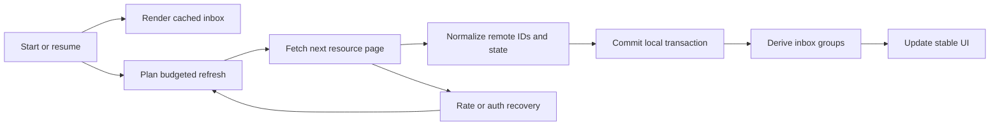

# 02 — GitHub connection and PR inbox

## Objective and dependencies

Turn selected GitHub repositories into a dependable personal PR inbox. Depends on step 01's desktop, persistence, and adapter boundaries.

## Proposed touchpoints

`packages/github`, `packages/domain/inbox`, `packages/domain/sync`, `packages/storage`, and `apps/desktop/src/renderer/features/{onboarding,projects,inbox}`.

## Implementation

For private dogfooding, connect the existing `gh` account with explicit in-app selection. Display account identity and capabilities. Keep one account active initially, with account/host IDs in every cache key. Reauthentication must not associate old drafts with a different account silently.

Prototype the distributable GitHub App device flow now, including refresh, installation/repository discovery, and an organization-owned repository. Finish that flow before inviting external users in step 07. Never embed an app secret or private key in the desktop bundle. Use the [device-flow](https://docs.github.com/en/apps/creating-github-apps/writing-code-for-a-github-app/building-a-cli-with-a-github-app) and [token-refresh](https://docs.github.com/en/apps/creating-github-apps/authenticating-with-a-github-app/refreshing-user-access-tokens) contracts.

Create repository search, pin/unpin/reorder, explicit repository selection, and PR URL opening. Store stable repository IDs so renames do not lose state. Do not assume the currently accessible repositories equal every repository on the user's GitHub account.

Fetch open PRs from selected repositories with pagination. Hydrate author, assignee, requested-reviewer, draft, and check summaries without loading every file or comment. When additional team membership access is missing, show that limitation. Use a pure selector for mutually exclusive bucket assignment: mine → review requested → assigned → other. Show secondary relationship badges and preserve stable focus during refresh.

Implement the shared request scheduler from [architecture.md](architecture.md). Persist cursors and last-success timestamps. Cache responses immediately for fast subsequent launch. Prioritize visible repositories and the active PR; back off on rate limits, offline state, repeated access failures, and app sleep.

## Validation and edge cases

Test author + reviewer + assignee overlap, a team request, an unavailable team membership, drafts, repository rename, more than 100 PRs, closing/merging a visible PR, and revocation mid-pagination. Treat failed or incomplete pagination as partial data, not an empty repository.

Use a fake clock to demonstrate that two windows do not double polling, a selected PR gets priority, secondary limits pause dispatch, and wake-up schedules reconciliation. Read current limits from responses; avoid correctness assertions tied to a hardcoded hourly quota.

## Checklist and exit criteria

- [ ] Connect and display the GitHub identity and access state.
- [ ] Add selectable/pinned repositories and direct PR links.
- [ ] Normalize and paginate PR lists.
- [ ] Implement stable inbox grouping, filtering, and unread badges.
- [ ] Implement one budgeted scheduler and recovery states.
- [ ] Validate the GitHub App flow or record a concrete blocker for distribution.

**Exit:** the owner can find their own PRs first, requested reviews next, and other open PRs after that across selected projects. A remote change becomes visible and a rate-limit response produces a truthful backoff state.
