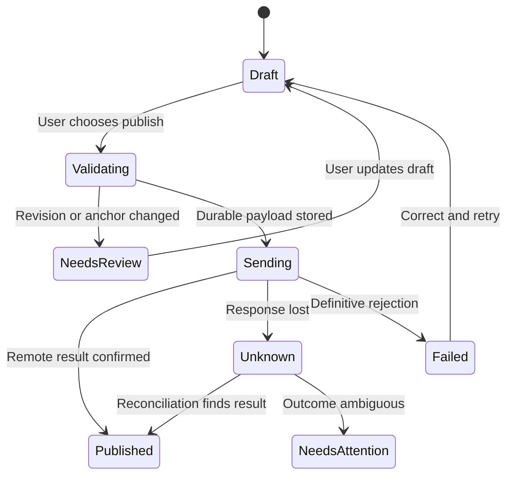

# 05 — Publish feedback and complete reviews

## Objective and dependencies

Complete the round trip from private review work to GitHub, with clear publication intent and recoverable failures. Depends on snapshots, anchors, notes, GitHub identity, and the scheduler from steps 01–04.

## Proposed touchpoints

Rust modules under `apps/desktop/src-tauri/src/{github,domain,storage,commands}` for comments/reviews/threads, drafts, publication rules, and operation journals; React features under `apps/desktop/src/features` for draft selection, finish review, and GitHub threads. Rust revalidates the exact payload and account/revision before dispatching any write.

## Implementation

Keep three concepts separate: local conversation, prepared GitHub draft, and canonical remote comment. Converting a note or model answer creates an editable draft copy with provenance. Later local edits do not silently modify a published comment.

Support these commands:

| Command | Adapter operation | Required context |
| --- | --- | --- |
| Post overall comment | PR issue-comment endpoint | Account, PR, exact body |
| Post inline comment | Review-comment endpoint | Validated path, side/range, reviewed commit |
| Reply | Review-comment reply or issue comment according to thread kind | Exact remote root ID and body |
| Submit review | Create/continue pending review, then submit selected event | PR, commit, selected comments, summary |
| Resolve/unresolve | GraphQL thread mutation | Remote thread node ID and viewer capability |

Use modern line/side/range parameters where supported rather than display offsets. Keep endpoint-specific payload builders separate; REST batch-review and individual-comment payloads are not automatically interchangeable. See [review comments](https://docs.github.com/en/rest/pulls/comments), [reviews](https://docs.github.com/en/rest/pulls/reviews), and [GraphQL PR operations](https://docs.github.com/en/graphql/reference/pulls).

Open the finish screen directly from Guide. Preview exact text, selected comments, review action, account, destination repository, and reviewed revision. Report code-reviewed, summary-acknowledged, deferred, unassessed, and unavailable coverage separately, with high-attention work remaining linked back to its step. Do not imply that collapsed routine groups were reviewed. The reviewer can intentionally submit a partial review; truthful coverage is context, not an arbitrary requirement to expand every file. Unselected notes and Codex messages stay local. Self-review permits Comment and disables Approve/Request changes. Enforce viewer capabilities and handle server-side restrictions even after a successful preflight.

Refresh the PR before dispatch. If base/head/diff changed, retain the draft and require inspection/remapping of affected anchors. An out-of-diff line remains local until the user chooses an explicit alternative. Pin the reviewed commit on the remote review. Re-fetch after publication to detect code changes racing with the write.

Persist a journal entry before each operation and serialize writes per account. Save remote IDs as soon as received. A review with several API steps records each success and can resume without recreating earlier comments. Detect an existing pending review before creating another; surface its provenance and allow continuation or opening in GitHub rather than silently overwriting it.

Do not promise exactly-once remote delivery. A local operation UUID only prevents local duplicate dispatch. Reconcile uncertain writes against remote identity, commit, anchors, body, and time. If the result remains ambiguous, present matching remote records and require an explicit retry decision in the product. Offline publication waits as a local draft; it does not auto-send on reconnection without a fresh user action.

Refresh canonical remote discussions after writes and display them at their anchored code within Guide. Track remote edits, deletions, resolved state, and outdated anchors. An unresolved thread prevents automatic folding of its group; following a thread reveals the code while preserving the reader's return position. Explicit user edits can update an existing remote comment; compare with the latest remote body before overwriting external changes.

## Validation and edge cases

Run adapter tests for 401, permission 403, secondary-limit 403/429, validation 422, and connection loss both before and after server acceptance. Test a head advancing during publication, the user's own PR, existing pending reviews, multi-line deletions, replies, and an externally edited comment.

Verify one real test PR round trip manually: local draft → GitHub review → fetched canonical thread. Test fixtures are synthetic and carry no private source. End-to-end tests must explicitly assert private text is absent from transmitted payloads.

## Checklist and exit criteria

- [ ] Add explicit draft conversion and selected-message previews.
- [ ] Complete review submission from Guide with honest coverage and return links.
- [ ] Add overall/inline comments, replies, and review events.
- [ ] Add resolve/unresolve with capability checks.
- [ ] Validate revision and anchors before every publication.
- [ ] Persist operation states and reconcile unknown results.
- [ ] Import canonical remote feedback and external edits.
- [ ] Demonstrate failure recovery without duplicate feedback.

**Exit:** finish a review from Guide, publish only the chosen feedback to a test PR as the user, view the same comments in GitHub and their guide steps, and recover an interrupted submission without losing drafts or blindly posting twice.
