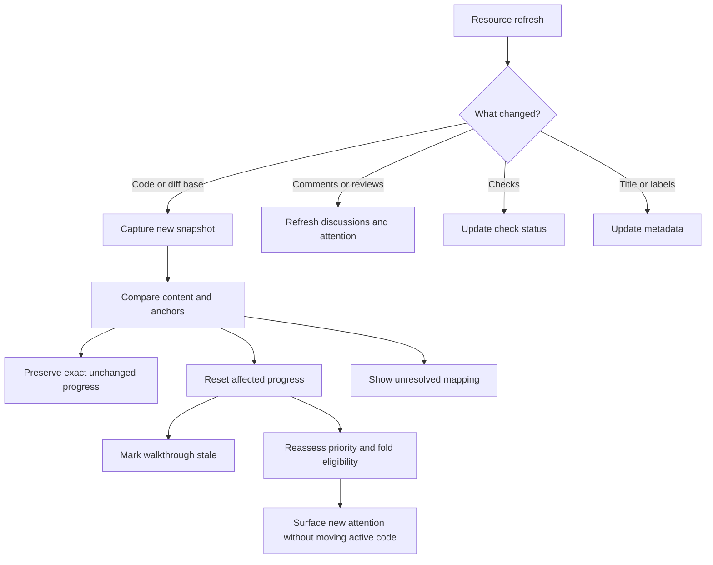

# 06 — Stay oriented as the PR changes

## Objective and dependencies

Make returning to a PR feel continuous: identify new work, preserve context, and avoid presenting stale analysis as current. Depends on steps 02–05.

## Proposed touchpoints

Rust modules under `apps/desktop/src-tauri/src/{domain,storage,github}` for revisions, progress, anchors, sync, snapshot retention, and remote refresh; React features under `apps/desktop/src/features` for activity, changed-since-review, and stale discussions.

## Implementation

Store three separate revision markers: latest captured, last opened, and last explicitly reviewed. Store per-resource activity watermarks for comments and checks. Viewing the PR list acknowledges neither review completion nor every discussion; define unread acknowledgement separately for each visible activity type.

When code changes, capture a new immutable snapshot. Keep the old one pinned while it is referenced by a note, walkthrough, or review. Do not replace the active reading surface immediately. Show Update available and a deliberate action to inspect the new revision.

Calculate changed-since-review using saved old/new content. Compare hunk fingerprints and blob identities, then use conservative content mapping for moved ranges. Mark an unchanged exact match as transferable progress; a modified hunk becomes unreviewed. Similarity alone never relocates a published draft without inspection. Ambiguous duplicates, rename-and-edit cases, and missing old source retain their original context and show a remapping decision.

Re-evaluate attention, dependencies, and automatic fold eligibility for changed code and affected context. A migration introduced into a previously routine/deferred group must become a visible attention item; the old collapsed state cannot hide it automatically. Keep the user's earlier deferral as history, and mark changed content pending a new decision. Reconsider priority overrides against the new snapshot. Summary acknowledgements transfer only for exactly unchanged summarized content; they never turn into code-reviewed progress.

A base branch update or retarget can change the PR diff without a new head SHA. Use the full snapshot fingerprint and base identity to invalidate analysis. A force-push may remove commit ancestry; content comparison still works when snapshots are retained. If they were evicted, explain that the prior comparison is unavailable rather than inventing a delta.

Invalidate narrowly: check updates do not require a new code walkthrough; discussion changes make discussion summaries stale and update fold eligibility; code changes affect walkthroughs and anchors. Carry validated unchanged section content forward only with visible provenance. The safe first implementation regenerates the overall walkthrough on demand; incremental model analysis is a later optimization after correctness is established. Deterministic attention rules and coverage update immediately without an automatic model call. Cache derived guide policy versions separately from model assessments so policy-only changes do not require paid regeneration.

Do not reorder or collapse the active guide step during a poll, incoming analysis result, or discussion update. Preserve scroll, selection, and composer. Show a new-attention/update notice and offer the revised route at the next explicit navigation boundary. New high-attention work remains discoverable even when the current review is paused or the prior group was manually folded.

Batch related activity into useful messages rather than notifying per API response. Desktop notifications are opt-in and should correspond to review requests, replies, or new code relevant to an active review. The app reconciles after sleep/reconnect and makes its last successful sync clear. No always-on daemon is required for MVP.

## Validation and edge cases

Test ordinary pushes, force-pushes, rebase, base branch advancement, retargeting, rename-only, rename-and-edit, identical repeated hunks, deleted fork branches, closure, merge, and reopening. Show that unrelated changes preserve exact code-reviewed progress while modified code resets it. Add a new high-attention hunk inside a folded/deferred group and a new unresolved comment on routine code; verify they become visible attention work without disrupting active typing. Test that unchanged text with changed dependency context is re-assessed rather than blindly inheriting its prior routine classification.

Pause publication and an analysis run while a push occurs. Confirm each retains its original revision, the pending answer is labeled correctly, and the new snapshot is available without disrupting typing. Simulate several events between polls; reconciliation must converge to authoritative state even without a complete event history.

## Checklist and exit criteria

- [ ] Separate latest/opened/reviewed revision markers and unread activity.
- [x] Capture revisions and preserve referenced old context.
- [ ] Implement changed-since-review and conservative anchor mapping.
- [ ] Invalidate walkthroughs and progress accurately.
- [ ] Reassess attention, fold eligibility, summary acknowledgements, and reviewer overrides.
- [ ] Surface newly consequential changes while preserving the active guide position.
- [x] Handle metadata, discussions, and checks independently.
- [ ] Add wake/reconnect convergence and optional notifications.
- [ ] Validate the revision-change scenario matrix.

**Exit:** review a PR, push another change, and return to a view that shows exactly what needs attention while preserving prior notes, discussions, and unchanged progress.
