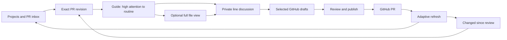

# diffcity: product and implementation plan

**Prepared:** October 20, 2026 · **Status:** local macOS alpha implemented; distribution and broader product gates remain

diffcity makes GitHub pull requests easy to understand, discuss, and revisit. Its primary experience is a Codex-guided review that puts consequential changes first, explains why they deserve attention, and folds assessed routine work into inspectable summaries. The personal PR inbox and GitHub feedback loop support that review experience.

The plan folder name `initial-product` is inferred from this being the project's first specification. The core experience is defined in [guided-review.md](guided-review.md); surrounding product details live in [product-spec.md](product-spec.md), and engineering contracts live in [architecture.md](architecture.md). Read those before executing the numbered steps.

## Motivation

A file-by-file diff does not explain why a change exists, how its parts fit together, or where the reviewer should concentrate. Reviewing one's own agent-generated code has the same problem: understanding the change is a separate task from producing it.

diffcity should answer three questions immediately: **What needs my attention? What does this PR do? What changed since I last looked?** The user should then be able to discuss a specific line with Codex and publish precisely the feedback they choose.

## Current state

The workspace started empty. It now contains the Tauri/React/Rust application, SQLite persistence, GitHub and Codex integrations, native tests, and CI. See [implementation and validation notes](../../implementation.md) for current evidence and boundaries. Proposed touchpoints in the original numbered steps describe the design intent; the maintained application structure is documented in the root README.

The authenticated personal GitHub account is `crs48`, whose profile name is Christopher Smothers. The requested repository is `crs48/diffcity`, initially private. This is an independent personal project.

The reference project's README, license, dependency manifest, repository tree, and selected GitHub integration source were inspected. See the [research brief](../../explorations/0000_[_]_DIFFCITY_ARCHITECTURE_AND_INTEGRATION.md). No application code was copied.

## Decisions and assumptions

| Decision | Status and rationale |
| --- | --- |
| Desktop app first; diff.city for downloads and docs | Confirmed by the user |
| GitHub PR review and Codex are the initial focus | Confirmed by the user |
| Guide is the primary review surface, ordered by attention with routine changes folded | Confirmed by the user; guide quality takes priority over inbox polish |
| Private personal repository, later public MIT project | Confirmed by the user; license can exist before public release |
| macOS first | The initial local build was validated on x86_64; Apple Silicon and other platforms still need explicit validation |
| Tauri 2, React + TypeScript, Rust, SQLite | Confirmed by the user for the first implementation; validate Codex streaming and large diffs in a packaged Tauri app |
| Original implementation, informed by Diffity | Recommended; selectively reuse only with explicit provenance and attribution |
| Repositories are called projects in the sidebar | Product interpretation; GitHub Projects boards are outside the first release |
| One GitHub account and one local machine initially | Deliberate MVP boundary; persist stable account IDs to allow expansion |
| Read-only Codex analysis and discussion | MVP scope; code editing, commits, and automatic fixes are later features |
| Local storage and direct API access | Recommended; no diffcity account or hosted source-code database required |

## Goals

- Automatically discover accessible GitHub repos and organization memberships, with a cross-repository inbox, with My PRs first, requested reviews next, assigned PRs after that, then other open PRs.
- Review without disturbing the user's current checkout or requiring a clone for basic diff browsing.
- Make Guide the default PR destination and support the complete review loop there.
- Order meaningful sections by review priority, with evidence-backed callouts for consequential changes and concise prerequisite context.
- Fold assessed routine changes, such as localization copy and API prose, while exposing exceptions and keeping every change accessible.
- Support private notes, line-scoped Codex discussions, and GitHub feedback from the same review surface.
- Preserve drafts, explicit review progress, and discussions across restarts and PR revisions.
- Keep updates timely and visible without unnecessary API traffic or automatic model spending.
- Ship a project that others can eventually build and contribute to under MIT.

## Non-goals for the first release

GitHub Projects boards, a full editor, local uncommitted-change review, autonomous fixes, merge controls, other AI providers, GitLab/Bitbucket, GitHub Enterprise Server, multi-user shared workspaces, hosted agents, a mobile client, and billing are deferred. Review remains useful when Codex is disconnected.

## Experience and architecture

The React webview presents immutable view models. The Rust core owns credentials, SQLite, GitHub requests, snapshot construction, and the Codex subprocess. Typed Tauri commands and events connect them. Pure domain functions determine sync transitions, anchor validity, and review readiness; UI selectors derive presentation state. Effects stay behind narrow interfaces.

GitHub is authoritative for public review state. The local database is authoritative for private notes and review progress. Codex produces explanations and suggestions; it cannot publish a comment or mark code reviewed.

## Step index and milestones

| Step | Deliverable | Exit demonstration |
| --- | --- | --- |
| [01 — Foundation](01-foundation.md) | Tauri shell, fixture-driven Guide, integration feasibility | A packaged app shows a migration first, folds routine translations, and completes a Codex handshake |
| [02 — GitHub inbox](02-github-inbox.md) | Authentication, repository selection, live PR lists | Real PRs appear in the requested priority order and refresh correctly |
| [03 — Diff review](03-diff-review.md) | Canonical diffs in Guide and Files, durable notes | Annotate additions/deletions within Guide and restart without losing work |
| [04 — Codex walkthrough](04-codex-walkthrough.md) | Review findings, attention ordering, explanations, folding, discussion | Complete a grounded review through Guide with high-attention changes surfaced and routine exceptions visible |
| [05 — GitHub publishing](05-github-publishing.md) | Draft review, comments, replies, submission | Publish chosen feedback under the user's identity and reconcile it back |
| [06 — Review updates](06-review-updates.md) | Changed-since-review, stale-state recovery | A new push invalidates affected progress without losing prior work |
| [07 — Release](07-release.md) | Hardened private alpha, distribution, public-readiness | A clean machine completes the full workflow; public release has a concrete checklist |

**First useful slice:** steps 01–04, using one real PR and local notes. **Complete review MVP:** steps 01–06. **Public launch:** step 07 after private dogfooding.

The Guide prototype starts in step 01. Keep inbox work in step 02 focused on reaching real PRs; step 03 supplies the same diff/comment components to Guide and Files. Step 04 is the core product quality gate. Defer extra inbox polish and optional features until attention ordering, folding, and in-guide review are useful on real PRs.

Plan by exit criteria rather than promising calendar dates before the integration spikes. Authentication, diff anchors, publishing recovery, and the Rust/TypeScript boundary are the main early reliability work.

## Risks and open questions

| Risk or question | Default / resolution |
| --- | --- |
| WebKit diff rendering and app responsiveness | Measure large-diff interaction, startup, and resource use in a packaged Tauri app during step 01 |
| Rust/TypeScript contract drift | Generate shared wire types from one contract definition and validate both sides of IPC |
| GitHub App installation blocked by an organization | Readable onboarding error and personal-alpha `gh` connection; never imply all accessible repositories are available through every credential |
| Codex executable/version mismatch | Verify app-server capabilities, not just a binary named `codex`; local shell inspection found an incompatible-looking `0.2.3` executable |
| Model invents groups, anchors, or evidence | Validate every reference and show explicit coverage gaps; deterministic file view always available |
| Priority ordering or folding hides consequential changes | Classify hunks, retain rule-derived attention floors, surface uncertain content early, and evaluate mixed-risk fixtures |
| Attention labels imply a defect was found | Keep change type, review priority, and finding severity distinct |
| Head/base changes during analysis or publication | Immutable snapshots, freshness checks, conservative remapping, and visible stale outcomes |
| Publish succeeds but response is lost | Durable operation journal and reconciliation; ambiguous operations require inspection before retry |
| Desktop polling has latency and rate cost | Budgeted adaptive polling initially; optional authenticated webhook relay later |
| Huge or incomplete PR patches | Explicit partial coverage, bounded loading, Git object fallback; never claim full review |
| Open-source distribution dependencies | Confirm licenses and required notices for exact pinned versions; keep signing and app credentials outside Git |

Tauri is the selected shell for the first implementation. The initial OS targets remain recommendations; step 01 verifies the concrete platform and integration requirements.

## Implementation checklist

- [x] Inspect the empty workspace and applicable instructions.
- [x] Research Diffity and primary GitHub/Codex documentation.
- [x] Confirm desktop-first product direction.
- [x] Confirm Tauri 2 for the first implementation and update architecture and milestones.
- [x] Prioritize the guided flow and specify attention ordering, folding, inline review, and quality gates.
- [x] Specify product behavior, architecture, phases, and release gates.
- [x] Check local document links, fenced blocks, sequential steps, and exit criteria.
- [ ] Complete step 01.
- [ ] Complete step 02.
- [ ] Complete step 03.
- [ ] Complete step 04.
- [ ] Complete step 05.
- [ ] Complete step 06.
- [ ] Complete private-alpha release gates in step 07.
- [ ] Make the repository public when the owner chooses to launch.

Check off implementation items only after their exit criteria are demonstrated. Use conventional commits with detailed bullets for completed implementation slices.

## Validation checklist

- [x] An author reviews their own PR, asks Codex a question, and publishes a selected comment.
- [ ] A requested reviewer submits a multi-line review on someone else's PR.
- [x] Seeded consequential changes appear early and are never automatically folded into routine groups.
- [x] A reviewer can read, ask, annotate, and finish within Guide without a forced Files detour.
- [x] Summary acknowledgement, deferred work, and actual code review remain distinct in progress reporting.
- [ ] A push, force-push, base change, or remote reply is surfaced with accurate review state.
- [ ] Offline work, restart, expired credentials, rate limits, and interrupted publication preserve drafts.
- [x] No private notes or model transcript reach GitHub unless explicitly selected.
- [ ] Large, renamed, deleted, generated, binary, and incomplete files report honest coverage.
- [ ] A clean-machine installation and source build both work.

## References

- [Guided review specification](guided-review.md), [product specification](product-spec.md), and [architecture](architecture.md)
- [Research findings and alternatives](../../explorations/0000_[_]_DIFFCITY_ARCHITECTURE_AND_INTEGRATION.md)
- [Diffity](https://github.com/nilbuild/diffity)
- [Codex app-server](https://learn.chatgpt.com/docs/app-server)
- [GitHub API integration practices](https://docs.github.com/en/rest/using-the-rest-api/best-practices-for-using-the-rest-api)
- [GitHub review comments](https://docs.github.com/en/rest/pulls/comments) and [reviews](https://docs.github.com/en/rest/pulls/reviews)
