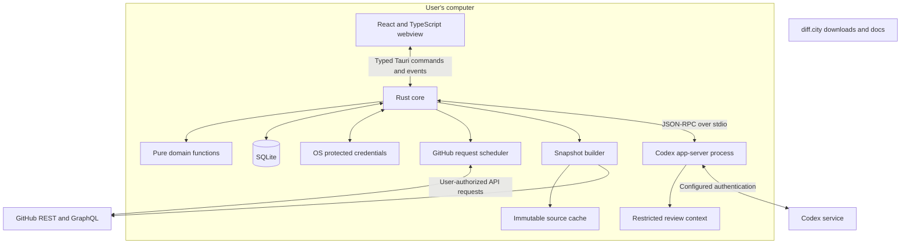
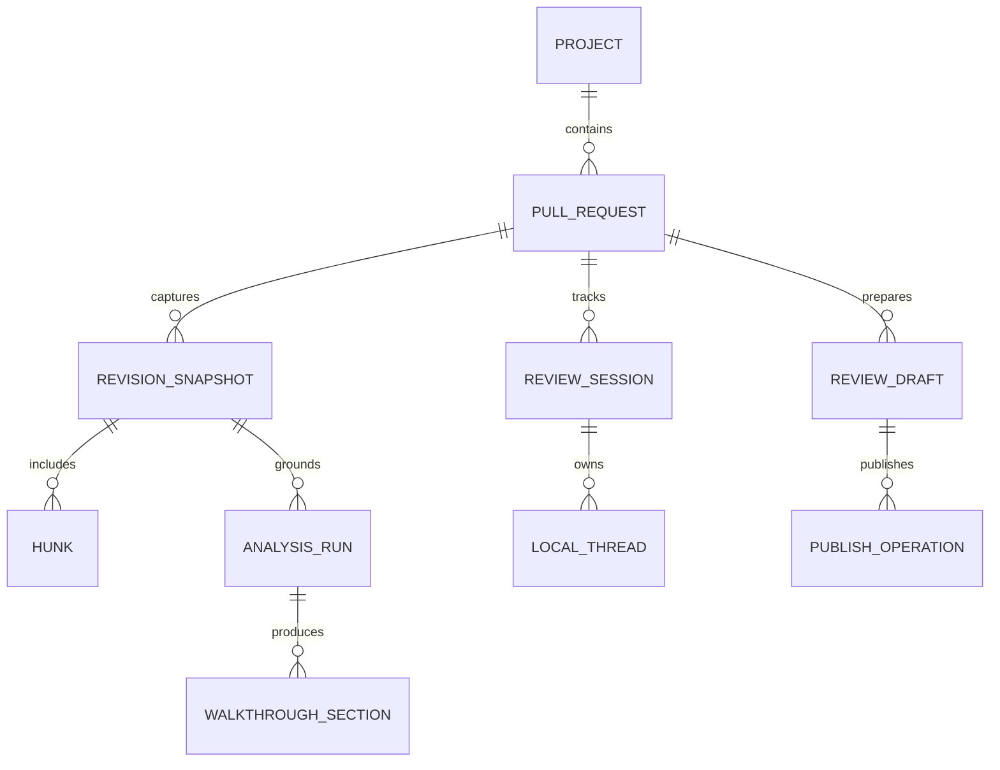
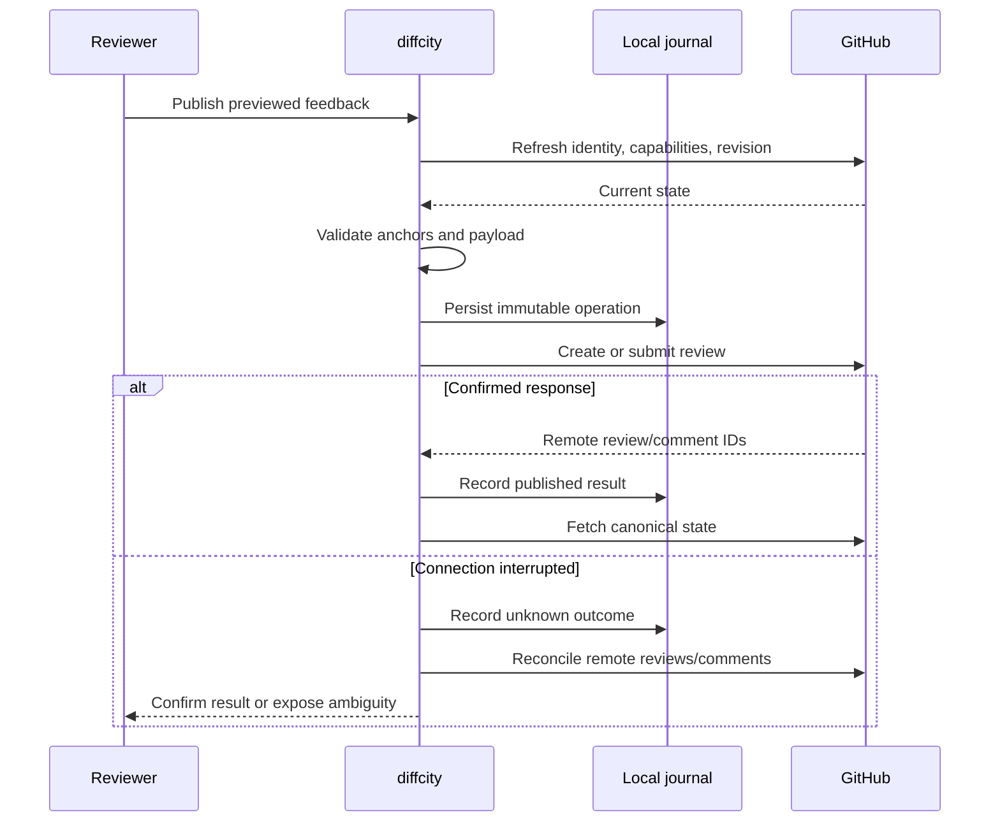

# Architecture and integration contracts

All paths and interfaces here are proposed. The workspace currently contains planning documents only. The user selected Tauri 2 for the first implementation, with React and TypeScript for the UI, Rust for the backend, and SQLite for local state. Step 01 verifies Codex streaming, persistence, and large-diff rendering in a packaged Tauri app.

## Boundaries



Keep filesystem, process, database, and credential access in Rust. Expose narrowly scoped Tauri commands to the bundled UI and stream typed results through channels/events. Limit capability grants to the intended windows, configure custom-command permissions explicitly, and validate arguments and resource ownership in Rust. Do not grant the webview arbitrary shell, SQL, filesystem, or remote IPC access. Capabilities control access to commands; application validation still enforces their behavior. See [Tauri capabilities](https://v2.tauri.app/security/capabilities/).

Use a restrictive content policy. Render PR descriptions, Markdown, code, and model text as untrusted content. Block unsolicited remote images and active HTML; open validated external links in the system browser. The UI remains a web application inside the [Tauri process model](https://v2.tauri.app/concept/process-model/), so choosing Rust does not remove web-content security requirements.

The Rust core orchestrates side effects through async tasks and owns credential access. Offload blocking Git, parsing, and database work to bounded workers; use web workers for expensive UI highlighting where supported. Stream bounded batches with cancellation/backpressure so large diffs and Codex output cannot flood IPC or freeze the UI. Diffcity's Node.js dependencies are build tooling; no Node backend service is required. Validate the chosen Codex distribution's runtime requirements separately.

## Proposed repository layout

```text
apps/
  desktop/
    src/
      app/             # React entry point and layout
      features/        # inbox, diffs, walkthroughs, discussions
      lib/             # typed invoke/event client and UI selectors
    src-tauri/
      src/
        commands/      # narrow IPC handlers and event/channel adapters
        domain/        # pure review, anchor, progress, and sync rules
        github/        # REST/GraphQL adapters and request scheduler
        codex/         # managed subprocess and JSON-RPC lifecycle
        diff/          # canonical patch parsing and line maps
        storage/       # SQLite ownership and transactional repositories
        contracts/     # serializable wire models and schema definitions
      migrations/      # versioned SQLite migrations
      capabilities/    # window-specific capability grants
      permissions/     # explicit custom-command permissions
      tauri.conf.json  # desktop build and bundle configuration
      Cargo.toml
  site/                # later: downloads, docs, release notes
packages/
  contracts/           # generated TypeScript wire types and JSON schemas
tests/
  fixtures/            # synthetic PRs and recorded, sanitized responses
  integration/         # protocol, sync, publication, persistence tests
  e2e/                 # complete desktop user journeys
docs/
  plans/initial-product/
  explorations/
```

Use a small pnpm workspace for frontend/build tooling and a Cargo workspace containing the desktop Rust crate. Pin the Rust toolchain and keep both Cargo and pnpm lockfiles. Start with Rust modules in one crate; extract crates only when a concrete reuse or isolation need appears. Do not introduce a general plugin framework, event bus, or hosted service before a requirement needs it. React renders selectors over immutable state; query caching supports presentation and does not replace the durable sync database.

Define wire contracts once in Rust, generate TypeScript types and JSON schemas, and check for generated-file drift in CI. Validate external input and model output in Rust and validate IPC messages at the UI boundary. Use a consistent tagged error model and deliberate serialization rules for IDs, timestamps, optional fields, and enums. Keep GitHub IDs as strings across IPC when numeric precision could be lost. Generated types do not replace runtime validation.

## Data model

| Entity | Essential fields and invariants |
| --- | --- |
| Account | GitHub host + stable user ID, login, credential reference; token is never a normal database column |
| Project | Account, stable repository ID, owner/name, pinned order, access status, sync preference |
| PullRequest | Repository ID + PR number/node ID, author, assignees, requested reviewers, base/head refs, state, checks summary |
| RevisionSnapshot | PR, base tip SHA, merge-base SHA when resolved, head SHA, diff fingerprint, completeness, capture time |
| ChangedFile / Hunk | Snapshot, old/new path, old/new blob IDs when known, exact patch, old/new line maps, availability reason |
| ReviewSession | User + PR, active snapshot, last opened revision, last reviewed revision, reading position |
| Progress | Session + snapshot + hunk/content fingerprint, user-set viewed state; no model-controlled completion |
| AnalysisRun | Snapshot, provider/runtime/model IDs, prompt/schema versions, context hash, coverage, status, usage if available |
| WalkthroughSection | Analysis run, order, title, summary, primary hunk IDs, secondary references, concerns, test notes |
| LocalThread / Message | Session, optional anchor, actor, body, timestamp, destination intent; private by default |
| GitHubThread / Comment | Remote IDs, canonical body, remote state, original/current anchors, timestamp, URL |
| ReviewDraft | PR + account, selected message copies, snapshot, action, summary, optional remote pending review ID |
| PublishOperation | Stable local operation ID, payload hash, immutable payload, state, remote IDs, attempts, reconciliation result |
| SyncCursor | Account/resource/page identity, ETag, Last-Modified, cursor, last success, next attempt, error state |

Persist content and associations transactionally. Use foreign keys and unique constraints for remote identities. Keep raw provider responses only when needed for diagnostics and scrub them before any sharing. Migrations need rollback/recovery guidance and a local backup before destructive transformations.



## Functional domain design

Prefer pure transformations and explicit effects. In Rust, the scheduler returns work descriptions from input state and time; the runner executes them and feeds typed results back. Unit tests can exercise rate limits and races with a fake clock. Canonical diff, anchor, publication, and progress rules live in Rust; TypeScript selectors handle presentation without duplicating those invariants. The following TypeScript shapes illustrate the generated wire contract:

```ts
type SnapshotKey = Readonly<{
  repositoryId: string;
  pullNumber: number;
  baseTipOid: string;
  headOid: string;
  diffFingerprint: string;
}>;

type Anchor = Readonly<{
  snapshot: SnapshotKey;
  path: string;
  oldPath?: string;
  side: "LEFT" | "RIGHT";
  startLine: number;
  endLine: number;
  hunkId: string;
  contextHash: string;
}>;

type AnchorResolution =
  | Readonly<{ kind: "exact"; anchor: Anchor }>
  | Readonly<{ kind: "moved"; candidate: Anchor; needsReview: true }>
  | Readonly<{ kind: "outdated"; reason: string }>
  | Readonly<{ kind: "ambiguous"; candidates: readonly Anchor[] }>;

// UI selector over immutable view models; critical review rules live in Rust.
declare function groupPullRequests(input: InboxInput): readonly InboxGroup[];
```

These are design examples, not an already-implemented API. Use discriminated unions for incomplete, stale, unauthorized, and unavailable states instead of contradictory boolean flags.

## GitHub authentication and API use

Personal alpha: support an explicit connection to the user's existing `gh` authentication. Resolve the account identity, access, and selected host. Read credentials only in the privileged service, never log them, and do not copy the GitHub CLI's token into a second persistent store.

Distributable app: use a diffcity GitHub App registered under the owner with device flow enabled. User access tokens make review actions attributable to the user. Separate app installation/repository selection from user sign-in; actual access is constrained by both the app and the user. Device-flow token refresh does not require shipping a client secret according to the current [GitHub refresh documentation](https://docs.github.com/en/apps/creating-github-apps/authenticating-with-a-github-app/refreshing-user-access-tokens). Prototype issuance, rotation, revocation, and organization restrictions before relying on the flow. See [GitHub's device-flow tutorial](https://docs.github.com/en/apps/creating-github-apps/writing-code-for-a-github-app/building-a-cli-with-a-github-app).

Proposed permissions: metadata read; contents read for revision context; pull requests read/write for reviews; checks and commit statuses read for status display. Add issues access only if a selected endpoint requires it. Do not request contents write, workflow write, or administration. Verify the precise permission matrix against the implemented endpoints. Team review-request discovery may require additional organization access; degrade explicitly if unavailable.

Use REST for PR/file/comment/review endpoints and conditional refreshes; use GraphQL for nested review threads, viewer capabilities, and resolve/unresolve operations where appropriate. Page every nested connection independently. Search is a discovery aid, not the only authoritative PR store. Record the selected supported REST API version in the adapter and test upgrades.

## Synchronization

One account-scoped queue coordinates reads and writes; windows and components never start independent polling loops. Start serially, prioritize user-initiated work, and coalesce equivalent refreshes. REST conditional responses can save primary quota, but only where the endpoint actually supports them; GraphQL needs its own query-cost budgeting. Respect response rate-limit headers, Retry-After, and secondary-limit backoff. [GitHub recommends webhooks and documents these limits](https://docs.github.com/en/rest/using-the-rest-api/best-practices-for-using-the-rest-api).

A desktop-only first release accepts bounded polling latency to avoid requiring a public relay. Initial proposed intervals, always subject to remaining budget and jitter:

| Scope | Healthy default |
| --- | --- |
| Active PR metadata, discussions, checks | 20–30 seconds; expensive resources staggered |
| Open PR lists in visible/pinned repositories | 60–120 seconds |
| Other selected repositories | 5–10 minutes, with a global work cap |
| Hidden/minimized app | Slow to several minutes or pause by preference |
| Sleep/offline/closed app | Pause; reconcile on wake/reconnect/start |
| User refresh or completed mutation | Prioritized refresh, still respecting API limits |

Example budget: 10 repository-list requests per minute plus three active-PR reads every 30 seconds is roughly 960 requests/hour before pagination. Conditional reads do not erase pagination, search, GraphQL, or secondary limits. Calculate actual projected cost and lengthen intervals as repositories/pages grow. Never poll all PR details on every list refresh.

Do not use the PR's `updated_at` alone to infer unchanged checks or threads. Reconcile those resources on their own cadence. Treat recurring 404s as an access/deletion investigation, not an infinite retry. Preserve cached state with a stale badge; remove access credentials and stop network work on logout.

Future webhook relay: opt-in hosted component, verified GitHub signatures, installation-to-account authorization, deduplicated delivery IDs, and a durable cursor for missed events. Send only invalidation identifiers to authenticated desktops; fetch authoritative content through the user's GitHub credentials. Polling remains a recovery path. The relay is not required for MVP.

## Revision capture and diffs

Fetch PR metadata, then paginated files and relevant content, then re-read metadata. If base/head changed during collection, discard the mixed result and retry with a bounded limit. Store the consistent snapshot before generating a walkthrough.

The PR diff normally compares the merge base to the head, not a naive current-base-to-head two-dot comparison. Record base tip and merge base separately. For Git fallback, fetch verified commit objects into an app-managed bare cache and compute the equivalent three-dot comparison; do not checkout or modify the user's working repository. Fork PRs use the base repository's verified PR ref when available and confirm its SHA. Handle missing/deleted fork heads as explicit unavailable states.

For an API-first snapshot, merge-base information can be unresolved until needed. Mark that limitation, and do not invent old-blob anchors. API patches can omit content, and the [file-list endpoint caps results at 3,000 files](https://docs.github.com/en/rest/pulls/pulls#list-pull-requests-files). Detect file-count mismatches and partial patches; either obtain sufficient immutable objects or show partial coverage. Binary, LFS, submodule, and oversized content gets an explicit representation.

Canonical line maps belong to the domain, independently of the display component. GitHub inline anchors use path, commit, side, and line/range; see the [review-comment API](https://docs.github.com/en/rest/pulls/comments#create-a-review-comment-for-a-pull-request). Do not store visual row indices as source positions. Renames retain both paths. Context expansion or hide-whitespace rendering must preserve canonical anchors.

## Codex integration

Use the supported local app-server protocol over a managed stdio subprocess. Generate client types/schemas from the pinned runtime; implement initialization, thread lifecycle, streamed turns, cancellation, and account state behind one adapter. Structured turn output is schema-validated before persistence. [Official protocol reference](https://learn.chatgpt.com/docs/app-server).

The Rust Codex module owns process spawning, framing, request IDs, stderr handling, shutdown, and reconnect. The webview receives normalized run events, never a general process handle. Prototype with a verified installed executable; if bundling Codex later, validate per-architecture sidecar packaging, licensing, and signing. [Tauri supports native sidecars](https://v2.tauri.app/develop/sidecar/); this transport requires no Node bridge.

This is a connection to a Codex runtime managed for diffcity, not an assumption that the running Codex desktop app exposes a stable automation socket. Detect exact executable and capabilities. A shell inspection during planning returned `codex 0.2.3` without useful app-server help; it is not a verified integration target. Do not silently replace the user's installation. Prototype with a verified OpenAI runtime and record its version.

Start one analysis at a time, configurable later. Keep an analysis thread per revision and independent discussion threads scoped to PR/revision/topic. Store model identity, runtime, prompt version, schema version, and context hash with output. A PR edit never changes the context under an in-flight run. Cache by all analysis inputs, not PR number alone.

Prepare a bounded immutable context bundle: PR description, canonical diff, section context, and selected supporting source. Initially use read-only, restricted execution with no GitHub token, no network tools, no inherited user MCP servers or hooks, and no repository-controlled instructions treated as authority. Avoid exposing the user's whole home directory. Validate effective restrictions on the actual runtime; if safe read scope cannot be enforced, use a no-tool, supplied-context mode or block the feature. Read-only filesystem access alone is not sufficient isolation.

No dependency installation, repo scripts, tests, or arbitrary PR commands are needed for the MVP's analysis. If relevant context is missing, report it. Future code execution would need a separately designed trust and sandbox boundary.

Codex authentication should use supported account flows and the configured account's available models. Do not scrape credentials, embed a provider key, or promise that every subscription covers every use. Keep protected authentication state separate from reviewed repository context. Source reaches the user's configured Codex service, so local storage is not a claim of local inference.

## Publication and recovery

Keep private drafts local until the user publishes. Use GitHub's distinct review, review-comment, and issue-comment APIs according to the selected action. Review submission can create a pending review with an exact commit and later submit it; reconcile an existing pending review first. See [review lifecycle](https://docs.github.com/en/rest/pulls/reviews) and [GraphQL thread operations](https://docs.github.com/en/graphql/reference/pulls).



Use local operation IDs and payload hashes to prevent concurrent duplicate dispatches. They do not confer server-side idempotency. After a lost response, reconcile account, review ID, commit, comment anchors, content, and time bounds; a unique match can resolve the operation. If indistinguishable duplicates or uncertain visibility remain, stop and show remote candidates instead of guessing. Serialize mutations and checkpoint every successful suboperation so a partial batch can resume safely.

GitHub does not provide a universal atomic compare-and-swap for the entire PR review. A head can advance between validation and write. Pin the reviewed commit, then re-read after success; if the revision moved, label the published review's revision and offer a follow-up review. Do not claim the preflight eliminates this race.

## Local privacy, diagnostics, and retention

Store app data outside the source checkout in the OS application-data directory. Credentials use OS protection; local source caches and notes use restrictive file permissions and normal disk protection, with no claim of full database encryption unless implemented. Offer per-project cache removal, retention controls, and explicit logout choices for local drafts.

Pin snapshots referenced by drafts or reviews; garbage-collect unreferenced large blobs by age and size. Diagnostics contain operation IDs, durations, API status, coverage counts, and runtime versions. Exclude source, prompts, tokens, private repository names, and comment bodies from default logs/telemetry. Metrics are local by default; diagnostic export is previewable and scrubbed.
