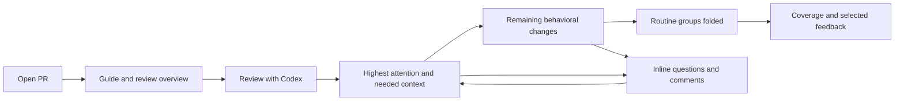

# Guided review: the primary product experience

**Priority:** core MVP requirement, confirmed by the owner. **Status:** specification; implementation and quality targets are unverified.

Opening a PR should lead to an ordered review of the code that deserves the most attention. The guide contains the actual diff, the explanation, the questions to consider, and the discussion tools. A reviewer should be able to complete most reviews here without switching to Files.

This document defines the guided experience in detail. The [product specification](product-spec.md) covers the surrounding inbox and publication workflow; [step 04](04-codex-walkthrough.md) implements the analysis pipeline and quality gate.

## The review journey

1. **Open the PR in Guide.** Restore a valid saved guide and reading position immediately. Show a compact introduction: purpose, main behavioral changes, revision, attention areas, and coverage.
2. **Choose Review with Codex** when analysis is needed. This requests both an evidence-based review and a walkthrough. The app can show a provisional rule-based route while analysis runs. Opening a PR alone does not authorize repeated model spending; a future per-project auto-analysis preference can make this automatic.
3. **Start with the highest-attention change.** Show its code, a short explanation, why it is first, and the specific behavior to check. Relevant setup or test context appears beside it.
4. **Work through decreasing attention.** Move through coherent topics, not alphabetical files. Ask Codex, save notes, prepare GitHub comments, inspect full context, and mark progress directly in the guide.
5. **Skim routine groups at the end.** Localization copy, prose documentation, and validated mechanical changes can appear as collapsed summaries with full access to their diffs.
6. **Finish with an honest review summary.** Show findings, drafts, code reviewed, summaries acknowledged, deferred work, and unavailable content before GitHub submission.



Files remains a complete escape hatch and an explicit user preference. Switching to Files and back preserves the guide's selection, scroll position, and drafts. If Codex is unavailable, the same Guide surface supports a provisional route with rule-derived labels and no invented AI explanation.

## A concrete walkthrough

For an invitation feature containing a migration, authorization changes, application code, API prose, and translations:

```text
Guide: Team invitations                       Revision abc123
2 need close review · 1 needs standard review · 2 routine groups

1  HIGH ATTENTION · Database migration                         Expanded
   Add an invitation constraint
   Why first: existing rows may violate the new constraint.
   Check: backfill order, deployment compatibility, rollback.
   [Migration diff] [Related write path] [Relevant tests]
   [Ask Codex] [Add review comment] [Mark reviewed] [Next]

2  HIGH ATTENTION · Authorization                              Expanded
   Restrict who can invite members
   Check: tenant boundary and role enforcement.

3  STANDARD REVIEW · Invitation behavior                       Expanded
   Follow the endpoint, caller, and focused tests together.

4  ROUTINE · API documentation                                 Collapsed
   Explain the invitation endpoint · 2 files / 36 changed lines
   [Expand all] [Acknowledge summary] [Defer]

5  ROUTINE · Localization                                      Collapsed
   Update copy across 18 locales · 18 files / 240 changed lines
   No key or placeholder changes detected in the assessed content.
   [Show sample] [Expand all] [Acknowledge summary] [Defer]
```

This is an illustrative route, not a rule that all PRs have five sections. A documentation-only PR may consist of one concise section. Its primary change is expanded on entry even when classified routine, so the user does not land on an entirely collapsed review.

## Attention, type, and findings are separate

**Change type** describes what changed. **Review priority** describes where human attention should go. **Finding severity** describes the impact of a particular suspected defect. A migration can require high attention with zero findings. Routine means lower estimated review priority in the assessed context, never guaranteed safe.

Use three attention levels: **High attention**, **Standard review**, and **Routine**. Add a distinct **Needs assessment** state for incomplete or uncertain classification; put it in the early attention queue and keep it expanded. Do not display a fabricated numeric risk score or confidence percentage.

| Change | Initial treatment | Signals that matter |
| --- | --- | --- |
| Database migration / backfill | High attention, expanded | Data loss, nullability, constraints, locks, deployment order, reversibility |
| Authorization, authentication, tenant boundaries | High attention, expanded | Changed trust boundary, access condition, credential or role handling |
| Public API / schema / serialization | High when compatibility changes; otherwise standard | Removed fields, contract changes, incompatible defaults, old clients |
| Core behavior, retries, state transitions | Standard or high according to impact | Error paths, concurrency, shared callers, broad reach |
| Tests | Beside the behavior they exercise | Removed assertions, weakened coverage, changed fixtures can elevate attention |
| API prose and examples | Routine candidate, summarized | Contract/spec sources, executable examples, security-sensitive advice, or mismatch with behavior elevate attention |
| Localization | Routine candidate, summarized | Key removal, placeholder/plural changes, fallback behavior, or critical user-facing wording elevate attention |
| Generated output / lockfiles | Routine candidate only after assessment | Dependency changes, install hooks, build/runtime changes, or unexplained generator drift elevate attention |
| Unknown / incomplete content | Needs assessment, expanded | Missing patches, insufficient context, unsupported formats, or conflicting evidence |

Classify at hunk level, then group. A dangerous hunk in a documentation or translation file must remain visible. If a hunk mixes routine and consequential edits, give the whole hunk the higher priority. Related high-priority changes can cross file boundaries; unrelated risk signals should not become one sprawling section.

## Ordering policy

Rust applies a deterministic policy to rule-derived signals and validated model assessments:

1. Inventory all changed files/hunks and record unavailable content. Derive initial signals from content and paths; paths alone cannot authorize routine folding.
2. Ask Codex to inspect the changes for behavior, dependencies, questions, and specific findings, with evidence references. Keep assessed and unassessed coverage separate.
3. Apply minimum-attention rules for recognized migrations, security boundaries, and other supported high-impact signals. Model assessment can promote attention; it cannot silently remove a rule-derived floor. PR-authored labels or instructions are untrusted hints.
4. Build cohesive sections. A section inherits the highest attention of its primary hunks, not their average. Extract exceptions from a routine group; if that is not possible without breaking a hunk, elevate the group.
5. Order high-attention work and needs-assessment entries before standard work, then routine work. Within a tier, use evidenced consequences: data loss or access failures, number of affected callers/users, deployment or rollback difficulty, and unresolved uncertainty. Specific findings strengthen those signals; coherent dependencies guide the narrative. Require evidence for these judgments and use stable IDs to break remaining ties rather than inventing precise risk scores.
6. Bring prerequisites into the current section as a short context card or code cross-reference. If a prerequisite truly needs its own earlier step, label why it precedes the higher-attention step. Do not bury a migration behind a long setup tour.

Every elevated section has a visible reason with code evidence: “Changes tenant filtering” or “Adds a constraint to existing data.” Finding severity appears only on a specific finding with its evidence and uncertainty. Generic categories use quiet badges; a concrete concern gets a persistent inline callout. Avoid repeated toast alerts during navigation.

The reviewer can expand anything, pin a section, adjust attention, or choose file order. Preserve the model/rule recommendation alongside the user's override. Raising priority forces expansion. Lowering a rule-elevated item is explicit, reversible, and does not erase its rationale or mark it reviewed. Personal overrides do not silently train a global policy or create repository configuration.

Streaming results never reorder the active step or collapse selected code. Show “New attention item available” and place it at the next navigation boundary. Finalize the route after assessment; retain a visible partial badge while coverage is incomplete.

## Folding policy

Automatic folding is a reading aid. It does not remove content from the snapshot, AI assessment scope, search, full file tree, or review accounting.

A routine group can default to collapsed only when its available contents were assessed, its category is supported by content evidence, and no elevated signal, unassessed hunk, actionable finding, unresolved discussion, or active draft/selection is attached. User-controlled folding remains available for any section, but the header must retain attention badges and unresolved counts.

Each folded card shows the reason, a short summary, file and changed-line counts, category, assessment status, and controls to expand all or inspect a sample. A sample is labeled as a sample. Search results and links to a comment reveal the exact matched code even when its parent is folded. Expanded state persists through navigation.

Exceptions appear before their routine peers. For example, one changed translation placeholder is an expanded attention item while the remaining assessed copy changes stay folded. A fresh commit or relevant new discussion invalidates the fold eligibility for affected content. Unavailable source gets an availability card, not a reassuring summary.

## Review interaction and progress

Keep explanation brief and code prominent. Each step answers: what changed, why it deserves this attention, what to inspect, and how it connects to adjacent behavior. Let the reviewer expand deeper reasoning instead of placing long model essays above the diff.

Offer next/previous step, next attention item, jump to topic, expand/collapse, Ask Codex, line/range comments, and full-file context without leaving Guide. Keyboard shortcuts must respect focused editors. Keep only the necessary context visible, and return to the same line after a discussion.

Persist these independently:

- **Presentation:** expanded/collapsed, scroll, selected range, pinned order.
- **Code review:** unreviewed/reviewed, explicitly set by the user against exact content.
- **Summary acknowledgement:** the user read the folded summary; this does not mark source reviewed.
- **Deferred work:** intentionally skipped, with an optional note.
- **AI coverage:** assessed, partial, unavailable; never counted as human review.

Do not show a single reassuring 100% progress bar while routine code was only summarized. Show parallel counts, including high-attention items remaining. Switching steps or acknowledging a summary never submits a GitHub review, changes GitHub's viewed state, or publishes text.

On a new revision, preserve exact unchanged code progress. Recompute affected attention, dependencies, and fold eligibility. A user-deferred group stays labeled deferred, and any new elevated content receives an attention badge regardless of its old presentation setting. Stale user priority overrides must be reconsidered rather than applied blindly to changed content.

## How we measure whether the guide is better

The ambition is a better guided review than the referenced tools. That is a product hypothesis to test, not a verified comparison. Use a curated corpus of at least 12 synthetic PRs, including migrations mixed with translation churn, authorization hidden in routine-looking files, contract-changing docs, placeholder changes, weakened tests, missing patches, related changes across files, and rebases.

Required fixture outcomes:

- [ ] Every seeded high-attention change is in the early attention queue and is never automatically folded.
- [ ] The most consequential change appears within the first three substantive steps; documented prerequisite exceptions are bounded and evaluated.
- [ ] Every changed hunk has one primary destination or an explicit unavailable/unassessed entry; cross-references do not inflate coverage.
- [ ] Every priority explanation and finding references real code in the captured revision.
- [ ] Routine localization/prose fixtures collapse as expected; mixed-risk exceptions remain expanded.
- [ ] Low-confidence, partial, failed, and cancelled analysis cannot masquerade as assessed routine content.
- [ ] A reviewer can inspect, ask, annotate, resume, and finish through Guide without a forced Files detour.
- [ ] Reordering, regeneration, and new commits preserve drafts and never reuse invalid progress or priority overrides.

During dogfooding, compare counterbalanced tasks using a raw file-order view and a simple topic-order guide. Measure time to first important concern, planted-issue detection, comprehension of the change, unnecessary context switches, mistaken folding, and manual priority corrections. Prefer faster orientation only when detection and comprehension hold up. Record actual results before claiming superiority over any product.

## Delivery priority

Build a fixture-driven Guide prototype in step 01, including migration callouts and a folded localization group. Keep step 02 limited to the inbox and PR access needed for the core loop. In step 03, render canonical diffs and comments inside the Guide as well as Files. Step 04 is the main product quality gate: review, prioritize, explain, fold, discuss, and resume one real PR. Inbox polish and optional features should not take precedence over that gate.

## References and inspiration

Linear describes chapters that expose core changes and separate auxiliary work in [its review design article](https://linear.app/now/code-review-should-be-fast). Its [review documentation](https://linear.app/docs/diffs) also describes guides and categories such as localization, documentation, and generated files. diffcity's proposed extension is explicit, evidence-backed attention ordering plus conservative folding and revision-aware review progress.

[Diffity](https://github.com/nilbuild/diffity) is the interaction reference for inline discussion and agent-assisted review. Its maintainer [notes that tours from the older version were absent after a rewrite](https://github.com/nilbuild/diffity/issues/17); the exact current tour behavior is not assumed here. The user's desired guided flow remains the product requirement regardless of a reference product's current feature set.
