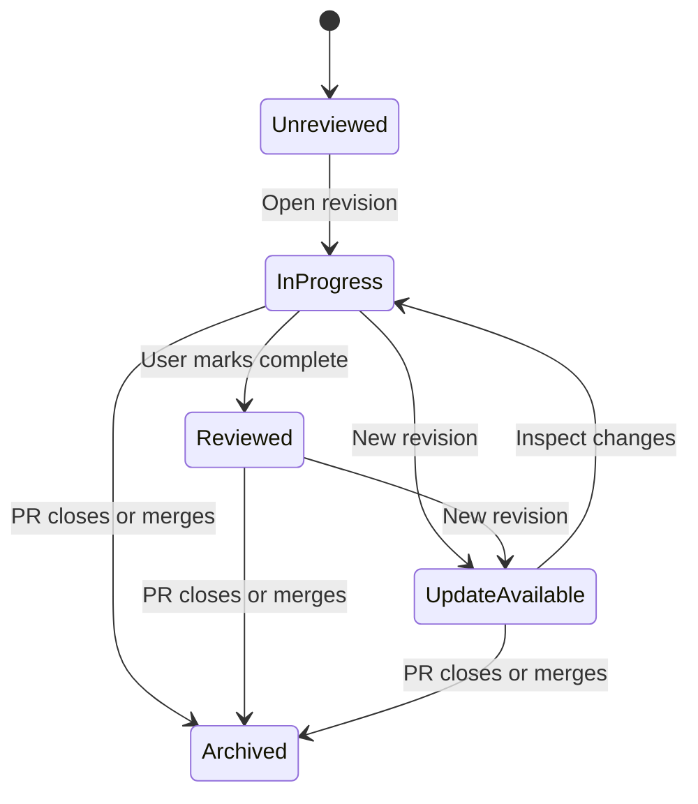

# diffcity product specification

**Product promise:** work through the changes that deserve the most attention first, make a confident review, and stay oriented when the PR evolves. The guided flow is the primary product experience.

This document defines the proposed MVP. Desktop-first and Tauri 2 are confirmed; macOS-first is the recommended release sequence. The interface uses React and TypeScript, with Rust services and local SQLite storage. [The plan](README.md) identifies implementation phases.

## People and core jobs

| Person | Job | Success looks like |
| --- | --- | --- |
| PR author | Review their own code or an agent's output | Explain the change, catch gaps, and prepare useful follow-up feedback |
| Requested reviewer | Understand someone else's change | Follow a coherent narrative, inspect evidence, and submit a complete review |
| Returning reviewer | Check the next revision | See what changed, which concerns remain, and which conclusions need reconsideration |

## Navigation and layout

Use three primary regions, with an optional discussion drawer. Avoid a permanently crowded four-column layout: the PR list can collapse while reading.

```text
┌ Projects ─────────┬ Pull requests ────────┬ Review workspace ───────────────────┐
│ All projects     │ My PRs                │ repo / #142  Add invitations         │
│ ★ owner/api  3   │  #142 Invitations  •  │ Checks • Reviews • Last synced      │
│ ★ owner/web  2   │  #137 Retry logic     │ Guide (default) | Files | Overview  │
│   team/sdk   1   │ Review requested      │ 2 attention areas · 3 routine groups│
│                 │  #89  Auth cleanup •  │ 1 of 5: Database migration          │
│ Add project     │ Assigned to me        │ Why it matters + actual diff        │
│                 │ Other open PRs        │                                     │
│                 │                       │ [Ask Codex] [Add review comment]    │
│ GitHub / Codex   │ Filters and search    │ Progress          [Finish review]   │
└─────────────────┴───────────────────────┴─────────────────────────────────────┘
                               A line selection opens the discussion drawer →
```

Project rows show owner/name, pin state, and attention counts. Adding a project opens a searchable list of repositories available to the active credential. Repository URL entry and PR URL opening are supported. A project does not need a local clone to appear here.

The All projects inbox and individual repository views share the same grouping rules:

1. **My PRs:** authored by the signed-in account, including drafts.
2. **Review requested:** direct requests, plus team requests when membership is available.
3. **Assigned to me:** PR assignee, excluding entries already in earlier groups.
4. **Other open PRs:** remaining PRs in selected projects.

Show one row per PR, with secondary badges when it matches several groups. Within each group sort unread actionable changes first, then latest meaningful activity, then PR number as a stable tie-breaker. Keep the selected row stationary while the user is interacting; apply reordered lists on navigation or an explicit refresh boundary.

Draft PRs remain visible and clearly labeled. Requested-review state and assignee state are different. Missing team membership information is shown as unavailable, not interpreted as no request.

Each PR row shows title, number, author, draft state, checks summary, review state, and new activity. Filters include author, reviewer relationship, draft/non-draft, unread, checks, and title/number. Closed and merged PRs leave the open inbox but remain accessible in recent history with their saved local review.

## First-run flow

1. Connect GitHub and display the account identity and repository access.
2. Select a few repositories; do not subscribe to every accessible repository automatically.
3. Detect a supported Codex runtime and offer its supported sign-in flow. Explain that analysis sends selected repository context to the configured Codex service.
4. Open the first PR immediately. Codex setup can be completed later.

For the owner's private alpha, connecting the existing GitHub CLI session is acceptable. The distributable app should offer a GitHub App device flow and selected-repository installation. Connection errors distinguish installation approval, organization policy, expired login, and unavailable repositories.

## PR overview

The overview combines the author's description with a separately labeled Codex summary, base/head branch, revision status, changed-file statistics, checks, review requests, and unresolved GitHub discussions. The model's claims link to evidence or state their uncertainty.

Opening a PR defaults to Guide, restoring the current walkthrough and reading position when available. Provide **Review with Codex**, **Continue review**, **Refresh**, **Open in GitHub**, and **Finish review**. The review action requests findings and a guided walkthrough together. Before generation, offer a provisional guide and a clear analysis action. Files remains available without waiting for AI and can be selected as a personal default.

An update banner says what changed: “New commits available,” “Base branch changed,” or “New review feedback.” Background refresh never replaces the diff underneath a text selection or an open composer.

## Guided walkthrough

A walkthrough is the main place to read and discuss a specific PR revision. Sections group related behavior across files and lead with the highest-attention changes, then standard changes, then routine groups. Necessary context and related tests appear beside the behavior they explain. A small PR may need one section. The detailed ordering, folding, and evaluation contract is in [guided-review.md](guided-review.md).

Every section contains:

- A short title and explanation of purpose and behavior.
- Review priority, change type, and an evidence-backed explanation of why the section appears here.
- The actual diff, with exact file/hunk references and expandable supporting context.
- Relationships to earlier/later sections when order matters.
- Potential concerns and review questions, clearly distinguished from confirmed facts.
- Test changes and unverified assumptions; reading a test is not evidence that it passed.
- A reviewer-controlled progress state and next/previous navigation.
- Inline Ask Codex, notes, GitHub draft comments, and a direct route to finish review.

Show an opening summary of attention areas and a closing coverage view. Every changed hunk belongs to one primary section or an explicit unassessed/unavailable entry; secondary references are permitted. The model cannot silently omit files or treat generated files as reviewed. Users can always inspect the full file tree.

Database migrations and authorization changes start with high-attention callouts even when no specific bug is found. Review priority and finding severity are separate. Prose documentation and localization copy are candidates for later, folded groups; contract changes, placeholder/key changes, unresolved discussions, and uncertain assessment surface as exceptions. Never infer safety from a filename or category alone.

Folded cards retain the summary, reason, counts, and Expand all control. They remain searchable and count toward total coverage. Acknowledge summary and Defer are distinct from Mark code reviewed. Within a documentation-only or similarly routine PR, expand the primary section initially so the guide still has a useful starting point.

Walkthrough generation streams progress such as “Assessing changes” and “Prioritizing review.” Persist only validated sections. A stopped or failed run leaves usable output labeled partial and offers retry; unassessed content remains expanded and visible early. A failed model response falls back to a rule-based guide with explicit limitations. Newly generated results never reorder the active step or collapse selected code.

The walkthrough is an aid to comprehension. It does not decide approval, silently mark sections reviewed, or promise to find every defect.

## Line discussions and comments

Selecting a line or contiguous range opens a composer with an explicit destination:

| Action | Meaning | Destination |
| --- | --- | --- |
| Save note | Personal observation | Local database |
| Ask Codex | Ask a question with selected code and discussion context | Codex; answer remains in the local thread |
| Add review comment | Prepare feedback for collaborators | Local GitHub draft until publication |
| Post comment / Submit review | Send the reviewed payload | GitHub, under the user's identity |

Destination is labeled in words, not only with color. The default is a private note. A private note is local until the user chooses Ask Codex; “private” does not imply on-device inference. A publish preview lists the exact messages to send. Converting a Codex answer to a GitHub draft copies only the selected text, never the whole conversation.

The Ask Codex context includes the question, selection, surrounding hunk, section summary, relevant prior local messages, and immutable revision identity. The user can also select several notes and ask Codex to discuss them together. Replies include navigable evidence where useful, and can say that available context is insufficient.

Codex has no GitHub write credential and cannot publish. Sending a question is a deliberate user action; merely polling a PR or saving a note does not trigger model calls. Provide Cancel and visible run status. If new code arrives mid-answer, retain the answer against its original revision and label it accordingly.

GitHub-origin comments appear inline with author, timestamp, status, and a GitHub link. A reply composer shows that its recipient is GitHub. A separate Ask Codex action can discuss that thread privately. Resolving a private discussion and resolving a GitHub thread are different actions.

## Finish review

The finish screen shows code reviewed, summaries acknowledged, deferred and unavailable content, high-attention items remaining, selected draft comments, unresolved concerns, incomplete analysis, and revision freshness. Folding and AI coverage never count as human review. It supports GitHub **Comment**, **Approve**, and **Request changes** when allowed. The author of a PR gets Comment; self-approval and self-request-changes are disabled with a clear explanation.

A user may submit a review without accepting every AI suggestion or viewing every file. Incomplete coverage stays visible; it is not represented as complete. Existing pending GitHub reviews are surfaced before adding a new one, with a path to continue or inspect them.

Before publication, refresh revision identity and validate every selected anchor. Changed or ambiguous anchors require review. For a comment on code outside GitHub's commentable diff, retain the note and offer an explicit file-level or overall-comment conversion. Never silently move it to another line.

On success, show GitHub URLs and fetch the canonical result. On failure, keep the draft. On an uncertain network result, show “Checking whether GitHub received this” and reconcile before offering retry. The app must not produce duplicate comments by blindly retrying a write.

## Updates and returning to a PR



Keep distinct records for latest fetched revision, last opened revision, and last explicitly reviewed revision. Opening a PR can acknowledge activity without marking its code reviewed.

“Changed since your review” compares saved content with the new revision. Unchanged hunk progress can carry forward. Changed ranges become unreviewed; ambiguous renames, force-pushes, and missing old content remain explicitly unresolved. Reused explanations retain their provenance; the overall walkthrough is not declared current without revalidation.

Reassess affected priority, section dependencies, and fold eligibility on a new revision. New high-attention changes surface even if their old group was folded or deferred. User priority overrides remain attributable to their original revision until reconsidered.

New commits invalidate code analysis; new comments invalidate discussion summaries; new check results update check status. Metadata-only changes should not trigger a full code analysis. Regenerating a walkthrough is initially explicit; per-repository automatic analysis can be considered after usage limits are understood.

Freshness is visible as “Updated 20 seconds ago,” “Offline,” “GitHub rate limit; retrying at…,” or “Access needs attention.” While the app is closed there is no local poller; opening or waking the app reconciles first. Background OS notifications are optional and focus on review requests, replies, and new code in an in-progress review.

## Quality and accessibility targets

These are proposed acceptance targets, not measured results:

- Cached inbox interactive within one second after the window is ready; cached PR navigation within 500 ms on the reference machine.
- Newly visible active-PR changes normally appear within 30 seconds under healthy network and API budget.
- Draft changes durably saved within 500 ms; closing a composer flushes pending writes.
- Normal benchmark: 100 changed text files / 10,000 changed lines; stress benchmark: 500 files / 50,000 lines with virtualization and explicit loading.
- Keyboard navigation, visible focus, screen-reader labels, adjustable font size, light/dark mode, and non-color-only diff cues.
- No sudden scroll jumps during sync; resizable panes and preserved reading position per PR.
- Progress for long analysis; cancellation acknowledged within two seconds, with subprocess termination fallback.
- Highest-attention work visible early, with findings and review-priority labels distinguished; routine folding never hides seeded consequential changes in the evaluation corpus.
- Core reading, questioning, commenting, and completion work inside Guide, with no required switch to Files.

Measure model completion latency empirically; do not promise a fixed walkthrough time. Show partial coverage and progress rather than a fabricated time estimate.

## Release boundaries

The MVP includes the complete human review loop and reliable updates. Automatic code changes, one-click fixes, cross-device draft sync, hosted collaboration, a webhook relay, and other providers are follow-on work. The domain initially hosts product information, installation, privacy/data-flow documentation, and release notes.

The private repository can carry an MIT license from day one. Public visibility, public binary distribution, and app registration availability are separate release decisions. Keep all test PRs and screenshots synthetic or expressly shareable so the eventual public history is suitable for release.
