# Releasing Diff City

The `Release macOS app` workflow publishes Apple silicon macOS 14+ builds from version tags on `main`. It never builds test-driver features. Both source CI and release CI use fixture tests without private accounts or model usage.

```mermaid
flowchart LR
  A[Version bump on main] --> B[Push version tag]
  B --> C[Validate versions and signing]
  C --> D[Types, contracts, lint, tests]
  D --> E[Build ARM app and DMG]
  E --> F[Verify signature, architecture, disk image]
  F --> G[ZIP, licenses, manifest, SHA256]
  G --> H[Upload assets to draft release]
  H --> I[Publish release]
  I --> J[Update website download URL]
```



## Signing

The default is **Developer ID signing and notarization**. Configure these repository Actions secrets, using the names expected by Tauri:

| Secret | Value |
| --- | --- |
| `APPLE_CERTIFICATE` | Base64-encoded Developer ID Application certificate and private key exported as `.p12` |
| `APPLE_CERTIFICATE_PASSWORD` | Password protecting that exported `.p12` |
| `APPLE_SIGNING_IDENTITY` | Full `Developer ID Application: …` identity from Keychain |
| `APPLE_ID` | Apple developer account email |
| `APPLE_PASSWORD` | Apple app-specific password for notarization; never the account password |
| `APPLE_TEAM_ID` | Apple developer team ID |

Set the Actions variable `MACOS_SIGNING_MODE` to `developer-id` (or leave it unset). The workflow rejects incomplete signing configuration, validates stapling on the app and DMG, and requires Gatekeeper to accept the app before uploading.

For an explicitly labeled **unsigned prerelease only**, set `MACOS_SIGNING_MODE` to `ad-hoc`. It produces an integrity-signed ARM app and discloses the lack of Developer ID/notarization in both the manifest and release notes. Stable tags cannot use this mode. Missing signing credentials never silently downgrade a signed release. See [Tauri's signing documentation](https://v2.tauri.app/distribute/sign/macos/).

Never commit or paste certificate/private-key material into issues. Store it directly in GitHub Actions secrets through Settings or a local `gh secret set` stdin/file operation.

## Publish

1. Update the version in root `package.json`, desktop/site `package.json`, `apps/desktop/src-tauri/Cargo.toml`, and `tauri.conf.json`. Refresh `Cargo.lock` with Cargo. Use `X.Y.Z-alpha.N`, `X.Y.Z-beta.N`, `X.Y.Z-rc.N`, or `X.Y.Z`.
2. Merge the tested change into `main`. Audit new assets and fixtures for private data.
3. Create and push the matching annotated tag, for example:

   ```sh
   git tag -a v0.1.0-alpha.1 -m 'Diff City 0.1.0-alpha.1'
   git push origin v0.1.0-alpha.1
   ```

4. Watch `Release macOS app`. It publishes only after all validations and asset uploads pass. A failed job may leave a draft, never an incomplete published release. Rerun with the existing tag through workflow dispatch if needed. Published assets cannot be overwritten by this workflow; use a new version for corrections.
5. Download the DMG and checksums **without authentication**, verify them, mount the image, and check that the included app launches. Test a clean workspace as well as upgrade behavior before broad promotion.
6. Set `PUBLIC_MACOS_DOWNLOAD_URL` to `https://github.com/crs48/diffcity/releases/download/TAG/diffcity-macos-arm64.dmg`. Run `Publish Diff City website` on `main`. The site reads `MACOS_SIGNING_MODE` to describe signing accurately. Use an explicit tag URL because GitHub's `/latest` excludes prereleases.

The repository must be public for anonymous release downloads. `diff.city` uses GitHub Pages. `SITE_DEPLOY_BRANCH` should be unset or `main`, and the `github-pages` environment should allow `main`.

## Local packaging

```sh
RELEASE_TAG=v0.1.0-alpha.1 MACOS_SIGNING_MODE=ad-hoc pnpm release:prepare
pnpm release:build
```

Output is in ignored `.local/release/assets/`. The app and release include generated dependency licenses, notices, and links to exact source versions. Clean old `target/aarch64-apple-darwin/release/bundle/dmg/` output before packaging a different version; the packager rejects ambiguous DMGs. Local packaging does not publish anything.

This alpha does not have an automatic update channel. Follow [installation and recovery](installation.md) for manual upgrades. Developer ID certificates, notarization, and release publication are distinct from the MIT license.
