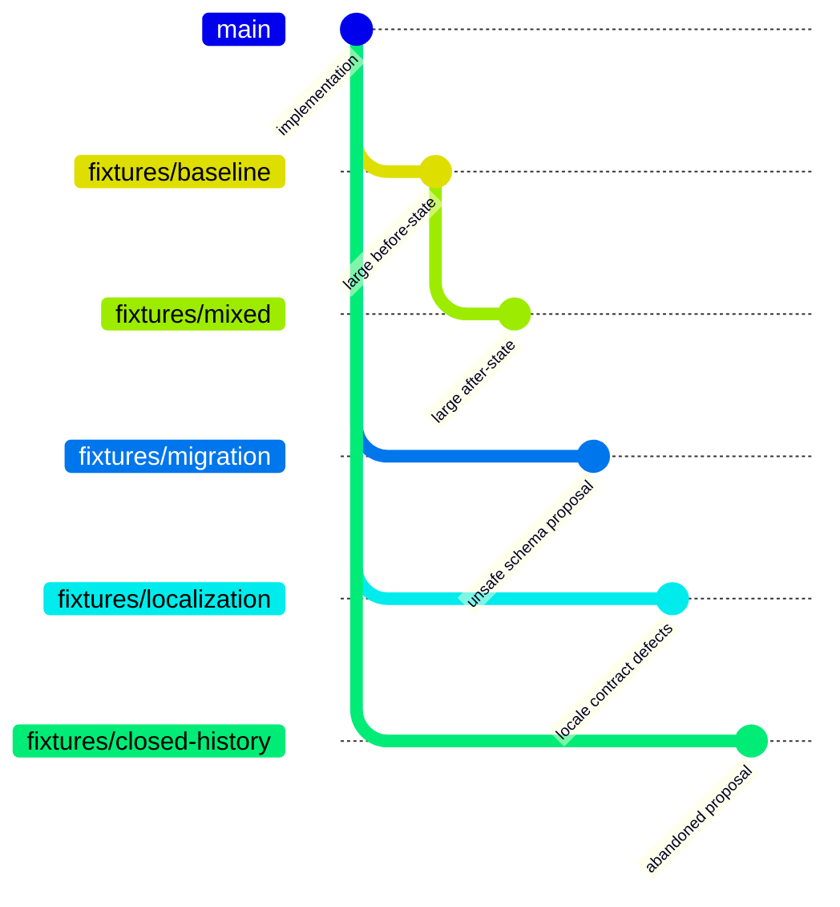

# GitHub review corpus

These PRs exercise Diffcity against its own private GitHub repository. Synthetic branches are deliberately unsuitable for merging. They remain separate from the real implementation branch.

| PR | State | Files | Added | Deleted | Focus |
| --- | --- | ---: | ---: | ---: | --- |
| [#2: application changes](https://github.com/crs48/diffcity/pull/2) | Open | evolving | evolving | evolving | Real PR history, localization, migrations, and verification tooling |
| [#3: mixed edits](https://github.com/crs48/diffcity/pull/3) | Draft | 20 | 8,580 | 8,288 | Access policies, SQL, API contracts, locales, whole-file removal, renames, binary, mode, line endings, generated content |
| [#4: unsafe migration](https://github.com/crs48/diffcity/pull/4) | Draft | 3 | 6 | 1 | Actual migration manifest and storage changes with deliberate data-loss and upgrade defects |
| [#5: locale contract changes](https://github.com/crs48/diffcity/pull/5) | Draft | 4 | 2,009 | 3 | Actual Spanish key/placeholder regressions and 2,000 new French/Arabic entries |
| [#6: abandoned proposal](https://github.com/crs48/diffcity/pull/6) | Closed, unmerged | 2 | 90 | 4 | Real README changes and archived experiment for historical review |

The original small [PR #1](https://github.com/crs48/diffcity/pull/1) remains available with its earlier explicitly approved GitHub review.

## Generate another local corpus

```sh
python3 tests/corpus/create.py --base HEAD --prefix fixtures/my-session
```

The generator creates five **local branches**, using a temporary Git index. It never checks out a fixture, changes the working tree, overwrites a ref, pushes, or opens a PR. Choose a new prefix each time. Push the branches explicitly when wanted, then open draft PRs labeled `TEST ONLY — DO NOT MERGE`:



The mixed PR targets its dedicated baseline to produce thousands of deletions as well as additions. Other fixtures target the implementation branch. Close the history fixture without merging. Do not interpret failing fixture checks as implementation failures: the migration and localization branches intentionally violate invariants.

## Live verification

```sh
cargo run -p diffcity --bin corpus-smoke -- 2 3 4 5 6
DIFFCITY_CORPUS_ANALYZE=4 cargo run -p diffcity --bin corpus-smoke -- 4
```

The harness uses the existing local `gh` login, opens each PR through the same Rust service as the app, validates every captured added/deleted line anchor, checks historical state, and reports capture limitations and renames. The optional analysis generates a real Codex guide and a private two-line migration discussion. It never publishes GitHub comments or merges anything. The default isolated database and JSON workspaces live in ignored `.local/corpus-smoke/`; override `DIFFCITY_DATA_DIR` and `DIFFCITY_REPOSITORY` if needed. The analysis option specifically expects the unsafe-migration fixture.

GitHub omits several patches in the large fixture. Diffcity reconstructs bounded UTF-8 text changes from immutable merge-base/head content and checks their line counts against GitHub. Binary and metadata-only files remain explicitly unavailable. Capture discloses any remaining limitation rather than treating absent code as reviewed. The model also has a bounded source budget; a large PR can remain partly unassessed. Mode-only and rename-only files remain visible even without textual hunks.
