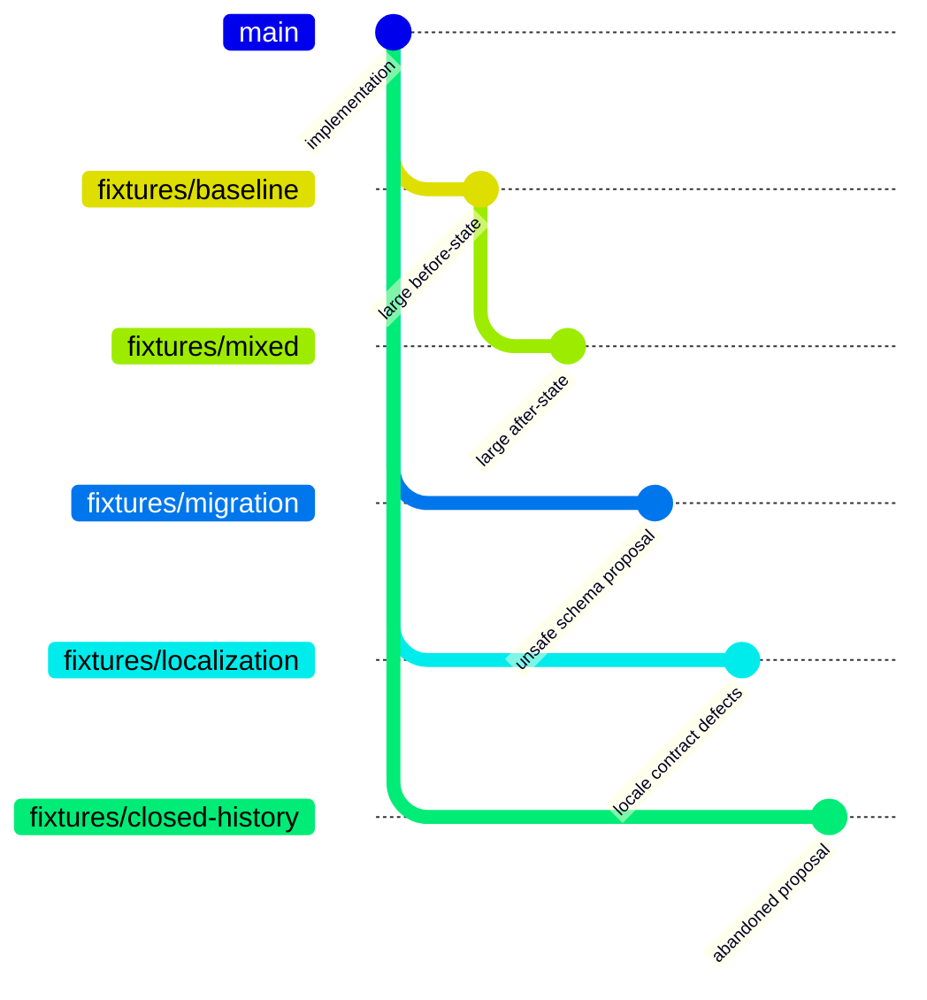
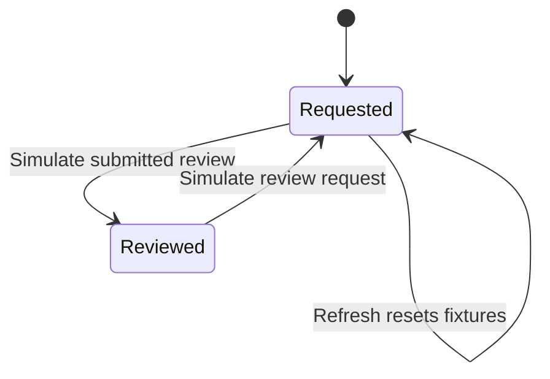

# GitHub review corpus

These historical PRs exercised Diff City during private development. They are preserved in the private development archive; their old numbers must not be used as targets in the new public repository. The sanitized fixture branches and local generators are available publicly. Synthetic branches are deliberately unsuitable for merging. Use **Sample inbox** for an account-free demo, or generate your own test branches and PRs for live GitHub checks.

| PR | State | Files | Added | Deleted | Focus |
| --- | --- | ---: | ---: | ---: | --- |
| [#2: application changes](https://github.com/crs48/diffcity-private-history/pull/2) | Merged | evolving | evolving | evolving | Real PR history, localization, migrations, and verification tooling |
| [#3: mixed edits](https://github.com/crs48/diffcity-private-history/pull/3) | Draft | 20 | 8,580 | 8,288 | Access policies, SQL, API contracts, locales, whole-file removal, renames, binary, mode, line endings, generated content |
| [#4: unsafe migration](https://github.com/crs48/diffcity-private-history/pull/4) | Draft | 3 | 6 | 1 | Actual migration manifest and storage changes with deliberate data-loss and upgrade defects |
| [#5: locale contract changes](https://github.com/crs48/diffcity-private-history/pull/5) | Draft | 4 | 2,009 | 3 | Actual Spanish key/placeholder regressions and 2,000 new French/Arabic entries |
| [#6: abandoned proposal](https://github.com/crs48/diffcity-private-history/pull/6) | Closed, unmerged | 2 | 90 | 4 | Real README changes and archived experiment for historical review |

The original small [PR #1](https://github.com/crs48/diffcity-private-history/pull/1) remains available with its earlier explicitly approved GitHub review.

## Generate another local corpus

```sh
python3 tests/corpus/create.py --base HEAD --prefix fixtures/my-session
```

The generator creates five **local branches**, using a temporary Git index. It never checks out a fixture, changes the working tree, overwrites a ref, pushes, or opens a PR. Choose a new prefix each time. Push the branches explicitly when wanted, then open draft PRs labeled `TEST ONLY — DO NOT MERGE`:



The mixed PR targets its dedicated baseline to produce thousands of deletions as well as additions. Other fixtures target the implementation branch. Close the history fixture without merging. Do not interpret failing fixture checks as implementation failures: the migration and localization branches intentionally violate invariants.

## Live verification

```sh
cargo run -p diffcity --example corpus-smoke -- 2 3 4 5 6
DIFFCITY_CORPUS_ANALYZE=4 cargo run -p diffcity --example corpus-smoke -- 4
```

The harness uses the existing local `gh` login, opens each PR through the same Rust service as the app, validates every captured added/deleted line anchor, checks historical state, and reports capture limitations and renames. The optional analysis generates a real Codex guide and a private two-line migration discussion. It never publishes GitHub comments or merges anything. The default isolated database and JSON workspaces live in ignored `.local/corpus-smoke/`; override `DIFFCITY_DATA_DIR` and `DIFFCITY_REPOSITORY` if needed. The analysis option specifically expects the unsafe-migration fixture.

GitHub omits several patches in the large fixture. Diffcity reconstructs bounded UTF-8 text changes from immutable merge-base/head content and checks their line counts against GitHub. Binary and metadata-only files remain explicitly unavailable. Capture discloses any remaining limitation rather than treating absent code as reviewed. The model also has a bounded source budget; a large PR can remain partly unassessed. Mode-only and rename-only files remain visible even without textual hunks.

## Inbox UX samples

Nine additional PRs exercise the owner's list in GitHub. All are authored by `crs48`, and none of the synthetic proposals is intended to merge.

| PR | State | Scenario |
| --- | --- | --- |
| [#7](https://github.com/crs48/diffcity-private-history/pull/7) | Open, ready | Keyboard navigation |
| [#8](https://github.com/crs48/diffcity-private-history/pull/8) | Open, ready | Notification batching |
| [#9](https://github.com/crs48/diffcity-private-history/pull/9) | Open, ready | Schema backfill |
| [#10](https://github.com/crs48/diffcity-private-history/pull/10) | Open, ready | API pagination |
| [#11](https://github.com/crs48/diffcity-private-history/pull/11) | Draft | Compact layout |
| [#12](https://github.com/crs48/diffcity-private-history/pull/12) | Draft | French catalog |
| [#13](https://github.com/crs48/diffcity-private-history/pull/13) | Draft | Incremental cache |
| [#14](https://github.com/crs48/diffcity-private-history/pull/14) | Closed, unmerged | Abandoned grouping experiment |
| [#15](https://github.com/crs48/diffcity-private-history/pull/15) | Closed, unmerged | Abandoned notifications draft |

Reproduce their local branches with `python3 tests/corpus/create_inbox.py --base HEAD --prefix fixtures/new-inbox-session`. Creation uses a temporary index and an atomic ref transaction; it never overwrites branches, switches the checkout, pushes, opens PRs, or merges anything.

Choose **Sample inbox** in the desktop sidebar for 23 local PRs defined in `tests/fixtures/inbox.json`. They cover owned ready/draft PRs, requested and assigned reviews, approved/commented/changes-requested submissions, re-requests, other authors' ready/draft PRs, and completed work ranging from hours to 50 days old. Completion ages are relative to the time the samples load. The fictional authors are explicitly labeled, have no GitHub URLs, and cannot publish reviews. Each card opens the shared invitation walkthrough with separate saved notes and progress.

For another author's open sample, **Simulate submitted review** moves it into Reviewed; **Simulate review request** restores its priority. These transitions change only the current sample inbox session. Refreshing the sample inbox resets its metadata. No review request is sent to a real person, and no second GitHub account is needed. Merged samples remain local, so synthetic code never has to merge to exercise the UX.



Run `cargo run -p diffcity --example inbox-smoke -- crs48/diffcity` for read-only GitHub metadata checks and JSON exports under `.local/inbox-smoke/`. It checks that all open PRs carry review metadata and that recent completions belong to the signed-in user, then exports the isolated local samples for browser replay. It does not connect to Codex or publish feedback.
