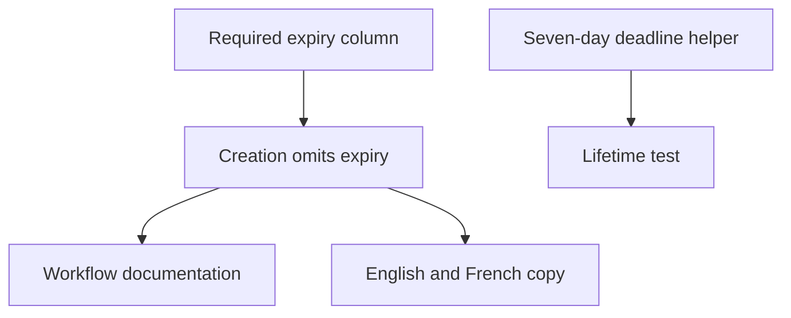

This change introduces team invitations with a seven-day lifetime, backed by a database deadline and new copy in English and French. The important review question is whether the new workflow preserves existing records and keeps each invitation inside its team.

### How the change fits together

The migration adds `expires_at`; a helper calculates a deadline; a focused test checks the lifetime. The visible creation path does not yet call that helper or supply the required expiry. Documentation explains the Members-page workflow, while matching locale keys supply the interface text. These pieces support the same feature, but their failure modes differ.

### Behavior and compatibility

| Area | Change | What to verify |
| --- | --- | --- |
| Existing data | A required expiry column is introduced | Populate deadlines before enforcing the constraint |
| Team access | Lookup and creation form the invitation boundary | Scope the email lookup to the current team |
| New invitations | A helper defines a seven-day deadline | Wire it into creation and verify acceptance rejects expired invitations |
| User guidance | Documentation and translated copy describe the flow | Keep the promised lifetime consistent with behavior |

### Where to focus

Start with the database migration, then follow the team boundary through lookup and creation. These changes have the largest consequences if they are wrong. Next, read the expiry helper beside its test; finish with the documentation and localization updates.

The supplied lookup searches by email without tenant scope. The migration needs scrutiny on a database with existing rows. Both deserve attention before treating the feature as ready for deployment.

### Evidence and open questions

The focused test demonstrates the intended seven-day calculation; it does **not** establish that expired invitations are rejected or that upgrades preserve existing data. No tests were executed for this illustrative guide, and unseen callers remain unassessed. The code chapters below keep these checks next to the relevant diff.
